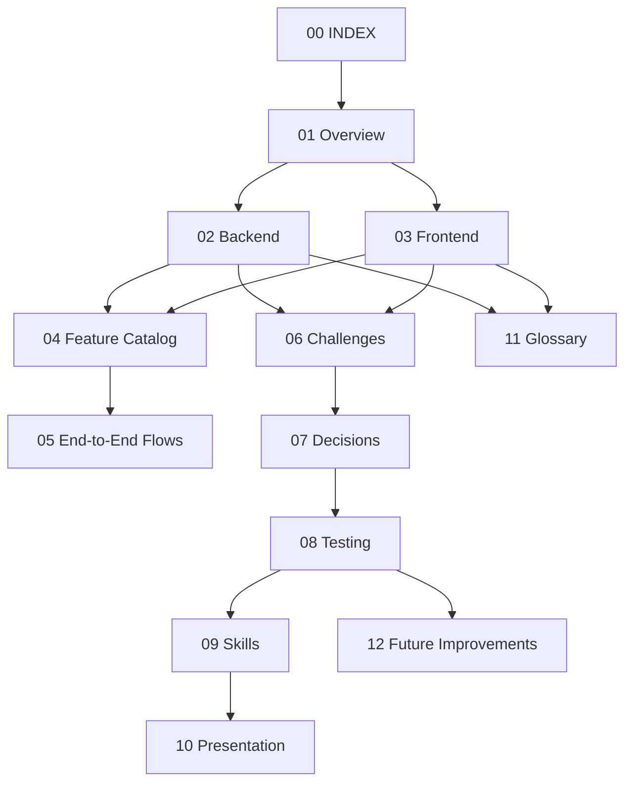

# Documentation Index — ماژول Tasks

## هدف این بسته مستندات

این بسته مستندات برای کسی نوشته شده است که میخواهد **واقعاً منطق فنی ماژول Tasks در پروژه Halgheh را بفهمد**، نه فقط فهرستی از فایلها ببیند.

ماژول Tasks در این پروژه یک ماژول ساده CRUD نیست. این ماژول شامل موارد زیر است:

- احراز هویت و مجوزدهی بر اساس Workspace و Task
- Kanban و List با مرتبسازی و Drag and Drop
- Checklist رابطهای با migration مخصوص خود
- Comments و Activity history
- Notification مربوط به ساخت Task
- نگهداری position و priority_position
- Deep link با `?task=<id>`
- اشتراکگذاری یک Task canonical بین چند Workspace
- جدا کردن مجوز محتوا از مجوزهای مدیریتی مانند Share و Delete

تمام مطالب این بسته بر اساس **کد واقعی، migrationها، API routerها، تستها و تاریخچه Git موجود در مخزن** نوشته شده است. جایی که چیزی قابل تأیید نبوده، صراحتاً به عنوان «نیازمند بررسی بیشتر» مشخص شده است.

---

## فهرست فایلها

| فایل | موضوع | مخاطب مناسب |
|---|---|---|
| [01-PROJECT-AND-TASKS-OVERVIEW.md](01-PROJECT-AND-TASKS-OVERVIEW.md) | نمای کلی projeto و جایگاه Tasks در Halgheh | کسی که تازه پروژه را دیده است |
| [02-BACKEND-COMPLETE-GUIDE.md](02-BACKEND-COMPLETE-GUIDE.md) | راهنمای کامل Backend: لایهها، دیتابیس، Authorization، Alembic، API Reference | کسی که میخواهد Backend را عمیق یاد بگیرد |
| [03-FRONTEND-COMPLETE-GUIDE.md](03-FRONTEND-COMPLETE-GUIDE.md) | راهنمای کامل Frontend: React، Kanban، List، Dialogها، URL state، Sharing UI | کسی که میخواهد Frontend را عمیق یاد بگیرد |
| [04-FEATURE-CATALOG.md](04-FEATURE-CATALOG.md) | فهرست کامل قابلیتها با وضعیت اجرا و نحوه Verification | کسی که میخواهد بداند «دقیقاً چه چیزی پیاده شده» |
| [05-END-TO-END-FLOWS.md](05-END-TO-END-FLOWS.md) | جریانهای کامل کاربر به همراه sequence diagram | کسی که میخواهد ارتباط Frontend و Backend را دنبال کند |
| [06-CHALLENGES-AND-SOLUTIONS.md](06-CHALLENGES-AND-SOLUTIONS.md) | مشکلات واقعی، ریشهها، راهحلها و درسها | کسی که میخواهد تجربه Debugging را یاد بگیرد |
| [07-ARCHITECTURE-DECISIONS.md](07-ARCHITECTURE-DECISIONS.md) | تصمیمات معماری وtrade-offها | کسی که میخواهد «چرا» پشت تصمیمها را بداند |
| [08-TESTING-AND-QUALITY-ASSURANCE.md](08-TESTING-AND-QUALITY-ASSURANCE.md) | آنچه واقعاً تست شد و آنکه نشد | کسی که میخواهد وضعیت کیفیت را بداند |
| [09-SKILLS-AND-LEARNING-OUTCOMES.md](09-SKILLS-AND-LEARNING-OUTCOMES.md) | مهارتهای بهدستآمده همراه با شواهد | کسی که برای ارائه فنی یا مصاحبه آماده میشود |
| [10-TECHNICAL-PRESENTATION-GUIDE.md](10-TECHNICAL-PRESENTATION-GUIDE.md) | یک ارائه ۱۵ تا ۲۰ دقیقهای با اسلاید و پاسخ سوالها | کسی که میخواهد پروژه را ارائه دهد |
| [11-TECHNICAL-GLOSSARY.md](11-TECHNICAL-GLOSSARY.md) | لغتنامه فنی با مثال از همین پروژه | کسی که میخواهد اصطلاحات را ساده یاد بگیرد |
| [12-FUTURE-IMPROVEMENTS.md](12-FUTURE-IMPROVEMENTS.md) | پیشنهادهای بهبود بر اساس وضعیت واقعی کد | کسی که میخواهد roadmap آینده را بداند |

---

## ترتیب پیشنهادی مطالعه

### مسیر یادگیری کامل

1. [01-PROJECT-AND-TASKS-OVERVIEW.md](01-PROJECT-AND-TASKS-OVERVIEW.md)
2. [02-BACKEND-COMPLETE-GUIDE.md](02-BACKEND-COMPLETE-GUIDE.md)
3. [03-FRONTEND-COMPLETE-GUIDE.md](03-FRONTEND-COMPLETE-GUIDE.md)
4. [05-END-TO-END-FLOWS.md](05-END-TO-END-FLOWS.md)
5. [04-FEATURE-CATALOG.md](04-FEATURE-CATALOG.md)
6. [06-CHALLENGES-AND-SOLUTIONS.md](06-CHALLENGES-AND-SOLUTIONS.md)
7. [07-ARCHITECTURE-DECISIONS.md](07-ARCHITECTURE-DECISIONS.md)
8. [08-TESTING-AND-QUALITY-ASSURANCE.md](08-TESTING-AND-QUALITY-ASSURANCE.md)
9. [09-SKILLS-AND-LEARNING-OUTCOMES.md](09-SKILLS-AND-LEARNING-OUTCOMES.md)
10. [11-TECHNICAL-GLOSSARY.md](11-TECHNICAL-GLOSSARY.md)
11. [12-FUTURE-IMPROVEMENTS.md](12-FUTURE-IMPROVEMENTS.md)
12. [10-TECHNICAL-PRESENTATION-GUIDE.md](10-TECHNICAL-PRESENTATION-GUIDE.md)

### مسیر سریع برای ارائه فنی

اگر وقت کمی دارید:

1. [01-PROJECT-AND-TASKS-OVERVIEW.md](01-PROJECT-AND-TASKS-OVERVIEW.md) — فقط نمای کلی.
2. [10-TECHNICAL-PRESENTATION-GUIDE.md](10-TECHNICAL-PRESENTATION-GUIDE.md) — اسلایدها و متن ارائه.
3. [06-CHALLENGES-AND-SOLUTIONS.md](06-CHALLENGES-AND-SOLUTIONS.md) — داستانهای Debugging.
4. [09-SKILLS-AND-LEARNING-OUTCOMES.md](09-SKILLS-AND-LEARNING-OUTCOMES.md) — مهارتهای قابل بیان در مصاحبه.

---

## چگونه از این مستندات برای یادگیری استفاده کنید

برای هر مبحث:

1. ابتدا توضیح ساده فارسی را بخوانید.
2. سپس نام فایل و تابع انگلیسی را در کد پیدا کنید.
3. snippet کوتاه موجود در مستند را با کد واقعی مقایسه کنید.
4. diagram Mermaid را دنبال کنید تا جریان داده را ببینید.
5. در نهایت، قسمت «چگونه در ارائه فنی توضیح دهم» را بخوانید.

هدف این است که بتوانید بدون حفظ کردن کد، **مسیر فکر کردن پشت آن** را توضیح دهید.

---

## چگونه ازاین مستندات برای ارائه فنی استفاده کنید

- فایل [10-TECHNICAL-PRESENTATION-GUIDE.md](10-TECHNICAL-PRESENTATION-GUIDE.md) شامل اسلاید، bullet point،diagram پیشنهادی، متن گفتاری ساده، جزئیات فنی، سوالات احتمالی و پاسخ آنها است.
- فایل [06-CHALLENGES-AND-SOLUTIONS.md](06-CHALLENGES-AND-SOLUTIONS.md) بهترین منبع برای قسمت «مشکلات و درسها» است.
- فایل [09-SKILLS-AND-LEARNING-OUTCOMES.md](09-SKILLS-AND-LEARNING-OUTCOMES.md) بهترین منبع برای قسمت «مهارتهای کسبشده» است.
- فایل [08-TESTING-AND-QUALITY-ASSURANCE.md](08-TESTING-AND-QUALITY-ASSURANCE.md) کمک میکند صادقانه بگویید چه چیزی تست شد و چه چیزی nicht.

---

## ارتباط بین مستندات

توضیح ساده: نمای کلی به دو شاخه Backend و Frontend تقسیم میشود. هر دو شاخه در فهرست قابلیتها و جریانهایEnd-to-End به هم میرسند. مشکلات و تصمیمات معماری از دل همین پیادهسازی بیرون میآیند و در نهایت به تست، مهارتها و ارائه فنی ختم میشوند.

---

## یادداشت مهم درباره صحت مطالب

- «پیادهشده» یعنی وجود آن در کد فعلی تأیید شده است.
- «تأییدشده در Runtime» یعنی یک API یا سناریو واقعاً اجرا شده است.
- «تست وجود دارد ولی اجرا نشد» یعنی فایل تست هست، ولی چون `pytest` در محیط موجود نبود، اجرا نشده است.
- «نیازمند بررسی بیشتر» یعنی شواهد کافی برای یک ادعا وجود ندارد.

Phase 3.1 also updated this package with the verified `_commit()`/`conflict_status` incident and the disposable QA Task runtime evidence. These are documented mainly in:
- [04-FEATURE-CATALOG.md](04-FEATURE-CATALOG.md)
- [05-END-TO-END-FLOWS.md](05-END-TO-END-FLOWS.md)
- [06-CHALLENGES-AND-SOLUTIONS.md](06-CHALLENGES-AND-SOLUTIONS.md)
- [07-ARCHITECTURE-DECISIONS.md](07-ARCHITECTURE-DECISIONS.md)
- [08-TESTING-AND-QUALITY-ASSURANCE.md](08-TESTING-AND-QUALITY-ASSURANCE.md)
- [09-SKILLS-AND-LEARNING-OUTCOMES.md](09-SKILLS-AND-LEARNING-OUTCOMES.md)
- [10-TECHNICAL-PRESENTATION-GUIDE.md](10-TECHNICAL-PRESENTATION-GUIDE.md)
- [12-FUTURE-IMPROVEMENTS.md](12-FUTURE-IMPROVEMENTS.md)
