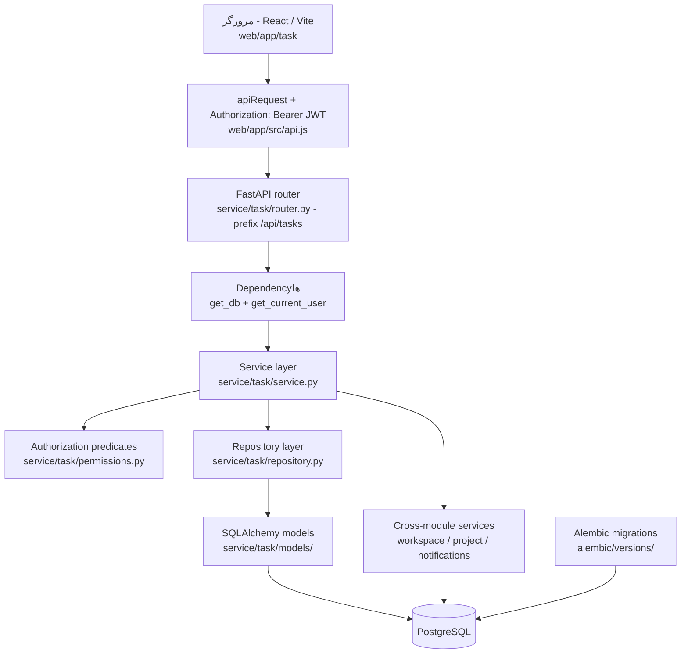
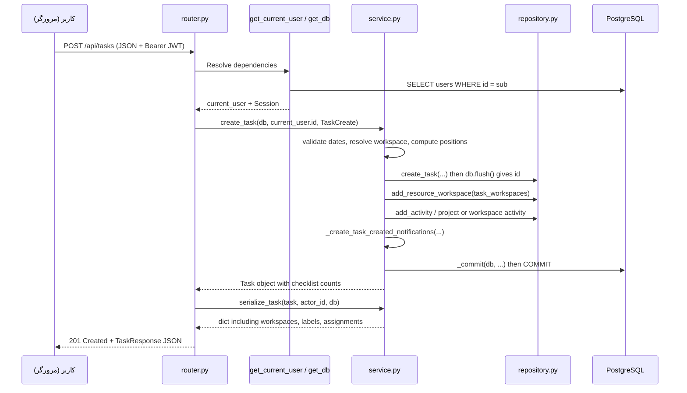

# مستندات ماژول Tasks — نمای کلی پروژه و تسکها

> **مخاطب:** توسعهدهندگانی که برای نخستین بار با Halgheh آشنا میشوند و میخواهند بدانند ماژول Tasks چیست، کجای پروژه قرار دارد و چگونه یک درخواست از مرورگر تا دیتابیس و برگشت سفر میکند.
>
> **رویکرد مستند:** نام تمام شناسهها (`Task`, `task_workspaces`, `/api/tasks`, `get_current_user` و ...) به انگلیسی نگه داشته شده تا جستجو در کد ساده باشد؛ متن توضیحی فارسی است.
>
> **وضعیت تأیید:** مطالب این مستند از خواندن مستقیم سورس کد بهدست آمدهاند. مواردی که فقط از روی کد قابل تأیید بودند در انتهای مستند تحت عنوان «موارد نیازمند بررسی بیشتر» آمدهاند. اجرای `pytest` در محیط نویسنده مستند در دسترس نبود.

---

## ۱. Halgheh چیست؟

Halgheh یک نرم افزار تحت وب برای کار گروهی است که چند قابلیت اصلی را در کنار هم قرار میدهد:

- **تقویم و رویدادها** (ماژول `calendar`)،
- **اسناد و فضای کاری** (`docs`, `workspace`)،
- **پروژهها** (`project`)،
- **تسکها** (`task`) — موضوع این مستند،
- **اعلانها** (`notifications`)،
- **احراز هویت** (`auth`) و قابلیتهای هوش مصنوعی (`ai`, `agent`).

از دیدگاه فنی، پروژه از دو بخش اصلی تشکیل شده است:

- **بکاند:** FastAPI در پوشه `service/` با نقطهٔ ورود `service/main.py`. تمام روترها در این فایل `include` میشوند؛ روتر مربوط به تسکها با پیشوند `/api/tasks` اضافه میشود (`app.include_router(task_router)`).
- **فرانتاند:** React + Vite در پوشه `web/app/`، با Tailwind CSS و کامپوننتهای shadcn/ui مبتنی بر Radix UI و آیکونهای Lucide. کد مربوط به تسکها در `web/app/task/` قرار دارد؛ مثلاً `web/app/task/api.js` تمام تماسهای HTTP مربوط به تسکها را در بر میگیرد.

پایگاه دادهٔ اصلی `PostgreSQL` است و تغییرات ساختار آن توسط `Alembic` ([فهرست migrationها](../../alembic/versions/)) مدیریت میشود. اتصال از طریق SQLAlchemy (`service/core/database.py`) برقرار میشود.

---

## ۲. جایگاه ماژول Tasks

ماژول Tasks مسئول «کارهایی است که باید انجام شوند»: عنوان، توضیح، وضعیت، اولویت، تاریخ شروع/پایان، ترتیب نمایش، وظایف فرزند (subtask)، تخصیصها (assignment)، برچسبها، نظرات، چکلیست و تاریخچهٔ تغییرات.

نکتهٔ مهمی که تازهکارها معمولاً اشتباه میکنند:

> **جدول `tasks` ستونی به نام `workspace_id` ندارد.**
> ارتباط تسک با Workspace از طریق جدول واسط `task_workspaces` برقرار میشود. در آن جدول مشخص میشود که کدام Workspace «اصلی» (`is_original`) است و سایر Workspaceها با سطح دسترسی `viewer` یا `editor` تسک را به اشتراک گذاشتهاند (`permission_level`, `shared_by_user_id`).

برای همین، هنگام ساخت تسک، سرویس ابتدا Workspace مقصد را تعیین میکند (`_resolve_task_workspace_id`) و سپس یک ردیف در `task_workspaces` ایجاد میکند (`_ensure_task_workspace_association`). فیلد `project_id` در جدول `tasks` اختیاری است و به معنای «عضویت در پروژه» است، نه جایگزینی Workspace.

---

## ۳. ارتباط Tasks با سایر بخشها

| بخش | رابطه با Task | محل کد |
|---|---|---|
| **User** | هر تسک یک `created_by` دارد (مالک). کاربران دیگری میتوانند بهصورت active assignee به تسک تخصیص داده شوند (`task_assignments`). نظرات و تاریخچه نیز به کاربران متصلاند. | `service/auth/models.py`, `service/task/models/assignment.py`, `service/task/models/comment.py`, `service/task/models/activity.py` |
| **Workspace** | تسکها «منابع» Workspace محسوب میشوند. عضویت در Workspace تعیین میکند که آیا کاربر تسک را میبیند و آیا حق تغییر دارد یا خیر. ارتباط از طریق `task_workspaces` است. | `service/workspace/models.py`, `service/workspace/repository.py`, `service/workspace/service.py` |
| **Project** | `tasks.project_id` اختیاری است. تسکهای متصل به پروژه تحت قواعد دسترسی پروژه هم قرار میگیرند (مسیر قدیمی/legacy). رویدادهای مربوط به تسک در `project_activities` ثبت میشود. | `service/project/`, `service/task/service.py` |
| **Notification** | هنگام ایجاد تسک، اعلان `task_created` برای سازنده و assigneeهای active ذخیره میشود. ستون `notifications.task_id` قابل نول است (`ON DELETE SET NULL`) تا اعلانها پس از حذف تسک باقی بمانند. | `service/notifications/models/notification.py`, `_create_task_created_notifications` در `service/task/service.py` |
| **Activity** | هر تغییر مهم یک ردیف `task_activities` مینویسد. ردیفها با `task_id` قابل نول و `ON DELETE SET NULL` ذخیره میشوند تا history پس از حذف تسک زنده بماند. | `service/task/models/activity.py`, `repository.add_activity` |

خلاصهٔ مدل ذهنی:

```text
User ──creates──> Task ──belongs to (optional)──> Project
                   │
                   ├──> task_workspaces ──> Workspace ──> WorkspaceMember (User)
                   ├──> task_assignments ──> User
                   ├──> task_comments ──> User
                   ├──> task_checklist_items
                   ├──> task_labels / task_label_assignments
                   ├──> task_activities (audit)
                   └──> notifications (task_id)
```

---

## ۴. معماری کلی

### دیاگرام معماری



**توضیح دیاگرام به فارسی:**

1. **Browser / ApiClient:** رابط کاربری React درخواستها را با `apiRequest` میسازد و توکن JWT ذخیرهشده در `localStorage.token` را بهصورت هدر `Authorization: Bearer ...` اضافه میکند.
2. **Router:** لایهٔ بسیار نازک HTTP در `service/task/router.py`. مسئولیت آن فقط گرفتن پارامترها، فراخوانی سرویس و تبدیل نتیجه به `response_model` است. هیچ قانون کسب و کاری در این لایه نیست.
3. **Dependencies:** `get_current_user` توکن را تأیید و کاربر را بارگذاری میکند؛ `get_db` یک `Session` SQLAlchemy ایجاد میکند و در پایان آن را میبندد (و در صورت خطا `rollback` میکند).
4. **Service:** قلب ماژول: قوانین وضعیتها، ترتیبها، مجوزها، نوشتن `TaskActivity`، ثبت اعلان و مرز تراکنش (`db.commit()`).
5. **Permissions / Repository:** `permissions.py` توابع خالص تصمیمگیری مجوز است؛ `repository.py` فقط SQLAlchemy مینویسد، خطای HTTP نمیدهد و **هرگز commit نمیکند**.
6. **Cross-module:** سرویس تسک برای Workspace، Project و Notification به سرویسهای همان ماژولها مراجعه میکند؛ بنابراین تغییر در قواعد Workspace میتواند بر دیدن تسک اثر بگذارد.
7. **Alembic:** ساختار دیتابیس خارج از برنامهٔ در حال اجرا و توسط migrationها تعریف میشود.

### لایهبندی در یک نگاه

```text
HTTP request
   ↓
router.py          (FastAPI, Pydantic request/response schemas)
   ↓
service.py         (business rules, authorization, transaction boundary)
   ↓
permissions.py     (pure role predicates)      repository.py (SQL only)
   ↓                                                  ↓
models/            (SQLAlchemy ORM) ──────────────> PostgreSQL
```

---

## ۵. فناوریها و دلیل انتخاب آنها

| فناوری | کاربرد در Halgheh | دلیل |
|---|---|---|
| **FastAPI** | روترهای بکاند، اعتبارسنجی با Pydantic و مستندات خودکار API | تعریف endpointها کوتاه است و `response_model` بهطور خودکار خروجی را فیلتر میکند. |
| **Pydantic v2** | `TaskCreate`, `TaskUpdate`, `TaskFilter`, `TaskResponse` و سایر schemaها | اعتبارسنجی title، تاریخها، رنگ برچسب و بدنهٔ خالی PATCH قبل از رسیدن به سرویس. |
| **SQLAlchemy ORM** | مدلها و کوئریها | relationshipها و قواعد `ON DELETE` بهصورت متمرکز در مدل تعریف میشوند. |
| **PostgreSQL** | دیتابیس اصلی | پشتیبانی از index جزئی (`uq_task_workspaces_original_task`) و قفل ردیفها (`with_for_update`). |
| **Alembic** | migrationها (001..034) | تغییر ساختار دیتابیس قابل ردیابی و قابل اجرا بر محیطهای مختلف است. |
| **JWT (PyJWT) + bcrypt (passlib)** | احراز هویت در `service/auth/security.py` | توکن stateless با `sub` و `exp`؛ رمز عبور هرگز بهصورت متن ساده ذخیره نمیشود. |
| **React + Vite** | فرانتاند | ساخت سریع و جداسازی featureها (مثلاً `web/app/task/`). |
| **Tailwind + shadcn/ui (Radix) + Lucide** | رابط کاربری | کامپوننتهای قابل دسترس و هماهنگ با سیستم طراحی تک رنگ Halgheh. |

---

## ۶. سفر یک درخواست: از مرورگر تا دیتابیس و برگشت

### دیاگرام توالی



**توضیح دیاگرام به فارسی:**

1. کاربر در رابط کاربری عنوان کار را مینویسد و دکمهٔ ایجاد را میفشارد. `web/app/task/api.js` با `createTask(payload)` درخواست `POST /api/tasks` را میسازد.
2. FastAPI ابتدا dependencyها را اجرا میکند: توکن بررسی میشود (`401` اگر غلط یا غایب باشد) و Session دیتابیس ساخته میشود.
3. روتر بدنهٔ درخواست را با `TaskCreate` اعتبارسنجی میکند؛ مثلاً عنوان خالی یا priority ناشناخته منجر به `422` میشود.
4. سرویس تاریخها را دوباره در سطح کسب و کار بررسی میکند، Workspace مقصد را پیدا میکند، موقعیتهای `position` و `priority_position` را با فاصلهٔ ۱۰۰۰ محاسبه میکند و سپس تسک را با `db.flush()` ذخیره میکند تا `id` برای ردیفهای وابسته در دسترس باشد.
5. سرویس ردیف `task_workspaces`، فعالیت `task_created`، رویداد Workspace/Project و اعلانها را **در همان تراکنش** اضافه میکند.
6. `_commit(db, conflict_detail=..., conflict_status=...)` تراکنش را نهایی میکند؛ در صورت `IntegrityError`، `rollback` و خطای HTTP مناسب صادر میشود.
7. روتر با `serialize_task` خروجی را به شکل `TaskResponse` درمیآورد: فیلدهای scalar بهعلاوهٔ `labels`, `assignments` و `workspaces`.
8. مرورگر پاسخ `201` را دریافت میکند و لیست یا صفحهٔ جزئیات تسک را بهروزرسانی میکند.

نکتهٔ امنیتی مهم: شناسهٔ کاربر از بدنهٔ درخواست خوانده نمیشود؛ همیشه `current_user.id` از توکن است. تنها شناسهای که کلاینت میفرستد `assigned_user_id` است و آن هم «هدف» تخصیص است، نه هویت فرستنده.

---

## ۷. مثال عملی: ایجاد و نمایش یک تسک

### ۷.۱ ایجاد

درخواست:

```http
POST /api/tasks HTTP/1.1
Authorization: Bearer <JWT>
Content-Type: application/json

{
  "title": "تهیهٔ گزارش ماهانه",
  "description": "گردآوری اعداد و ارسال تا آخر هفته",
  "priority": "high",
  "workspace_id": 3,
  "start_date": "2026-11-26",
  "due_date": "2026-11-30"
}
```

پاسخ موفق (`201`) — شکل کوتاه شده:

```json
{
  "id": 42,
  "title": "تهیهٔ گزارش ماهانه",
  "description": "گردآوری اعداد و ارسال تا آخر هفته",
  "status": "todo",
  "priority": "high",
  "start_date": "2026-11-26",
  "due_date": "2026-11-30",
  "completed_at": null,
  "parent_task_id": null,
  "created_by": 7,
  "project_id": null,
  "position": 1000,
  "priority_position": 3000,
  "checklist_total": 0,
  "checklist_completed": 0,
  "created_at": "2026-11-26T09:12:00+00:00",
  "updated_at": "2026-11-26T09:12:00+00:00",
  "labels": [],
  "assignments": [],
  "workspaces": [
    { "id": 3, "name": "تیم محصول", "workspace_type": "shared" }
  ]
}
```

در پشت صحنه، علاوه بر ردیف `tasks`، موارد زیر ایجاد میشود: `task_workspaces` (با `is_original=true`)، `task_activities` (با `action="task_created"`)، رویداد Workspace و اعلان `task_created` برای کاربر 7.

### ۷.۲ نمایش

برای خواندن مجدد:

```http
GET /api/tasks/42 HTTP/1.1
Authorization: Bearer <JWT>
```

اگر کاربر عضو Workspace مربوطه نباشد یا تسک وجود نداشته باشد، پاسخ `404` با `{"detail": "Task not found"}` است — این یک تصمیم عمدی برای جلوگیری از IDOR و حدس زدن شناسههاست. اگر کاربر تسک را میبیند ولی اجازهٔ تغییر ندارد، پاسخ برخی عملیات `403` است.

برای لیست:

```http
GET /api/tasks?scope=visible&status=todo&sort=due_date&order=asc&limit=20&offset=0
Authorization: Bearer <JWT>
```

پاسخ:

```json
{
  "items": [ /* TaskSummary objects with workspaces and checklist counters */ ],
  "total": 1,
  "limit": 20,
  "offset": 0
}
```

---

## ۸. مفاهیم کلیدی برای تازهکار

| مفهوم | معنی ساده |
|---|---|
| `status` | یکی از `todo`, `in_progress`, `blocked`, `done`, `cancelled`. انتقالها توسط `PUT /api/tasks/{task_id}/status` و جدول `ALLOWED_STATUS_TRANSITIONS` کنترل میشوند. |
| `priority` | `low`, `medium`, `high`, `urgent`. ترتیب اهمیت در تابلوی اولویت (`urgent` بالاترین). |
| `position` / `priority_position` | اعداد با فاصلهٔ ۱۰۰۰ برای جابهجایی در ستون وضعیت/اولویت بدون بازنویسی کل لیست. |
| `assignee` | کاربری که بهصورت active به تسک تخصیص یافته؛ حق تغییر وضعیت و درج نظر دارد، ولی نمیتواند ساختار تسک را تغییر دهد یا آن را حذف کند. |
| `parent_task_id` | ارتباط self-referencing برای تسکهای فرزند. حلقهها توسط سرویس رد میشوند. |
| `label` | برچسب خصوصیِ سازنده؛ اتصال آن به تسک فقط توسط مالک تسک ممکن است. |
| `checklist` | آیتمهای کوچک داخل تسک با `is_completed` و `position`. |
| `activity` | تاریخچهٔ تغییرات (audit). حتی پس از حذف تسک باقی میماند. |
| `workspace_id` در کوئریها | زمینهای (context) برای تصمیمگیری مجوز؛ **ستونی در جدول `tasks` نیست**. |

---

## ۹. چگونه مستند بکاند را بخوانیم؟

فایل [`02-BACKEND-COMPLETE-GUIDE.md`](./02-BACKEND-COMPLETE-GUIDE.md) بهصورت مستقل وارد جزئیات بکاند میشود:

- **بخش A:** لایهها، Dependency Injection، احراز هویت، تراکنشها، خطاها و اعتبارسنجی پاسخ؛
- **بخش B:** طراحی دیتابیس جدول به جدول همراه diagram ER؛
- **بخش C:** چرخهٔ عمر کامل یک تسک (تمام عملیات و endpointها)؛
- **بخش D:** مجوزها و امنیت؛
- **بخش E:** Alembic و migrationهای 033/034؛
- **بخش F:** مرجع کامل `/api/tasks`.

---

## ۱۰. موارد نیازمند بررسی بیشتر

1. **اجرای تستها:** فایلهای `service/tests/test_task_position.py`, `test_task_checklist.py` و `test_task_workspace_sharing.py` وجود دارند، ولی `pytest` در محیط نویسنده مستند در دسترس نبود؛ بنابراین رفتار دقیق در زمان اجرا توسط تستها تأیید نشده است (بررسی AST/ساخت و تماسهای API طبق شواهد موجود انجام شد).
2. **ایجاد subtask:** در کد فعلی `service.create_subtask` نتیجهٔ `_admin_task(...)` به متغیر `parent` اختصاص داده نشده، ولی در خطوط بعدی از `parent.id` و `parent.project_id` استفاده میشود. این موضوع نیازمند بررسی/تأیید توسط تیم توسعه است؛ در این مستند بهعنوان رفتار «در حال حاضر» ثبت نشده است.
3. **پاسخ `PATCH /api/tasks/{task_id}/position`:** روتر در اینجا `serialize_task(task)` را بدون `actor_id` و `db` فراخوانی میکند، بنابراین لیست `workspaces` در پاسخ خالی خواهد بود. مشخص کردن اینکه این رفتار عمدی است یا نیاز به اصلاح دارد، نیازمند بررسی است.
4. **پیام CORS گیجکننده:** پیش از اصلاح Phase 3.1، یک `TypeError` داخلی در سه تماس share موجب `500` میشد و مرورگر آن را بهعنوان خطای CORS نمایش میداد. اصلاح در کد فعلی مشهود است، ولی بهتر است با یک سناریوی تکرارپذیر در محیط تست تأیید شود.
5. **کد تکراری در انتهای router.py:** آخرین خط `delete_checklist_item` دو `return Response(...)` پشت سر هم دارد؛ خط دوم دسترسناپذیر (dead code) است و تأثیری بر رفتار ندارد، ولی پاکسازی آن میتواند در آینده انجام شود.
