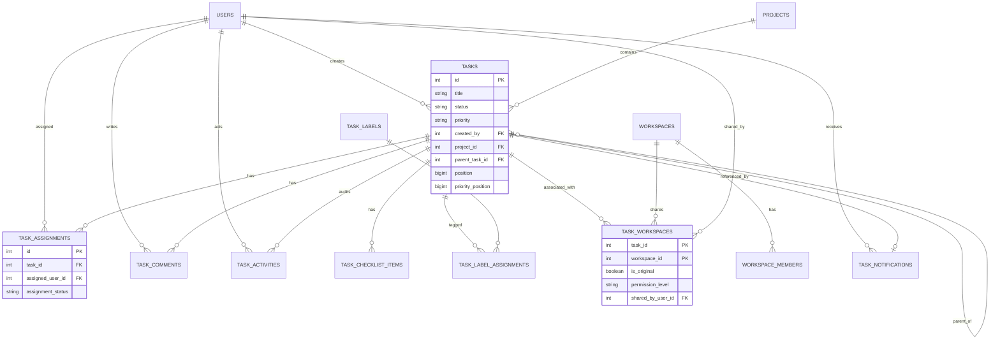

# راهنمای کامل بکاند ماژول Tasks (Halgheh)

> این مستند بهصورت مستقل نوشته شده است و نیازی به خواندن مستند شمارهٔ ۱ ندارد. هدف آن توضیح کامل بکاند ماژول Tasks از لایهٔ HTTP تا دیتابیس و migrationها است.
>
> **قرارداد نگارش:** شناسهها و نام فایلها به انگلیسی (`TaskWorkspace`, `service.py`, `uq_task_workspaces_original_task`) و توضیحات به فارسیاند. تمام مسیرها نسبت به ریشهٔ مخزن Halghehاند.

## راهنمای وضعیت تأیید

| علامت | معنی |
|---|---|
| `✅ کد` | مسیر، امضای تابع، schema و رفتار از روی سورس خوانده شده و با بررسی AST و ساخت پروژه مطابقت دارد. |
| `⚠️ اجرا` | رفتار دقیق در زمان اجرا توسط `pytest` تأیید نشده است. فایلهای تست وجود دارند، ولی `pytest` در محیط نویسنده مستند در دسترس نبود؛ طبق شواهد موجود، بررسی AST/ساخت و تعداد محدودی تماس API در مرحلهٔ پیشین اجرا شد. |

تمام endpointها در جدول بخش F با ترکیب `✅ کد · ⚠️ اجرا` مشخص شدهاند مگر جایی که صراحتاً خلاف آن گفته شود.

---

# A. معماری بکاند

## A.1 لایهها

```text
service/main.py                     → FastAPI app, CORS, include_router
service/task/router.py              → HTTP layer (thin), prefix /api/tasks
service/task/schemas.py             → Pydantic v2 request/response models
service/task/service.py             → business rules + authorization + transactions
service/task/permissions.py         → pure role predicates (no DB, no HTTP)
service/task/repository.py          → SQLAlchemy queries only (no HTTP errors, no commits)
service/task/models/                → ORM tables and constraints
service/workspace/ + project/ + notifications/  → cross-module services
alembic/versions/                   → schema migrations
```

| لایه | مسئولیت | آنچه نباید انجام دهد |
|---|---|---|
| `router.py` | تبدیل HTTP به فراخوانی سرویس، `Depends(get_db)`, `Depends(get_current_user)`, `response_model` | نوشتن قانون کسب و کار یا دست مستقیم به مدلها |
| `schemas.py` | اعتبارسنجی ورودی و شکلدهی خروجی | پذیرفتن شناسهٔ کاربر جاری (actor همیشه از توکن میآید) |
| `service.py` | قوانین وضعیت، مجوزها، activity، اعلان، `db.commit()` | پاسخ HTTP ساختن (بهجز `HTTPException`) |
| `permissions.py` | توابعی مانند `can_edit(role)` | دسترسی به دیتابیس |
| `repository.py` | `select`, `with_for_update`, `db.add`, `db.delete`, `db.flush()` | `commit` یا پرتاب `HTTPException` |
| `models/` | ستونها، FKها،CHECKها، indexها و relationshipها | منطق کسب و کار |

مثال لایهٔ نازک روتر (از `router.py`):

```python
@router.post("", response_model=TaskResponse, status_code=status.HTTP_201_CREATED)
def create_task(
    data: TaskCreate,
    db: Session = Depends(get_db),
    current_user: User = Depends(get_current_user),
):
    task = service.create_task(db, current_user.id, data)
    return service.serialize_task(task, actor_id=current_user.id, db=db)
```

## A.2 Dependency Injection

`get_db` در `service/core/database.py` یک Session میسازد، در استثناء `rollback` میکند و همیشه میبندد:

```python
def get_db():
    db = SessionLocal()
    try:
        yield db
    except Exception:
        db.rollback()
        raise
    finally:
        db.close()
```

`get_current_user` در `service/auth/dependencies.py` هدر `Authorization: Bearer` را میخواند، توکن را decode میکند، کاربر را با `db.get(User, user_id)` بارگذاری میکند و در صورت شکست `401 Not authenticated` میدهد.

پارامترهای فیلتر لیست توسط dependency جداگانهٔ `_task_filter` در `router.py` ساخته میشوند؛ خطاهای `ValidationError` مربوط به Pydantic به `422` با یک `detail` رشتهای تبدیل میشوند:

```python
except ValidationError as exc:
    raise HTTPException(
        status_code=422,
        detail=exc.errors()[0].get("msg", "Invalid filter"),
    )
```

## A.3 احراز هویت (Authentication)

`service/auth/security.py`:

- `JWT` با الگوریتم `HS256`، payload شامل `sub` (شناسهٔ کاربر به رشته تبدیلشده) و `exp`؛
- `TOKEN_EXPIRE_MINUTES = 60 * 24` (۲۴ ساعت)؛
- رمز عبور با `bcrypt` از طریق `passlib` هش میشود؛
- در محیط production، نبود `SECRET_KEY` موجب `RuntimeError` هنگام استارتاپ میشود؛ در development از مقدار پیشفرض `dev-secret-change-me` استفاده میشود.

کدามن:

```python
def create_token(user_id: int) -> str:
    payload = {
        "sub": str(user_id),
        "exp": datetime.now(timezone.utc) + timedelta(minutes=TOKEN_EXPIRE_MINUTES),
    }
    return jwt.encode(payload, SECRET_KEY, algorithm=ALGORITHM)
```

فرانتاند توکن را در `localStorage.token` نگه میدارد و `apiRequest` در `web/app/src/api.js` آن را بهصورت `Authorization: Bearer <token>` ارسال میکند.

## A.4 تراکنشها

قاعده: **repository commit نمیکند، service commit میکند.**

```python
def _commit(db: Session, *, conflict_detail: str, conflict_status: int) -> None:
    try:
        db.commit()
    except IntegrityError:
        db.rollback()
        raise HTTPException(status_code=conflict_status, detail=conflict_detail)
```

- `repository.create_task`, `create_comment` و `create_checklist_item` از `db.flush()` برای بهدست آوردن `id` استفاده میکنند، نه `commit`.
- `repository.create_assignment` عمداً `flush` نمیکند تا تضادraceی unique شدن کاربر روی همان تسک توسط `_commit` به `409` تبدیل شود.
- activity، اعلانها و تغییر اصلی همیشه در یک تراکنش ذخیره میشوند.
- قفلها (`with_for_update`) در `list_status_task_ids_for_update`, `list_priority_task_ids_for_update`, `get_task_for_update` و `list_checklist_item_ids_for_update` قرار دارند.

## A.5 خطاها

| کد | منبع | مثالّ پیام |
|---|---|---|
| `401` | `get_current_user` | `Not authenticated` |
| `403` | سرویس، هنگامی که تسک دیده میشود ولی مجوز کافی نیست | `Only the task owner may perform this operation` |
| `404` | `_visible_task`, label، comment، item، association | `Task not found`, `Label not found`, `Checklist item not found` |
| `400` | قوانین کسب و کار و `IntegrityError` خیلی از عملیات | `Invalid status transition from 'done' to 'blocked'` |
| `409` | تضادهای ویژه: تخصیص تکراری، برچسب تکراری، اشتراکگذاری | `User is already assigned to this task`, `Could not share task with this workspace` |
| `422` | Pydantic (بدنه یا `_task_filter`) | `Unknown task status: ...`, `Update body must not be empty` |
| `500` | handler عمومی در `service/main.py` | `Internal server error` (جزئیات در لاگ سمت سرور) |

فلسفهٔ 404 در برابر 403: منابع نامرئی و منابع موجودنبوده پاسخ یکسانی میدهند تا حدس شناسه (IDOR) چیزی لو ندهد؛ منبع مرئی با مجوز ناکافی `403` میدهد.

## A.6 اعتبارسنجی پاسخ

- روترها `response_model=TaskResponse`, `TaskListResponse`, `TaskSummary | None`, `TaskCommentOut`, `TaskActivityListResponse`, `TaskWorkspaceOut`, `TaskChecklistItemOut`, `TaskStatisticsOut` و غیره را مشخص میکنند.
- Schemaهای پاسخ از `ConfigDict(from_attributes=True)` استفاده میکنند، بنابراین آبجکت ORM مستقیم قابل برگشت است.
- `TaskSummary` فقط فیلدهای scalar دارد (بدون relationshipها) تا لیستها دچار N+1 نشوند؛ `TaskResponse` فیلد `description` و لیستهای `labels`, `assignments` را اضافه میکند.
- `service.serialize_task` برچسبها را از `TaskLabelAssignment.label` صاف میکند و در صورت داشتن `actor_id` و `db`، فهرست `workspaces` را از سرویس Workspace میآورد.
- Schemaهای ورودی مانند `TaskCreate` و `TaskUpdate` دارای `extra="forbid"`اند؛ بنابراین ارسال فیلد اضافهای مانند `created_by` منجر به `422` میشود.

---

# B. طراحی دیتابیس

## B.1 جدول `tasks`

منبع: `service/task/models/task.py`، migrationهای `017` تا `019`.

| ستون | نوع | توضیح |
|---|---|---|
| `id` | Integer, PK | شناسهٔ تسک |
| `title` | String, NOT NULL | `length(title) > 0` (`ck_tasks_title_not_empty`) |
| `description` | Text, NULL | توضیح اختیاری |
| `status` | String, NOT NULL, default `todo` | `ck_tasks_status`: `todo`, `in_progress`, `blocked`, `done`, `cancelled` |
| `priority` | String, NOT NULL, default `medium` | `ck_tasks_priority`: `low`, `medium`, `high`, `urgent` |
| `created_by` | Integer, NOT NULL, FK → `users.id` `ON DELETE CASCADE` | مالک تسک و تنها کلید مالکیت در قوانین قدیمی |
| `project_id` | Integer, NULL, FK → `projects.id` `ON DELETE SET NULL` | عضویت اختیاری در پروژه |
| `parent_task_id` | Integer, NULL, FK → `tasks.id` `ON DELETE SET NULL` | خود-ارجاع؛ حذف والد فرزندان را به سطح بالا ارتقا میدهد |
| `start_date`, `due_date` | Date, NULL | قید `due_date >= start_date` (`ck_tasks_date_order`) |
| `completed_at` | DateTime(timezone), NULL | با قید `ck_tasks_completed_state`: فقط و فقط هنگام `status = 'done'` غیر نول است |
| `position` | BigInteger, NOT NULL, default `0` | ترتیب در ستون وضعیت (migration `018_task_pos`) |
| `priority_position` | BigInteger, NOT NULL, default `0` | ترتیب در ستون اولویت (migration `019_task_prio`) |
| `created_at`, `updated_at` | DateTime(timezone), NOT NULL | `server_default=now()`, `onupdate=now()` |

قیدها و indexها:

```text
ck_tasks_status, ck_tasks_priority, ck_tasks_title_not_empty,
ck_tasks_completed_state, ck_tasks_date_order, ck_tasks_parent_not_self
ix_tasks_created_by, ix_tasks_created_by_status, ix_tasks_due_date,
ix_tasks_parent_task_id, ix_tasks_project_id,
ix_tasks_status_position_id (status, position, id),
ix_tasks_priority_position_id (priority, priority_position, id)
```

**روابط ORM:** `creator` (به User)، `parent` / `children` (خود-ارجاع با `remote_side=[id]` و `passive_deletes=True`)، `assignments`, `comments`, `label_assignments`, `checklist_items` (همه با `cascade="all, delete-orphan"` و `passive_deletes=True`). **هیچ رابطهٔ `activities` وجود ندارد** تا مبادا cascade هنگام حذف تسک، ردیفهای audit را پاک کند.

> **نکتهٔ کلیدی:** در `tasks` ستون `workspace_id` وجود ندارد. Workspaceها فقط از طریق `task_workspaces` متصل میشوند.

## B.2 جدول `task_assignments`

منبع: `service/task/models/assignment.py`.

| ستون | نوع / قید |
|---|---|
| `id` | Integer, PK |
| `task_id` | FK → `tasks.id` `CASCADE`, NOT NULL |
| `assigned_user_id` | FK → `users.id` `CASCADE`, NOT NULL |
| `assigned_by` | FK → `users.id` `CASCADE`, NOT NULL |
| `assignment_status` | String, `active` یا `cancelled` (`ck_task_assignments_status`), default `active` |
| `assigned_at` | DateTime(timezone), NOT NULL |

- `uq_task_assignments_task_user` — unique trên `(task_id, assigned_user_id)`؛ تخصیص مجدد همان کاربر idempotent است و ردیف cancelled دوباره active میشود.
- indexها: `ix_task_assignments_task_id`, `ix_task_assignments_assigned_user_id`.
- روابط: `task`, `assigned_user` (با `foreign_keys=[assigned_user_id]`), `assigned_by_user` (با `foreign_keys=[assigned_by]`).

## B.3 جدول `task_comments`

| ستون | نوع / قید |
|---|---|
| `id` | Integer, PK |
| `task_id` | FK → `tasks.id` `CASCADE` |
| `user_id` | FK → `users.id` `CASCADE` |
| `content` | Text, NOT NULL |
| `created_at`, `updated_at` | DateTime(timezone) |

indexها: `ix_task_comments_task_id`, `ix_task_comments_task_created (task_id, created_at, id)`. روابط: `task`, `user`.

## B.4 جدول `task_activities` (audit)

منبع: `service/task/models/activity.py`.

| ستون | نوع / قید |
|---|---|
| `id` | Integer, PK |
| `task_id` | Integer NULL, FK → `tasks.id` **SET NULL** |
| `actor_id` | Integer NULL, FK → `users.id` **SET NULL** |
| `action` | String(64), NOT NULL (مجموعهٔ باز؛ بدون CHECK migration) |
| `old_value`, `new_value` | Text NULL — رشتههای JSON سریالیزهشده توسط `_snap` |
| `created_at` | DateTime(timezone) |

indexها: `ix_task_activities_task_created`, `ix_task_activities_actor_id`. هر دو FK قابل نولاند تا history پس از حذف تسک/کاربر باقی بماند. کدهای action که سرویس مینویسد: `task_created`, `task_updated`, `task_deleted`, `status_changed`, `priority_changed`, `due_date_changed`, `assignee_added`, `assignee_removed`, `label_added`, `label_removed`, `comment_added`, `comment_deleted`.

## B.5 جدولهای `task_labels` و `task_label_assignments`

`task_labels`: `id` (PK)، `name` (String, NOT NULL، `ck_task_labels_name_not_empty`)، `color` (String(7), NULL، قید format `#RRGGBB` با `lower`/`substr` portable)، `created_by` (FK → `users.id` `CASCADE`). unique: `uq_task_labels_creator_name (created_by, name)`; index: `ix_task_labels_created_by`.

`task_label_assignments`: `id` (PK)، `task_id` (FK → `tasks.id` `CASCADE`)، `label_id` (FK → `task_labels.id` `CASCADE`). unique: `uq_task_label_assignments_task_label (task_id, label_id)`; index: `ix_task_label_assignments_label_id`. روابط دوطرفه با `Task` و `TaskLabel`.

## B.6 جدول `task_checklist_items`

منبع: `service/task/models/checklist.py`، migration `020_task_checklist`.

| ستون | نوع / قید |
|---|---|
| `id` | Integer, PK |
| `task_id` | FK → `tasks.id` `CASCADE` |
| `title` | String(200), NOT NULL |
| `is_completed` | Boolean, default `false` |
| `position` | Integer, default `0` |
| `created_at`, `updated_at` | DateTime(timezone) |

indexها: `ix_task_checklist_items_task_id`, `ix_task_checklist_items_task_position (task_id, position, id)`. رابطه: `task` (back_populates `checklist_items`).

## B.7 جدول `task_workspaces`

منبع: `service/workspace/models.py`، migration `030` و سپس `034`.

| ستون | نوع / قید |
|---|---|
| `task_id` | FK → `tasks.id` `CASCADE` — بخشی از PK مرکب |
| `workspace_id` | FK → `workspaces.id` `CASCADE` — بخشی از PK مرکب |
| `is_original` | Boolean, NOT NULL, default `false` |
| `permission_level` | String(16), `viewer` یا `editor` (`ck_task_workspaces_permission_level`), default `viewer` |
| `shared_by_user_id` | Integer NULL, FK → `users.id` **SET NULL** |
| `created_at` | DateTime(timezone) |

- PK مرکب: `(task_id, workspace_id)`.
- indexها: `ix_task_workspaces_workspace_id`, `ix_task_workspaces_task_id`, `ix_task_workspaces_shared_by_user_id`.
- **partial unique index** `uq_task_workspaces_original_task` روی `(task_id)` وقتی `is_original` است: هر تسک دقیقاً یک Workspace اصلی دارد.
- رابطه: `shared_by` (به User). هیچ رابطهٔ مستقیمی از این جدول به `Task` در مدل تعریف نشده؛ کوئریها مستقیماً از کلاس `TaskWorkspace` استفاده میکنند.

## B.8 جدول `notifications` (بخش مربوط به Tasks)

منبع: `service/notifications/models/notification.py`.

| ستون | نوع / قید |
|---|---|
| `id` | Integer, PK |
| `user_id` | FK → `users.id` `CASCADE` |
| `type`, `title`, `message` | String / String / Text |
| `is_read`, `read_at` | Boolean / DateTime — قید `ck_notifications_read_state` آن دو را هماهنگ نگه میدارد |
| `task_id` | Integer NULL, FK → `tasks.id` **SET NULL** |
| سایر FKها | `event_id`, `reminder_id`, `scheduled_reminder_id`, `invitation_id` (همه SET NULL) |
| `created_at`, `updated_at` | DateTime(timezone) |

indexها: `ix_notifications_user_id_created_at`, `ix_notifications_user_id_is_read`, `ix_notifications_created_at` و unique جزئی `uq_notifications_scheduled_reminder`.

## B.9 جدولهای پشتیبان

- `users`: صاحب تسک، نویسندهٔ نظر، assignee و shared_by.
- `workspaces` (`service/docs/models/workspace.py`): `owner_id` مالک ضمنی است؛ در Workspace شخصی (`personal`) فقط مالک دسترسی دارد.
- `workspace_members`: عضویت پذیرفتهشده در Workspace shared با نقش `admin`/`editor`/`viewer` و unique `(workspace_id, user_id)`.
- `projects`, `project_members`: مسیر دسترسی قدیمی/bridge پروژه.
- `project_activities`, workspace activity: رویدادهای Cross-module هنگام ایجاد/تغییر/حذف تسک.

## B.10 نمودار ER



## B.11 مثال SQL

```sql
-- تسک اصلی در Workspace شمارهٔ 3، همراه با اشتراک ساده در Workspace شمارهٔ 9
INSERT INTO tasks (title, status, priority, created_by, project_id,
                   position, priority_position)
VALUES ('گزارش ماهانه', 'todo', 'high', 7, NULL, 1000, 3000);

INSERT INTO task_workspaces
    (task_id, workspace_id, is_original, permission_level, shared_by_user_id)
VALUES
    (42, 3, true,  'editor', NULL),
    (42, 9, false, 'viewer', 7);
```

---

# C. چرخهٔ عمر تسک — عملیات بهعملیات

در جدولهای زیر «روتر» نام تابع در `service/task/router.py`، «سرویس» نام تابع در `service/task/service.py` و «repo» متدهای `service/task/repository.py` است.

## C.1 ایجاد تسک و تسک فرزند

| مورد | مقدار |
|---|---|
| Endpoint | `POST /api/tasks` / `POST /api/tasks/{task_id}/subtasks` |
| روتر | `create_task`, `create_subtask` |
| Schema | `TaskCreate` (شامل `title`, `description`, `priority`, `project_id`, `workspace_id`, `start_date`, `due_date`), `SubtaskCreate` (اضافه کردن `parent_task_id`) |
| سرویس | `create_task`, `create_subtask`, `_resolve_task_workspace_id`, `_ensure_task_workspace_association`, `_create_task_created_notifications` |
| repo | `list_status_task_ids_for_update`, `get_status_position_neighbors`, `list_priority_task_ids_for_update`, `get_priority_position_neighbors`, `create_task`, `add_activity` |
| جدولها | `tasks`, `task_workspaces`, `task_activities`, `notifications`, (`project_activities` یا workspace activity) |
| پاسخ | `201` + `TaskResponse` |
| خطاها | `422` schema، `400` تاریخ نامعتبر/Workspace شخصی پیدا نشود، `403` عدم حق ایجاد در Workspace، `404` والد نامرئی برای subtask |
| مجوز | ایجاد: کاربر احراز هویتشده با `can_create_resource` در Workspace؛ subtask: مالک تسک والد (`_admin_task`) |

مراحل `create_task` بهترتیب:

1. `_validate_dates(start, due)`.
2. اگر `project_id` داده شده، `project_service.require_project_manage`.
3. `_resolve_task_workspace_id`: `workspace_id` صریح ← Workspace پروژه ← Workspace شخصی کاربر.
4. قفل و محاسبهٔ انتهای ستون `todo` و ستونpriority، با فاصلهٔ `_POSITION_GAP = 1000`.
5. `repository.create_task` + `db.flush()` (دریافت `id`).
6. درج ردیف اصلی `task_workspaces` (`is_original=True`, `permission_level="editor"`).
7. `repository.add_activity(action="task_created")`.
8. ثبت رویداد Project (اگر `project_id`) یا Workspace activity (در غیر این صورت).
9. `_create_task_created_notifications`؛ سپس `_commit` و `db.refresh` و `populate_checklist_counts`.

برای `create_subtask`: روتر ابتدا بررسی میکند `data.parent_task_id == task_id` و در غیر این صورت `400` میدهد؛ فرزند `project_id` والد را به ارث میبرد و Workspaceهای والد را کپی میکند (اولین آنها اصلی و `editor`، بقیه `viewer`).

## C.2 خواندن، لیست و آمار

| مورد | مقدار |
|---|---|
| Endpoint | `GET /api/tasks/{task_id}`, `GET /api/tasks`, `GET /api/tasks/my`, `GET /api/tasks/assigned-by-me`, `GET /api/tasks/statistics` |
| روتر | `get_task`, `list_tasks`, `list_my_tasks`, `list_assigned_by_me`, `task_statistics` |
| Schema | `TaskFilter`, `TaskResponse`, `TaskListResponse`, `TaskStatisticsOut` |
| سرویس | `get_task` ← `_visible_task`, `list_tasks`, `task_statistics`, `attach_task_workspaces` |
| repo | `get_task`, `list_visible`, `list_created_by`, `list_assigned_to`, `list_assigned_by`, `_visible_clause`, `_apply_filters`, `_order_clause`, `_checklist_counts_for_tasks`, `task_statistics` |
| جدولها | خواندنی: `tasks`, `task_assignments`, `task_workspaces`, `task_labels`, `task_checklist_items` |
| پاسخ | `200` + `TaskResponse` / `TaskListResponse` / `TaskStatisticsOut` |
| خطاها | `404` تسک نامرئی، `400` scope ناشناخته، `422` فیلتر نامعتبر |
| مجوز | حداقل `can_view`؛ لیستها توسط `_visible_clause` محدود میشوند |

نکته: `scope` میتواند `visible` (پیشفرض)، `created`, `assigned` یا `assigned_by` باشد. `TaskFilter.sort` از مجموعهٔ `due_date`, `created_at`, `updated_at`, `priority`, `position`, `priority_position` و `due` از `overdue`, `today`, `upcoming`, `no_due` است. ترتیب پیشفرض: کارهای باز ابتدا، سپس نزدیکترین deadline، سپس اولویت بالاتر، سپس `id` (tie-break).

## C.3 ویرایش خصوصیات

| مورد | مقدار |
|---|---|
| Endpoint | `PATCH /api/tasks/{task_id}` |
| روتر / Schema / سرویس | `update_task` / `TaskUpdate` / `update_task` ← `_owned_task` |
| repo | `update_task`, `list_priority_task_ids_for_update`, `get_priority_position_neighbors`, `add_activity` |
| جدولها | `tasks`, `task_activities`, workspace activity |
| پاسخ | `200` + `TaskResponse` |
| خطاها | `404` نامرئی، `403` مجوز ویرایش ندارد، `422` بدنه خالی/عنوان نول/priority ناشناخته، `400` تاریخ نامعتبر |
| مجوز | `can_edit` (owner یا shared editor) |

`status` عمداً در `TaskUpdate` نیامده است؛ `__field_actions` نگاشت هر فیلد به action است (`priority → priority_changed`, `due_date`/`start_date → due_date_changed`, rest → `task_updated`). تغییر `priority` از طریق PATCHposition آن را به انتهای ستون مقصد میبرد. `project_id` جداگانه بررسی میشود و `project_changed` activity مینویسد.

## C.4 تغییر وضعیت

| مورد | مقدار |
|---|---|
| Endpoint | `PUT /api/tasks/{task_id}/status` |
| روتر / Schema / سرویس | `set_task_status` / `TaskStatusUpdate` / `set_task_status` |
| repo | `list_status_task_ids_for_update`, `get_status_position_neighbors`, `add_activity` |
| جدولها | `tasks`, `task_activities`, (`project_activities` هنگام تکمیل) |
| پاسخ | `200` + `TaskResponse` |
| خطاها | `403` نقش بدون `can_change_status`، `400` انتقال نامعتبر، `404` نامرئی |
| مجوز | owner، editor یا active assignee |

```python
ALLOWED_STATUS_TRANSITIONS = {
    "todo": {"in_progress", "blocked", "done", "cancelled"},
    "in_progress": {"todo", "blocked", "done", "cancelled"},
    "blocked": {"in_progress", "done", "cancelled"},
    "done": {"todo", "in_progress"},
    "cancelled": {"todo"},
}
```

همان وضعیت = no-op(idempotent). هنگام ورود به `done`، `completed_at = datetime.now(timezone.utc)` و خروج از آن مقدار را پاک میکند؛ قید DB `ck_tasks_completed_state` این invariant را تضمین میکند. تسک به انتهای ستون مقصد منتقل میشود (`position` جدید) و activity `status_changed` ثبت میشود.

## C.5 جابهجایی (reorder) در وضعیت یا اولویت

| مورد | مقدار |
|---|---|
| Endpoint | `PATCH /api/tasks/{task_id}/position` |
| روتر / Schema | `set_task_position` / `TaskPositionUpdate` |
| سرویس | `set_task_position`, `_compute_target_position`, `_compute_target_priority_position`, `_normalize_status_positions`, `_normalize_priority_positions` |
| repo | `list_status_task_ids_for_update`, `get_status_position_neighbors`, `list_priority_task_ids_for_update`, `get_priority_position_neighbors`, `add_activity` |
| جدولها | `tasks`, `task_activities` |
| پاسخ | `200` + `TaskResponse` |
| خطاها | `400` هر دو هدف یا هیچکدام، هدف ناشناخته، همسایه نامعتبر/خارج از ستون، ترتیب معکوس همسایهها، self-neighbor |
| مجوز | حالت status: `can_change_status`؛ حالت priority: `can_edit` |

دقیقاً یکی از `target_status` یا `target_priority` باید ارسال شود. `before_task_id` و `after_task_id` همسایگان مقصداند؛ فقدان هردو به معنای الحاق به انتها و تنها `after_task_id` به معنای شروع ستون است. موقعیتها با فاصلهٔ ۱۰۰۰ تا حد امکان «میانگین دو همسایه» میگیرند؛ اگر جا تنگ شود، `_normalize_*_positions` کل ستون را با فواصل ۱۰۰۰ بازنویسی میکند. تمام عملیات تحت قفل `FOR UPDATE` انجام میشود.

## C.6 حذف تسک

| مورد | مقدار |
|---|---|
| Endpoint | `DELETE /api/tasks/{task_id}` |
| روتر / سرویس | `delete_task` / `delete_task` ← `_visible_task` + `can_delete_task` + `ws_service.can_delete_resource_everywhere` |
| repo | `add_activity`, `delete_task` |
| جدولها | حذف از `tasks`؛ cascade: `task_assignments`, `task_comments`, `task_checklist_items`, `task_label_assignments`, `task_workspaces`؛ **SET NULL**: `task_activities.task_id`, `notifications.task_id`, فرزندان `tasks.parent_task_id` |
| پاسخ | `204 No Content` |
| خطاها | `404`, `403` |
| مجوز | فقط مالک تسک (`can_delete_task`) و این حق در تمام Workspaceهای مرتبط هم معتبر باشد |

حذف فیزیکی (hard delete) است — ستون soft-delete وجود ندارد. activity حذف قبل از `db.delete` نوشته میشود تا history بماند.

## C.7 تخصیص کاربر

|Endpoint|روتر / Schema|سرویس|repo|پاسخ|خطاها|مجوز|
|---|---|---|---|---|---|---|
| `POST /api/tasks/{task_id}/assignments` | `assign_user` / `TaskAssignmentCreate` | `assign_user` | `get_assignment`, `create_assignment`, `user_exists`, `add_activity` | `200` + `TaskResponse` | `400` کاربر وجود ندارد، `409` تضاد unique، `403`, `404` | owner |
| `PUT /api/tasks/{task_id}/assignee` | `reassign_task` / `TaskAssignmentCreate` | `reassign_task` | همان بهعلاوهٔ `add_activity` | `200` + `TaskResponse` | `409`, `400`, `403`, `404` | owner |
| `DELETE /api/tasks/{task_id}/assignments/{user_id}` | `remove_assignment` | `remove_assignment` | `get_assignment`, `add_activity` | `204` | `403`, `404` | owner |

رفتارها: تخصیص مجدد همان کاربر active → no-op؛ ردیف cancelled دوباره active میشود (`assigned_at` بهروز، history حفظ). `reassign_task` تمام activeهای قبلی را cancelled میکند وهدف را تنها assignee میسازد. `remove_assignment` فقط status را cancelled میکند و ردیف را نگه میدارد. برای تسکهای پروژهای، رویداد `TASK_REASSIGNED` در `project_activities` با جزئیات assigneeهای قبلی/جدید ثبت میشود.

## C.8 والد و تسک فرزند

| Endpoint | روتر / Schema | سرویس | repo | پاسخ | خطاها | مجوز |
|---|---|---|---|---|---|---|
| `PUT /api/tasks/{task_id}/parent` | `set_task_parent` / `TaskParentUpdate` | `set_parent_task` | `ancestor_ids`, `update_task`, `add_activity` | `200` + `TaskResponse` | `400` self-parent یا حلقه، `403`, `404` | owner |
| `GET /api/tasks/{task_id}/parent` | `get_task_parent` | `get_parent_task` | `get_task` | `200` + `TaskResponse \\| null` | `404` | حداقل view |
| `POST /api/tasks/{task_id}/subtasks` | `create_subtask` / `SubtaskCreate` | `create_subtask` | همان ایجاد تسک | `201` + `TaskResponse` | `400` عدم تطابق parent با URL، `403`, `404` | owner والد |
| `GET /api/tasks/{task_id}/subtasks` | `list_subtasks` / `TaskFilter` | `list_subtasks` | `list_subtasks` | `200` + `TaskListResponse` | `404` | والد مرئی + `_visible_clause` |

پیشگیری از حلقه: `repository.ancestor_ids` تا عمق ۱۰۰ بالا میرود؛ اگر `task.id` در اجداد والد پیشنهادی باشد، `400 Circular parent-child relationship` صادر میشود. DB تنها self-parent ساده را توسط `ck_tasks_parent_not_self` منع میکند.

## C.9 برچسبها

| Endpoint | روتر / Schema | سرویس | جدولها | پاسخ | خطاها | مجوز |
|---|---|---|---|---|---|---|
| `POST /api/tasks/labels` | `create_label` / `TaskLabelCreate` | `create_label` | `task_labels` | `201` + `TaskLabelOut` | `400` تکرار نام، `422` رنگ نامعتبر | کاربر جاری (خصوصی) |
| `GET /api/tasks/labels` | `list_labels` | `list_labels` | `task_labels` | `200` + `TaskLabelListResponse` | — | فقط برچسبهای خود کاربر |
| `PATCH /api/tasks/labels/{label_id}` | `update_label` / `TaskLabelUpdate` | `update_label` | `task_labels` | `200` + `TaskLabelOut` | `404`, `422`, `400` | فقط سازنده |
| `DELETE /api/tasks/labels/{label_id}` | `delete_label` | `delete_label` | `task_labels`, `task_label_assignments`, `task_activities` | `204` | `404` | فقط سازنده |
| `PUT /api/tasks/{task_id}/labels/{label_id}` | `attach_label` | `attach_label` | `task_label_assignments`, `task_activities` | `200` + `TaskResponse` | `404`, `409`, `403` | owner تسک + مالک برچسب |
| `DELETE /api/tasks/{task_id}/labels/{label_id}` | `detach_label` | `detach_label` | همان | `204` (روتر) / `TaskResponse` (سرویس) | `404`, `403` | owner |

`get_label_for_user` تضمین میکند فقط برچسب خود کاربر قابل استفاده است. `delete_label` پیش از حذف، برای هر ردیف متصل activity `label_removed` مینویسد تا history باقی بماند.

## C.10 نظرات

| Endpoint | روتر / Schema | سرویس | repo | پاسخ | خطاها | مجوز |
|---|---|---|---|---|---|---|
| `GET /api/tasks/{task_id}/comments` | `list_comments` | `list_comments` | `list_comments` | `200` + `TaskCommentListResponse` (قدیمیترین ابتدا) | `404` | view |
| `POST /api/tasks/{task_id}/comments` | `add_comment` / `TaskCommentCreate` | `add_comment` | `create_comment`, `add_activity` | `201` + `TaskCommentOut` | `403`, `404`, `422` | owner, editor یا assignee (`can_comment`) |
| `DELETE /api/tasks/{task_id}/comments/{comment_id}` | `delete_comment` | `delete_comment` | `get_comment`, `delete_comment`, `add_activity` | `204` | `404` نظر، `403` نویسنده نیست | فقط نویسندهٔ نظر |

## C.11 تاریخچهٔ activity

`GET /api/tasks/{task_id}/activities` → روتر `list_activity`، سرویس `list_activity`, repo `list_activity`، جدول `task_activities`, پاسخ `200` + `TaskActivityListResponse` (جدیدترین ابتدا)، خطا `404`. مجوز: دیدن تسک کافی است. `limit` حداکثر ۱۰۰ و `offset` حداقل ۰ در سرویس اعمال میشود.

## C.12 اعلانها

`_create_task_created_notifications` در همان تراکنش ایجاد تسک اجرا میشود:

```python
recipient_ids = {actor_id}
for assignment in task.assignments:
    if assignment.assignment_status == "active":
        recipient_ids.add(assignment.assigned_user_id)
# Notification(user_id=..., type="task_created",
#              title="New task created", message=f'Task "{task.title}" was created.',
#              task_id=task.id)
```

گیرندگان بر اساس `user_id` dedup میشوند. در کد فعلی تنها ایجاد تسک اعلان میسازد؛ سایر تغییرات تنها `task_activities` و workspace/project activity مینویسند.

## C.13 چکلیست

| Endpoint | روتر / Schema | سرویس | repo | پاسخ | خطاها | مجوز |
|---|---|---|---|---|---|---|
| `GET /api/tasks/{task_id}/checklist` | `list_checklist_items` | `list_checklist_items` | `list_checklist_items` | `200` + `TaskChecklistListResponse` | `404` | view |
| `POST /api/tasks/{task_id}/checklist` | `create_checklist_item` / `TaskChecklistItemCreate` | `create_checklist_item` | `get_max_checklist_position`, `create_checklist_item`, `add_activity` | `201` + `TaskChecklistItemOut` | `400` عنوان خالی/طولانی، `403` | `can_edit` |
| `PATCH /api/tasks/{task_id}/checklist/{item_id}` | `update_checklist_item` / `TaskChecklistItemUpdate` | `update_checklist_item` | `get_checklist_item`, `add_activity` | `200` + `TaskChecklistItemOut` | `404` آیتم، `400`, `403` | `can_edit` |
| `DELETE /api/tasks/{task_id}/checklist/{item_id}` | `delete_checklist_item` | `delete_checklist_item` | `get_checklist_item`, `delete_checklist_item`, `add_activity` | `204` | `404`, `403` | `can_edit` |
| `PATCH /api/tasks/{task_id}/checklist/reorder` | `reorder_checklist_items` / `TaskChecklistReorder` | `reorder_checklist_items` | `list_checklist_item_ids_for_update`, `add_activity` | `200` + `TaskChecklistListResponse` | `400` تکرار ID، مجموعهٔ ناقص، `403` | `can_edit` |

موقعیت آیتم new با `max(position) + 1000` شروع میشود. reorder با قفل ردیفها، برابری دقیق مجموعهٔ IDها را بررسی میکند و سپس بهصورت دو مرحلهای positionها را ابتدا به `1_000_000_000 + idx` و سپس به `idx * 1000` میبرد تا تضاد موقت ایجاد نشود.

## C.14 اشتراکگذاری با Workspace

| Endpoint | روتر | سرویس | جدولها | پاسخ | خطاها |
|---|---|---|---|---|---|
| `GET /api/tasks/{task_id}/workspaces` | `list_task_workspaces` | `list_task_workspaces` | `task_workspaces`, `workspaces`, `workspace_members` | `200` + `list[TaskWorkspaceOut]` | `404` |
| `POST /api/tasks/{task_id}/workspaces/{workspace_id}` | `attach_task_to_workspace` | همنام | `task_workspaces`, workspace activity | `201` + dict (بدون `response_model`) | `400`, `403`, `404`, `409` |
| `PATCH /api/tasks/{task_id}/workspaces/{workspace_id}` | `update_task_workspace_permission` | همنام | همان | `200` + `TaskWorkspaceOut` | `400`, `403`, `404` |
| `DELETE /api/tasks/{task_id}/workspaces/{workspace_id}` | `detach_task_from_workspace` | همنام | همان | `204` | `400`, `403`, `404` |

همهٔ عملیات sharing نیازمند `_admin_task` یعنی مالک canonical تسکاند (`can_share`). علاوه بر آن، هنگام attach، نقش کاربر در Workspace مقصد باید `can_manage_content` داشته باشد. `permission_level` فقط `viewer` یا `editor` پذیرفته میشود. associated بودن قبلی → attach idempotent با `attached: false`. ردیف `is_original` نه قابل جدا شدن است و نه قابل تغییر سطح دسترسیتن: هر دو `400` میدهند. فهرست workspaces فقط Workspaceهایی را نشان میدهد که کاربر جاری بتواند ببیند و بر اساس `(not is_original, workspace_name, workspace_id)` مرتب میشود.

نمونهٔ خروجی `TaskWorkspaceOut`:

```json
{
  "workspace_id": 9,
  "workspace_name": "تیم بازاریابی",
  "workspace_type": "shared",
  "is_original": false,
  "permission_level": "viewer",
  "shared_by_user_id": 7,
  "created_at": "2026-11-26T10:00:00+00:00"
}
```

---

# D. مجوزها و امنیت

## D.1 احراز هویت در برابر مجوزدهی

- **Authentication (authn):** «شما کی هستید؟» → `get_current_user` + JWT. بدون آن `401`.
- **Authorization (authz):** «آیا اجازهٔ این کار را دارید؟» → `service/task/permissions.py` + `_access_role` + Workspace permissions. کافی نبودن → `403` یا `404`.

هیچ schemaای `actor_id` یا `created_by` را از کلاینت قبول نمیکند. `TaskAssignmentCreate.assigned_user_id` تنها user-id قابل ارسال است و هدف تخصیص است.

## D.2 نقشها

```python
ROLE_OWNER = "owner"
ROLE_EDITOR = "editor"
ROLE_ASSIGNEE = "assignee"
ROLE_PROJECT_VIEWER = "project_viewer"
ROLE_NONE = "none"
```

رتبهبندی داخلی `_role_rank`: `none=0 < project_viewer=1 < assignee=2 < editor=3 < owner=4`.

## D.3 ماتریس مجوزها

| عملیات | owner | editor | assignee | project_viewer | none |
|---|:---:|:---:|:---:|:---:|:---:|
| دیدن تسک (`can_view`) | ✅ | ✅ | ✅ | ✅ | ❌ |
| ویرایش title/description/date/priority/checklist (`can_edit`) | ✅ | ✅ | ❌ | ❌ | ❌ |
| تغییر وضعیت (`can_change_status`) | ✅ | ✅ | ✅ | ❌ | ❌ |
| نظر دادن (`can_comment`) | ✅ | ✅ | ✅ | ❌ | ❌ |
| تخصیص/جابهجاییassignee (`can_assign`) | ✅ | ❌ | ❌ | ❌ | ❌ |
| ساختار parent/subtask (`can_manage_structure`) | ✅ | ❌ | ❌ | ❌ | ❌ |
| برچسبها (`can_manage_labels`) | ✅ | ❌ | ❌ | ❌ | ❌ |
| اشتراک Workspace (`can_share`) | ✅ | ❌ | ❌ | ❌ | ❌ |
| حذف تسک (`can_delete_task`) | ✅ | ❌ | ❌ | ❌ | ❌ |

سازندهٔ تسک (`created_by`) بهطور ذاتی `owner` است؛ `editor` نقشی است که تنها از طریق `permission_level = "editor"` در `task_workspaces` و با داشتن `can_manage_content` در Workspace بهدست میآید.

## D.4 الگوریتم `_access_role`

1. تسک وجود ندارد → `none`.
2. تمام ردیفهای `TaskWorkspace` مربوط به تسک را بخواند.
3. اگر `workspace_id` بهعنوان context ارسال شده، فقط همان Workspace در نظر گرفته میشود؛ نبود ردیف → `none`.
4. برای هر ردیف: Workspace بارگذاری، عضویت کاربر (`ws_repo.get_member`) و نقش Workspace (`workspace_role`) محاسبه；اگر `can_view` نباشد ردیف نادیده گرفته میشود.
5. کاندید نقش تسک: `editor` اگر `permission_level == "editor"` **و** `ws_permissions.can_manage_content(ws_role)`؛ در غیر این صورت `project_viewer`. بالاترین رتبه انتخاب میشود.
6. اگر هیچ Workspace قابل دسترسی نباشد → `none` **حتی اگر کاربر سازندهٔ تسک باشد** (حفظ قانون دیدن قدیمی).
7. در غیر این صورت اگر `task.created_by == actor_id` → `owner`؛ وگرنه بهترین کاندید.
8. fallback (فقط وقتی هیچ ردیف `TaskWorkspace` وجود ندارد): نقش پروژه (`project_service.get_project_role`)؛ `can_manage_project_content` → owner وگرنه `project_viewer`؛ در نبود پروژه، `permissions.task_role` قدیمی.

```python
candidate = (
    permissions.ROLE_EDITOR
    if row.permission_level == "editor"
    and ws_permissions.can_manage_content(ws_role)
    else permissions.ROLE_PROJECT_VIEWER
)
```

دو گیت وجود دارد: **عضویت در Workspace (گیت بیرونی)** و **سطح ارتباط تسک (گیت داخلی)**. نقش بالای Workspace بهتنهایی نمیتواند تسکی را که `viewer` share شده ارتقا دهد.

## D.5 رفتارlegacy

- `permissions.task_role`: مالک = `created_by`، assignee = تخصیص active، بقیه = `none`.
- `repository._visible_clause`: قانون canonical یعنی «تسک دارای association با Workspace قابل دسترس کاربر است»؛ و قانون legacy یعنی «ردیف بدون association» (`~has_workspace_assoc`) و قابل دیدن از طریق قواعد شخصی (creator/assignee active/یک سطح subtask) یا پروژهٔ قابل دسترس.
- سطحRepository دیدن را در SQL اعمال میکند، بنابراین فیلترهای ارسالشده توسط کاربر نمیتوانند تسکهای بیگانه را آشکار کنند.
- مهاجرت 034 تمام تسکهای موجود را به شکل canonical درمیآورد، ولی مسیر fallback برای سازگاری با دیتابیسهای قدیمی باقی مانده است.

## D.6 اصلاح Phase 3.1 — خطای `_commit`

پیش از اصلاح، سه تماس اشتراکگذاری تنها `conflict_detail` را به `_commit` میدادند. چون امضای تابع `conflict_status` را اجباری کرده بود، `TypeError` رخ میداد، handler عمومی `500` برمیگرداند و مرورگر پیام گیجکنندهٔ CORS نمایش میداد. اصلاح:

```python
# attach
_commit(db, conflict_detail="Could not share task with this workspace",
        conflict_status=status.HTTP_409_CONFLICT)
# detach
_commit(db, conflict_detail="Could not remove this workspace association",
        conflict_status=status.HTTP_400_BAD_REQUEST)
# permission update
_commit(db, conflict_detail="Could not update this workspace permission",
        conflict_status=status.HTTP_400_BAD_REQUEST)
```

درس آموخته: خطای داخلی پایتون نباید بهعنوان خطای CORS تفسیر شود؛ کد وضعیت خطا باید صریحاً در لایهٔ سرویس تعیین شود.

---

# E. Alembic و ساختار migrationها

## E.1 مفاهیم

- `revision` شناسهٔ migration و `down_revision` والد آن است؛ Alembic با دنبال کردن این زنجیرهها میفهمد کدام migrationها اجرا نشدهاند.
- هنگامی که دو شاخه وجود دارد، `alembic heads` دو سر میدهد و تا زمان merge نمیتوان `upgrade head` را بهطور یکتا اجرا کرد.
- migrationها تغییرات schema و گاهی backfill داده را در `upgrade()` مینویسند؛ `downgrade()` اختیاری است.

## E.2 گراف migrationها

```mermaid
flowchart LR
    A001["001_initial_schema"] --> A017["017_task_domain_foundation"]
    A017 --> B018["018_project_domain_foundation"]
    B018 --> B019["019_project_membership_invitations"] --> B020["020_invitation_username"] --> B021["021"] --> B022["022"] --> B023["023"] --> B024["024"] --> B025["025"] --> B026["026"] --> B027["027"] --> B028["028_unified_workspace_foundation"] --> B029["029"] --> B030["030_resource_workspace_associations"] --> B031["031"] --> B032["032_workspace_activity"]

    A017 --> T018["018_task_pos"]
    T018 --> T019["019_task_prio"]
    T019 --> T020["020_task_checklist"]

    B032 --> M033["033_merge_heads"]
    T020 --> M033
    M033 --> M034["034_task_workspace_sharing"]
```



- **شاخهٔ A (پروژه/Workspace):** `018` تا `032`.
- **شاخهٔ B (تکمیل Task):** `018_task_pos` (ستون `position`) → `019_task_prio` (`priority_position`) → `020_task_checklist` (جدول `task_checklist_items`).
- **دو سر:** `032` و `020_task_checklist`.

## E.3 migration 033_merge_heads

```python
revision = "033_merge_heads"
down_revision = ("032", "020_task_checklist")

def upgrade() -> None:
    pass  # merge-only; بدون تغییر schema یا داده
```

تنها وظیفهٔ آن یکی کردن دو سر شاخه است تا `alembic upgrade head` مسیر واحدی پیدا کند.

## E.4 migration 034_task_workspace_sharing

`revision = "034_task_workspace_sharing"`, `down_revision = "033_merge_heads"`.

`upgrade()`:

1. وجود جدول `task_workspaces` و ستونها را با inspector بررسی میکند (idempotency).
2. سه ستون اضافه میکند: `is_original` (boolean, default false)، `permission_level` (String(16), default `viewer`) و `shared_by_user_id` (FK → `users.id` SET NULL). ستون `created_at` از migration `030` وجود دارد.
3. `_resolve_original_workspace` Workspace اصلی هر تسک را با الویت شواهد تعیین میکند:
   1. `projects.workspace_id` زمانی که تسک به پروژهای تعلق دارد و آن Workspace در `task_workspaces` هست؛
   2. Workspace ثبتشده در activity تکایجاد `task.created` (از `project_activities`)؛
   3. تنها association موجود.
4. در صورت تعارض شواهد یا نبود مدرک، migration با پیامی شامل شناسهٔ دقیق تسکها متوقف میشود (`RuntimeError`) — بهجای حدس زدن.
5. backfill: ردیف اصلی `is_original=true` و `permission_level='editor'` میگیرد؛ بقیه `viewer` و `shared_by_user_id=NULL`.
6. بعد از backfill بررسی میکند که هر تسک دقیقاً یک ردیف اصلی دارد (`HAVING count(*) <> 1`).
7. قید `ck_task_workspaces_permission_level`، index `ix_task_workspaces_shared_by_user_id` و partial unique index `uq_task_workspaces_original_task` (روی `task_id` وقتی `is_original`) ایجاد میشود.
8. `downgrade()` عمداً خالی است: migration forward-only است.

نمونهٔ backfill:

```sql
UPDATE task_workspaces
SET is_original = (workspace_id = :wid),
    permission_level = CASE WHEN workspace_id = :wid THEN 'editor' ELSE 'viewer' END,
    shared_by_user_id = NULL
WHERE task_id = :tid;
```

## E.5 نحوهٔ تأیید (دستورات پیشنهادی، اجرا نشده در این مستند)

```bash
alembic heads                  # باید تنها 034_task_workspace_sharing باشد
alembic current                # وضعیت فعلی دیتابیس
alembic upgrade head           # اعمال تمام migrationها
alembic history                # بررسی زنجیره و merge
```

پس از اجرا، بررسیهای پیشنهادی: وجود سه ستون جدید در `task_workspaces`، وجود partial unique index، و اینکه `SELECT task_id, count(*) FROM task_workspaces WHERE is_original GROUP BY task_id HAVING count(*) <> 1` هیچ ردیفی برنگرداند.

---

# F. مرجع کامل API `/api/tasks`

**همهٔ endpointها نیاز به هدر `Authorization: Bearer <JWT>` دارند؛ در نبود آن `401 Not authenticated` برگشت میشود.** پارامتر `workspace_id` در اکثر endpointها یک context اختیاری برای مجوزدهی است و بهمعنای ستونی در جدول `tasks` نیست. endpointهای Workspace از `context_workspace_id` بهعنوان context و از `workspace_id` مسیر بهعنوان هدف share استفاده میکنند.

## F.1 فهرست endpointها

| # | Method & URL | پارامترها / بدنه | پاسخ | مجوز | خطاهای main | تأیید |
|---|---|---|---|---|---|---|
| 1 | `POST /api/tasks` | `TaskCreate` | `201` `TaskResponse` | احراز هویت + حق ایجاد در Workspace | `400,403,422` | ✅ کد · ⚠️ اجرا |
| 2 | `GET /api/tasks` | `scope`, `status[]`, `priority[]`, `created_by`, `assigned_user_id`, `parent_task_id`, `project_id`, `workspace_id`, `label_id`, `due`, `q`, `sort`, `order`, `limit`, `offset` | `200` `TaskListResponse` | view | `400,422` | ✅ کد · ⚠️ اجرا |
| 3 | `GET /api/tasks/my` | `TaskFilter` | `200` `TaskListResponse` | assignee | `422` | ✅ کد · ⚠️ اجرا |
| 4 | `GET /api/tasks/assigned-by-me` | `TaskFilter` | `200` `TaskListResponse` | delegate کننده | `422` | ✅ کد · ⚠️ اجرا |
| 5 | `GET /api/tasks/statistics` | `project_id` | `200` `TaskStatisticsOut` | view | `400` | ✅ کد · ⚠️ اجرا |
| 6 | `POST /api/tasks/labels` | `TaskLabelCreate` | `201` `TaskLabelOut` | کاربر جاری | `400,422` | ✅ کد · ⚠️ اجرا |
| 7 | `GET /api/tasks/labels` | `limit`, `offset` | `200` `TaskLabelListResponse` | برچسبهای خود | `422` | ✅ کد · ⚠️ اجرا |
| 8 | `PATCH /api/tasks/labels/{label_id}` | `TaskLabelUpdate` | `200` `TaskLabelOut` | سازندهٔ برچسب | `400,404,422` | ✅ کد · ⚠️ اجرا |
| 9 | `DELETE /api/tasks/labels/{label_id}` | — | `204` | سازندهٔ برچسب | `404` | ✅ کد · ⚠️ اجرا |
| 10 | `GET /api/tasks/{task_id}` | `workspace_id` | `200` `TaskResponse` | view | `404` | ✅ کد · ⚠️ اجرا |
| 11 | `PATCH /api/tasks/{task_id}` | `TaskUpdate`, `workspace_id` | `200` `TaskResponse` | owner/editor | `400,403,404,422` | ✅ کد · ⚠️ اجرا |
| 12 | `DELETE /api/tasks/{task_id}` | `workspace_id` | `204` | owner | `403,404` | ✅ کد · ⚠️ اجرا |
| 13 | `PUT /api/tasks/{task_id}/status` | `TaskStatusUpdate`, `workspace_id` | `200` `TaskResponse` | owner/editor/assignee | `400,403,404,422` | ✅ کد · ⚠️ اجرا |
| 14 | `PATCH /api/tasks/{task_id}/position` | `TaskPositionUpdate`, `workspace_id` | `200` `TaskResponse` | حالت وضعیت: `can_change_status`؛ حالت اولویت: `can_edit` | `400,403,404,422` | ✅ کد · ⚠️ اجرا |
| 15 | `PUT /api/tasks/{task_id}/parent` | `TaskParentUpdate`, `workspace_id` | `200` `TaskResponse` | owner | `400,403,404,422` | ✅ کد · ⚠️ اجرا |
| 16 | `GET /api/tasks/{task_id}/parent` | `workspace_id` | `200` `TaskResponse \\| null` | view | `404` | ✅ کد · ⚠️ اجرا |
| 17 | `POST /api/tasks/{task_id}/subtasks` | `SubtaskCreate`, `workspace_id` | `201` `TaskResponse` | owner والد | `400,403,404,422` | ✅ کد · ⚠️ اجرا |
| 18 | `GET /api/tasks/{task_id}/subtasks` | `TaskFilter` | `200` `TaskListResponse` | view | `404,422` | ✅ کد · ⚠️ اجرا |
| 19 | `POST /api/tasks/{task_id}/assignments` | `TaskAssignmentCreate`, `workspace_id` | `200` `TaskResponse` | owner | `400,403,404,409,422` | ✅ کد · ⚠️ اجرا |
| 20 | `PUT /api/tasks/{task_id}/assignee` | `TaskAssignmentCreate`, `workspace_id` | `200` `TaskResponse` | owner | `400,403,404,409,422` | ✅ کد · ⚠️ اجرا |
| 21 | `DELETE /api/tasks/{task_id}/assignments/{user_id}` | `workspace_id` | `204` | owner | `403,404` | ✅ کد · ⚠️ اجرا |
| 22 | `GET /api/tasks/{task_id}/comments` | `workspace_id`, `limit`, `offset` | `200` `TaskCommentListResponse` | view | `404,422` | ✅ کد · ⚠️ اجرا |
| 23 | `POST /api/tasks/{task_id}/comments` | `TaskCommentCreate`, `workspace_id` | `201` `TaskCommentOut` | owner/editor/assignee | `403,404,422` | ✅ کد · ⚠️ اجرا |
| 24 | `DELETE /api/tasks/{task_id}/comments/{comment_id}` | `workspace_id` | `204` | نویسندهٔ نظر | `403,404` | ✅ کد · ⚠️ اجرا |
| 25 | `GET /api/tasks/{task_id}/activities` | `workspace_id`, `limit`, `offset` | `200` `TaskActivityListResponse` | view | `404,422` | ✅ کد · ⚠️ اجرا |
| 26 | `PUT /api/tasks/{task_id}/labels/{label_id}` | `workspace_id` | `200` `TaskResponse` | owner + مالک برچسب | `403,404,409` | ✅ کد · ⚠️ اجرا |
| 27 | `DELETE /api/tasks/{task_id}/labels/{label_id}` | `workspace_id` | `204` | owner + مالک برچسب | `403,404` | ✅ کد · ⚠️ اجرا |
| 28 | `GET /api/tasks/{task_id}/workspaces` | `context_workspace_id` | `200` `list[TaskWorkspaceOut]` | view | `404` | ✅ کد · ⚠️ اجرا |
| 29 | `POST /api/tasks/{task_id}/workspaces/{workspace_id}` | `permission_level` (پیشفرض `viewer`), `context_workspace_id` | `201` dict شامل `attached` | owner + `can_manage_content` در مقصد | `400,403,404,409` | ✅ کد · ⚠️ اجرا |
| 30 | `PATCH /api/tasks/{task_id}/workspaces/{workspace_id}` | `permission_level`, `context_workspace_id` | `200` `TaskWorkspaceOut` | owner | `400,403,404` | ✅ کد · ⚠️ اجرا |
| 31 | `DELETE /api/tasks/{task_id}/workspaces/{workspace_id}` | `context_workspace_id` | `204` | owner | `400,403,404` | ✅ کد · ⚠️ اجرا |
| 32 | `GET /api/tasks/{task_id}/checklist` | `workspace_id` | `200` `TaskChecklistListResponse` | view | `404` | ✅ کد · ⚠️ اجرا |
| 33 | `POST /api/tasks/{task_id}/checklist` | `TaskChecklistItemCreate`, `workspace_id` | `201` `TaskChecklistItemOut` | owner/editor | `400,403,404,422` | ✅ کد · ⚠️ اجرا |
| 34 | `PATCH /api/tasks/{task_id}/checklist/reorder` | `TaskChecklistReorder`, `workspace_id` | `200` `TaskChecklistListResponse` | owner/editor | `400,403,404,422` | ✅ کد · ⚠️ اجرا |
| 35 | `PATCH /api/tasks/{task_id}/checklist/{item_id}` | `TaskChecklistItemUpdate`, `workspace_id` | `200` `TaskChecklistItemOut` | owner/editor | `400,403,404,422` | ✅ کد · ⚠️ اجرا |
| 36 | `DELETE /api/tasks/{task_id}/checklist/{item_id}` | `workspace_id` | `204` | owner/editor | `403,404` | ✅ کد · ⚠️ اجرا |

> **ترتیب تعریف روترها:** مسیرهای ثابت (`/my`, `/assigned-by-me`, `/statistics`, `/labels`) پیش از مسیر پارامتریک `/{task_id}` تعریف شدهاند تا بهعنوان `task_id` خوانده نشوند. بههمین ترتیب `checklist/reorder` قبل از `checklist/{item_id}` آمده است.

## F.2 نمونهٔ درخواست/پاسخ کامل

### ایجاد تسک

```http
POST /api/tasks
Authorization: Bearer eyJhbGciOi...
Content-Type: application/json

{"title": "پیادهسازی ورود", "priority": "high", "workspace_id": 3}
```

```http
HTTP/1.1 201 Created
Content-Type: application/json
```

```json
{
  "id": 42, "title": "پیادهسازی ورود", "description": null,
  "status": "todo", "priority": "high",
  "start_date": null, "due_date": null, "completed_at": null,
  "parent_task_id": null, "created_by": 7, "project_id": null,
  "position": 1000, "priority_position": 3000,
  "checklist_total": 0, "checklist_completed": 0,
  "created_at": "2026-11-26T09:12:00+00:00",
  "updated_at": "2026-11-26T09:12:00+00:00",
  "labels": [], "assignments": [],
  "workspaces": [{"id": 3, "name": "تیم محصول", "workspace_type": "shared"}]
}
```

### فیلتر لیست

```http
GET /api/tasks?status=todo&status=in_progress&due=overdue&sort=due_date&order=asc&limit=20
Authorization: Bearer eyJhbGciOi...
```

```json
{"items": [], "total": 0, "limit": 20, "offset": 0}
```

### جابهجایی در ستون اولویت

```http
PATCH /api/tasks/42/position
Authorization: Bearer eyJhbGciOi...
Content-Type: application/json

{"target_priority": "urgent", "after_task_id": 15}
```

پاسخ `200` + `TaskResponse` با `priority: "urgent"` و `priority_position` محاسبهشده؛ `status` تغییر نمیکند.

### اشتراکگذاری

```http
POST /api/tasks/42/workspaces/9?permission_level=viewer
Authorization: Bearer eyJhbGciOi...
```

```json
{
  "workspace_id": 9,
  "workspace_name": "تیم بازاریابی",
  "workspace_type": "shared",
  "is_original": false,
  "permission_level": "viewer",
  "shared_by_user_id": 7,
  "created_at": "2026-11-26T10:00:00+00:00",
  "attached": true
}
```

تکرار همان درخواست `attached: false` برمیگرداند (idempotent). حذف Workspace اصلی و تغییر سطح دسترسی آن `400` میدهد.

### خطای مجوز

```http
HTTP/1.1 403 Forbidden
{"detail": "Only the task owner may perform this operation"}
```

### خطای فیلتر

```http
HTTP/1.1 422 Unprocessable Entity
{"detail": "Unknown task status: doing"}
```

---

# موارد نیازمند بررسی بیشتر

1. **عدم اجرای تستها:** سه فایل تست در `service/tests/` (`test_task_position.py`, `test_task_checklist.py`, `test_task_workspace_sharing.py`) وجود دارند، ولی `pytest` در محیط نویسنده مستند در دسترس نبود. طبق شواهد موجود، بررسی AST، ساخت پروژه و تماسهای API محدود اجرا شدند؛ پوشش رفتاری کامل توسط تستها تأیید نشده است. پیشنهاد: اجرای `pytest` بر دیتابیس تست disposable مشخصشده در `service/tests/conftest.py`.

2. **متغیر `parent` در `create_subtask`:** در `service/task/service.py` خط 479 نتیجهٔ `_admin_task(...)` به متغیر ذخیره نشده، ولی خطوط 494، 495، 503 و 521 از `parent.id` / `parent.project_id` استفاده میکنند. از روی کد بهنظر میرسد مسیر ایجاد subtask با `NameError` مواجه شود. این موضوع بهعنوان رفتار تأییدشده ثبت نشده و نیازمند بررسی و اصلاح توسط تیم توسعه است.

3. **`workspaces` خالی در پاسخ جابهجایی:** روتر `set_task_position` از `service.serialize_task(task)` بدون `actor_id` و `db` استفاده میکند؛ در نتیجه فهرست `workspaces` در پاسخ آن endpoint خالی است. عمدی بودن یا نیاز به اصلاح آن مشخص نیست.

4. **تفاوت شکل پاسخ حذف برچسب:** سرویس `detach_label` یک `Task` برمیگرداند، ولی روتر `detach_label` وضعیت `204` و بدنهٔ خالی برمیگرداند. مصرفکنندهها باید به قرارداد روتر تکیه کنند.

5. **پیام CORS اشتباه در خطاهای داخلی:** اصلاح Phase 3.1 در کد فعلی دیده میشود، ولی تأیید آن با یک سناریوی تکرارپذیر خطای unique در محیط تست انجام نشده است.

6. **کد دسترسناپذیر در router.py:** خط آخر فایل دو `return Response(status_code=204)` پشت سر هم دارد؛ دومی هیچ تأثیری ندارد و پاکسازی آن اختیاری است.

7. **محدودهٔ اعلانها:** تنها ایجاد تسک اعلان مینویسد. اگر انتظار میرود تغییر وضعیت یا تخصیص هم اعلان ایجاد کند، این قابلیت در کد فعلی وجود ندارد و نیازمند طراحی جداگانه است.

8. **مهاجرت 034 و دیتابیسهای بدون شواهد:** الگوریتم backfill در صورت نبود مدرک معتبر، migration را متوقف میکند. قبل از اجرای `upgrade head` بر دیتابیس production، باید خروجی `_resolve_original_workspace` بر روی یک کپی بررسی شود.
