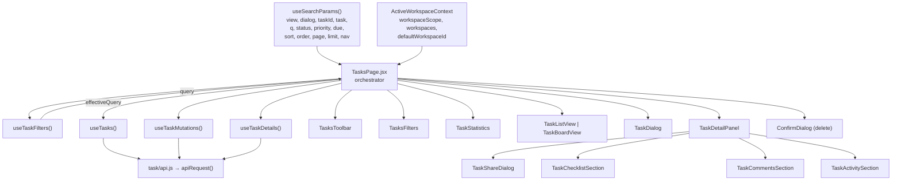
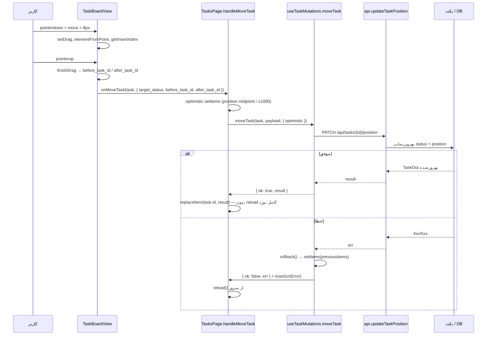
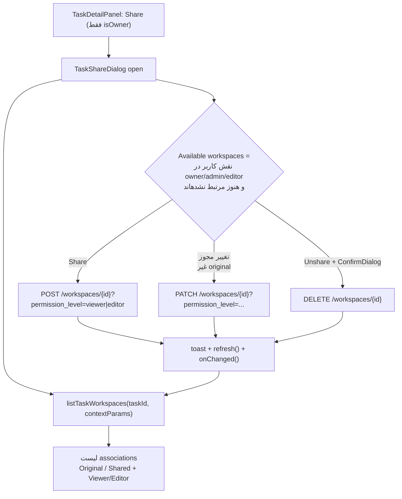

# راهنمای کامل فرانتاند ماژول Tasks (هالگهه)

> **زبان و قراردادها:** متن فارسی است، اما تمام شناسهها (`TaskBoardView`، `useTaskFilters`، `effectiveQuery`، `workspaceScope` و ...) به انگلیسی و دقیقاً همان چیزی که در سورس وجود دارد نوشته میشوند. مسیرها نسبت به ریشهٔ مخزن (`/home/mikel/Documents/halgheh-dev`) هستند.
>
> **منبع این مستند:** خواندن سورس موجود در `web/app/task/`، هوکها، کامپوننتهای shared، `web/app/workspace/ActiveWorkspaceContext.jsx` و قرارداد بکند `service/task/`. این مستند صرفاً توصیفی است و هیچ فایلی از برنامه را تغییر نمیدهد.
>
> **توضیح مهم دربارهٔ وضعیت تست:** در جریان تهیهٔ این مستند تنها بررسی read-only (خواندن و `grep`) انجام شد. `pytest` در محیط در دسترس نبود و تست خودکار اجرا نشد؛ جریان اشترینگ در فاز 3.1 با یک تسک QA یکبارمصرف بهصورت smoke تست شده است. جزئیات در فصل 04 و جدول وضعیت آنجا آمده است.

---

## فهرست

- [A. معماری React: جریان داده، props، state، hooks، effects، memoization](#a-معماری-react)
- [B. کاتالوگ تک تک کامپوننتها](#b-کاتالوگ-تک-تک-کامپوننتها)
- [C. نمای Kanban: ستونها، کارتها، انتقال وضعیت و Drag & Drop](#c-نمای-kanban)
- [D. نمای List: ردیفها، مرتبسازی، فیلتر، جستجو و Load More](#d-نمای-list)
- [E. ایجاد و ویرایش تسک (TaskDialog)](#e-ایجاد-و-ویرایش-تسک)
- [F. چکلیست (TaskChecklistSection)](#f-چکلیست)
- [G. وضعیت URL، Deep Link و ناوبری مرورگر](#g-وضعیت-url-deep-link-و-ناوبری-مرورگر)
- [H. یکپارچگی Workspace و اشترینگ تسک](#h-یکپارچگی-workspace-و-اشترینگ-تسک)
- [I. استایل، تم، رسپانسیو و دسترسپذیری](#i-استایل-تم-رسپانسیو-و-دسترسپذیری)

---

<a id="a-معماری-react"></a>

## A. معماری React

### A.1 نقشهٔ کلی

ماژول Tasks یک «صفحهٔ هماهنگکننده» (`TasksPage.jsx`) دارد که وضعیت را از URL میخواند، هوکها را صدا میزند و نتیجه را بهعنوان `props` به نمای لیست یا بورد و سه پنل (Create/Edit، Detail، Delete confirmation) پخش میکند. هیچ State manager خارجی (Redux/Zustand) وجود ندارد؛ منبع حقیقت عبارت است از: **URL search params + state محلی هوکها + Context workspace**.



### A.2 مثال واقعی: از URL تا درخواست API

```jsx
// web/app/task/TasksPage.jsx
const [searchParams, setSearchParams] = useSearchParams()
const rawView = searchParams.get('view')
const view = VALID_VIEWS.has(rawView) ? rawView : 'kanban'   // مقدار پیشفرض امن

const effectiveQuery = useMemo(
  () => (view === 'kanban' ? { ...query, sort: 'position', order: 'asc' } : query),
  [view, query],
)

const { items, total, statistics, loading, error, hasMore, reload, loadMore, replaceItem, setItems } =
  useTasks({ query: effectiveQuery, onUnauthorized: handleUnauthorized })
```

`useMemo` در اینجا دو کار میکند: (1) تضمین مرتبسازی `position asc` در بورد (چون چیدمان ستونها بر اساس موقعیت است)، (2) جلوگیری از تغییر هویت `query` در هر رندر، چون `useTasks` روی `query` یک `useEffect` دارد. اگر `query` هر بار شیء جدیدی میبود، هر رندر منجر به بارگذاری مجدد لیست میشد.

در سمت هوک فیلترها هم `query` با `useMemo` ساخته میشود و `resetPagination` عمداً `useCallback` است:

```jsx
// web/app/task/hooks/useTaskFilters.js
const query = useMemo(() => {
  const q = { sort: filters.sort || 'updated_at', order: filters.order || 'desc', limit, offset }
  q.scope = activeNav.scope || 'visible'
  if (filters.q?.trim()) q.q = filters.q.trim()
  if (workspaceScope && workspaceScope !== 'all') q.workspace_id = workspaceScope
  return q
}, [activeNav, filters, limit, offset, projectId, workspaceScope])

// Stable identity: TasksPage observes this callback in an effect.
const resetPagination = useCallback(
  () => updateParams((next) => next.delete('page'), { replace: true }),
  [updateParams],
)
```

> نکٔه معماری: کامنت سورس صراحتاً میگوید اگر `resetPagination`_inline میبود، اثر `useEffect(() => resetPagination(), [workspaceScope, resetPagination])` در `TasksPage` در هر رندر URL را مینوشت و حلقهٔ آپدیت ایجاد میکرد. اینجا «memoization بهعنوان قرارداد پایداری» است، نه صرفاً بهینهسازی.

### A.3 چرخهٔ بارگذاری، خطا و لغو درخواست

`useTasks` سه الگوی مهم را پیاده میکند:

1. **شماره درخواست (`requestRef`, `statsRequestRef`)**: فقط پاسخی که `requestId === requestRef.current` باشد اعمال میشود؛ پاسخهای قدیمی (race condition) نادیده گرفته میشوند.
2. **`AbortController`**: هر درخواست جدید، درخواست قبلی را لغو میکند؛ خطای `AbortError` به عنوان خطا به کاربر نمایش داده نمیشود.
3. **Dedupe در Load More**: هنگام الحاق صفحهٔ بعدی، آیتمهایی که `id` آنها در صفحات قبل دیده شده حذف میشوند.

```jsx
setItems((prev) => {
  if (!append) return nextItems
  const seen = new Set(prev.map((i) => i.id))
  return [...prev, ...nextItems.filter((i) => !seen.has(i.id))]
})
```

همین الگو در `useTaskDetails` (`Promise.all` با `.catch(err => ({ __error: err }))` برای بخشهای غیر بحرانی) و `TaskShareDialog` (AbortController هنگام بسته شدن دیالوگ) تکرار شده است.

### A.4 ارتباط بین کامپوننتها

سه کانال ارتباطی وجود دارد:

| کانال | مثال | توضیح |
|---|---|---|
| Callback props | `onOpen(id)`, `onStatusChange(task, status)`, `onMoveTask(task, payload)`, `onSaved(info)`, `onChanged()` | کامپوننت فرزند تصمیمسازگیرنده را به والد میسپارد؛ منطق API در والد یا هوک مشترک است. |
| URL بهعنوان کانال | `setSearchParams` در `TasksPage` و `useTaskFilters` | باز شدن دیالوگ، انتخاب تسک، فیلترها و صفحه همگی قابل اشتراک و قابل بازگشت با Back/Forward مرورگرند. |
| `refreshKey` | `detailsRefreshKey` در `TasksPage` → `refreshKey` در `TaskDetailPanel` → `useTaskDetails` | بعد از ذخیره/حذف/تغییر وضعیت، پنل جزئیات بدون نیاز به بسته شدن، دوباره بارگذاری میشود. |

**Optimistic update + rollback** نمونهٔ دیگری از ارتباط است: `TasksPage` قبل از فراخوانی `useTaskMutations` یک تابع `optimistic` میدهد که `replaceItem`/`setItems` را تغییر میدهد و یک تابعrollback برمیگرداند؛ هوک در صورت خطا rollback را صدا میزند:

```jsx
const result = await changeStatus(task, status, {
  optimistic: (current) => {
    const previousStatus = current.status
    const previousPosition = current.position
    replaceItem(current.id, (item) => ({ ...item, status }))
    return () => replaceItem(current.id, (item) => ({
      ...item, status: previousStatus, position: previousPosition,
    }))
  },
})
```

**Toast** از `@/components/ui/toast.jsx` از طریق `useToast()` در `TasksPage`، `TaskDetailPanel` و `TaskShareDialog` استفاده میشود (اعلان موفقیت/خطا، `variant: 'destructive'`).

### A.5 رویدادها و تغییرات همزمان

- جستجو 300ms debounce است (`SEARCH_DEBOUNCE_MS = 300`) تا هر حرف، درخواست جداگانه نفرستد.
- `isStatusPending(id)` از `useTaskMutations` دکمهها و درگ را برای همان تسک قفل میکند؛ `inflight` Set از دوبار کلیک جلوگیری میکند.
- `handleUnauthorized` در `TasksPage` توکن را پاک کرده و به `/login` هدایت میکند؛ تمام هوکها `onUnauthorized` را در `ref` نگه میدارند تا هویت تابع پایدار بماند.

---

<a id="b-کاتالوگ-تک-تک-کامپوننتها"></a>

## B. کاتالوگ تک تک کامپوننتها

### B.1 جدول خلاصه

| کامپوننت / هوک | مسیر | هدف | Props اصلی | State اصلی | Children / وابستگیها | فراخوانی API | روابط |
|---|---|---|---|---|---|---|---|
| `TasksPage` | `web/app/task/TasksPage.jsx` | هماهنگکنندهٔ صفحه، خواندن URL، توزیع props، حذف، deep link | — (صفحهٔ مسیر) | `dialogTask`, `deleteTarget`, `deleteBusy`, `deleteError`, `workspaceScope`, `currentUser`, `labelOptions`, `detailsRefreshKey`, `actionError` | `TasksToolbar`, `TasksFilters`, `TaskStatistics`, `TaskListView`/`TaskBoardView`, `TaskDialog`, `TaskDetailPanel`, `ConfirmDialog` | `getCurrentUser`, `listLabels`, `listTasks`, `getTask`, `deleteTask` | تمام هوکها را ترکیب میکند |
| `TasksToolbar` | `web/app/task/TasksToolbar.jsx` | عنوان، شمارش تسکها، دکمهٔ Create، تعویض نما | `view`, `onViewChange`, `onCreate`, `activeLabel`, `total`, `title`, `canCreate` | ندارد | `TasksViewSelector`, `Button`, `Badge` | — | والد: `TasksPage` |
| `TasksViewSelector` | `web/app/task/TasksViewSelector.jsx` | دکمهٔ List/Kanban با `aria-pressed` | `view`, `onChange` | ندارد | `Button` (shadcn), Lucide icons | — | توسط `TasksToolbar` |
| `TasksFilters` | `web/app/task/TasksFilters.jsx` | جستجوی debounce، فیلتر وضعیت/اولویت/سررسید، workspace، مرتبساز | `filters`, `onChange`, `view`, `workspaceScope`, `onWorkspaceScopeChange`, `workspaces` | `searchValue`, `searchTimerRef`, `latestFiltersRef` | `Input`, `Label`, `Select`, `WorkspaceScopeSelect` | — | `onChange` → `setFilters` → URL |
| `TaskStatistics` | `web/app/task/TaskStatistics.jsx` | 6 کارت آمار (Total/Open/Completed/Overdue/Due today/Completion) | `statistics`, `loading`, `error`, `onRetry` | ندارد | `LoadingState`, `ErrorState`, `Badge`-like `Stat` محلی | غیرمستقیم (`getTaskStatistics` توسط `useTasks`) | والد: `TasksPage` |
| `TaskBoardView` | `web/app/task/TaskBoardView.jsx` | بورد Kanban، ستونها، DnD Pointer/Touch | `items`, `loading`, `error`, `onRetry`, `boardMode`, `onStatusChange`, `onPriorityChange`, `onDelete`, `onMoveTask`, `onOpen`, `isStatusPending`, `readOnly`, `emptyTitle`, `emptyDescription`, `activeWorkspaceId` | `drag`, `dragRef`, `pointerIdRef`, `cardRectsRef`, `suppressClickRef`, `pendingRef`, refs پایدار شنوندهها | `TaskCard`, `Badge`, `EmptyState`ها | — (همهٔ mutationها توسط والد) | `TaskCard` را در ستونها میچیند |
| `TaskCard` | `web/app/task/TaskCard.jsx` | کارت تسک + منوهای سهنقطهای Priority/Status/Delete | `task`, `onStatusChange`, `onPriorityChange`, `onDelete`, `onOpen`, `busy`, `compact`, `draggable`, `isDragging`, `onPointerDown`, `dataTaskId`, `readOnly`, `activeWorkspaceId` | ندارد (محض presentational) | `DropdownMenu`, `Badge`, `WorkspaceBadges`, `MetaRow` محلی | — | توسط بورد و لیست (در لیست نسخهٔ جداگانهٔ ردیف وجود دارد) |
| `TaskListView` | `web/app/task/TaskListView.jsx` | ردیفهای جدولگونه، اکشنها و پیشرفت چکلیست | `items`, `loading`, `error`, `onRetry`, `onStatusChange`, `onPriorityChange`, `onDelete`, `onOpen`, `isStatusPending`, `selectedTaskId`, `readOnly`, `activeWorkspaceId` | ندارد | `DropdownMenu`, `PriorityBadge` محلی، حالتهای loading/error | — | جایگزین بورد هنگام `view === 'list'` |
| `TaskDialog` | `web/app/task/TaskDialog.jsx` | دیالوگ ایجاد/ویرایش + draft چکلیست + ذخیرهٔ موقت | `open`, `mode`, `task`, `availableLabels`, `allTasks`, `projectId`, `workspaceId`, `onClose`, `onSaved`, `onChanged`, `loading`, `loadError` | `title`, `description`, `priority`, `statusValue`, `startDate`, `dueDate`, `selectedLabelIds`, `draftChecklist`, `createdTaskId`, `saving`, `error`, `draftConflict`, `draftRestored` | `DialogShell`, `FormField`, `FormError`, `TaskChecklistSection`, `Select`, `Input`, `Textarea` | `createTask`, `updateTask`, `updateTaskStatus`, `attachLabel`, `detachLabel`, `createChecklistItem` | توسط `TasksPage`؛ deep link `?dialog=create|edit&taskId=..` |
| `TaskDetailPanel` | `web/app/task/TaskDetailPanel.jsx` | Sheet جزئیات، مجوزها، Share/Edit/Delete، چکلیست/نظرات/فعالیت | `taskId`, `currentUserId`, `refreshKey`, `readOnly`, `canManage?`, `canComment?`, `onClose`, `onEdit`, `onDeleted`, `onOpenTask`, `onUnauthorized`, `onChanged`, `workspaces`, `contextWorkspaceId` | `deleteOpen`, `deleteBusy`, `deleteError`, `statusBusy`, `statusError`, `shareOpen`, `shareVersion`, `associations` | `Sheet`, `ScrollArea`, `IconButton`, `ConfirmDialog`, `TaskShareDialog`, 3 section | `listTaskWorkspaces`, `deleteTask`, `updateTaskStatus`; بقیه توسط `useTaskDetails` | Deep link `?task=<id>` |
| `TaskShareDialog` | `web/app/task/TaskShareDialog.jsx` | لیست/افزودن/تغییر مجوز/حذف اشتراک workspace | `open`, `taskId`, `taskTitle`, `workspaces`, `contextWorkspaceId`, `onClose`, `onChanged`, `onUnauthorized` | `associations`, `loading`, `error`, `actionError`, `busy`, `selectedWorkspaceId`, `permission`, `confirmTarget`, `reloadKey` | `DialogShell`, `ConfirmDialog`, `Select`, `Badge`, `Separator`, `useToast` | `listTaskWorkspaces`, `shareTaskWithWorkspace`, `updateTaskWorkspacePermission`, `unshareTaskWorkspace` | توسط `TaskDetailPanel` |
| `TaskChecklistSection` | `web/app/task/TaskChecklistSection.jsx` | CRUD + progress + hide completed + reorder چکلیست (حالت draft هم دارد) | `taskId`, `canEdit`, `onChanged`, `draftMode`, `draftItems`, `onDraftItemsChange` | `items`, `newTitle`, `addBusy`, `editingId`, `editTitle`, `busyIds`, `collapsedCompleted`, `draggingId`, `dragOverId`, `announce` | `Checkbox`, `Input`, `Button`, `LoadingState`, `ErrorState`, `useToast` | `listChecklistItems`, `createChecklistItem`, `updateChecklistItem`, `deleteChecklistItem`, `reorderChecklistItems` | در `TaskDetailPanel` و `TaskDialog` |
| `TaskCommentsSection` | `web/app/task/TaskCommentsSection.jsx` | نمایش/افزودن/حذف نظر (فقط نویسندهٔ نظر حذف میکند) | `comments`, `error`, `busy`, `currentUserId`, `onAdd`, `onDelete`, `canComment` | `draft` | `Textarea`, `FieldMessage`, `IconButton` | غیرمستقیم توسط `useTaskDetails` | در `TaskDetailPanel` |
| `TaskActivitySection` | `web/app/task/TaskActivitySection.jsx` | خواندن لاگ فعالیت (old/new value) | `activities`, `error` | ندارد | — | غیرمستقیم (`listActivities`) | در `TaskDetailPanel` |
| `useTasks` | `web/app/task/hooks/useTasks.js` | لیست، آمار، Load More، reload | `query`, `onUnauthorized`, `loadStatistics` | `items`, `total`, `statistics`, `loading`, `loadingMore`, `statsLoading`, `error`, `statsError` | ref-based request guard | `listTasks`, `getTaskStatistics` | توسط `TasksPage` |
| `useTaskFilters` | `web/app/task/hooks/useTaskFilters.js` | فیلتر/صفحهبندی مبتنی بر URL | `projectId?`, `projectMode?`, `workspaceScope` |_none_ (همه از URL مشتق میشود) | `useSearchParams` | — | `query` را به `useTasks` میدهد |
| `useTaskDetails` | `web/app/task/hooks/useTaskDetails.js` | بارگذاری جزئیات + نظر + فعالیت + لیبل + اکشنها | `taskId`, `onUnauthorized`, `refreshKey` | `task`, `comments`, `activities`, `availableLabels`, error/busy flags | — | `getTask`, `listComments`, `listActivities`, `listLabels`, `createComment`, `deleteComment`, `attachLabel`, `detachLabel`, `removeAssignment` | توسط `TaskDetailPanel` |
| `useTaskMutations` | `web/app/task/hooks/useTaskMutations.js` | تغییر وضعیت/اولویت/موقعیت با optimistic rollback | `onUnauthorized`, `onError`, `onSettled` | `pendingStatusIds` + `inflight` ref | — | `updateTaskStatus`, `updateTask`, `updateTaskPosition` | توسط `TasksPage` |
| `api.js` | `web/app/task/api.js` | تمام wrapperهای `apiRequest` + `buildQuery` | — | — | `../src/api.js` | تمام endpointهای تسک | لایهٔ تنها ارتباط با بکند |
| `taskConstants.js` | `web/app/task/utils/taskConstants.js` | ثوابت وضعیت/اولویت/مرتبساز/ناو | — | — | — | — | منبع ستونهای بورد و گزینهها |
| `taskFormat.js` | `web/app/task/utils/taskFormat.js` | `statusLabel`, `priorityLabel`, `formatDate`, `formatDateTime`, `isOverdue` | — | — | `taskConstants` | — | استفاده در کارت، لیست، جزئیات، اشترینگ |
| `tasks.css` | `web/app/task/tasks.css` | توکنهای گرم Workspace-aligned + چیدمان بورد/دیالوگ/چکلیست | — | — | — | — | توسط `TasksPage` ایمپورت میشود |

### B.2 نکات مهم پیادهسازی

**`TasksPage` بهعنوان orchestrator.** تمام تصمیمات حساس در اینجا گرفته میشود:

- `dialogMode` فقط در صورتی `create`/`edit` است که پارامتر `dialog` معتبر باشد؛ `dialogTaskId` با `Number.parseInt` خوانده میشود.
- هنگام `edit`، تسک توسط `getTask(dialogTaskId)` بارگذاری میشود؛ خطای 401 → خروج، سایر خطاها → `dialogTaskError` و نمایش `ErrorState` داخل دیالوگ.
- `createWorkspaceId = workspaceScope !== ALL_WORKSPACES ? workspaceScope : defaultWorkspaceId` — مقصد ایجاد تسک در حالت «همهٔ workspaceها»، workspace شخصی است.
- حذف: `requestDelete(task)` → `ConfirmDialog` → `confirmDelete()`؛ خطاهای 403/404 پیامهای مخصوص دارند و در 404 آیتم محلی هم حذف میشود.
- `handleSaved(info)` پس از ذخیره `reload()`، `loadDialogData()` و بump کردن `detailsRefreshKey` و toast مناسب انجام میدهد.

**`TaskCard` و منوها.** منوی سهنقطه (`MoreHorizontal`) فقط «Delete task» دارد؛ Share در کارت وجود ندارد و **منحصراً در پنل جزئیات** است. دکمههای Priority و Status همانند لیست از `DropdownMenu` shadcn استفاده میکنند. ویژگی `data-no-card-drag="true"` روی دکمهٔ منو تضمین میکند که کلیک منو با DnD تداخل نکند.

**`TaskCommentsSection`.** دکمهٔ حذف فقط وقتی `comment.user_id === currentUserId` است نمایش داده میشود؛ ورودی `maxLength={4000}` و `onAdd` بولی برمیگرداند تا فرم فقط در موفقیت پاک شود.

**`TaskActivitySection`.** نگاشت `describeActivity` شامل `task_created`, `task_updated`, `priority_changed`, `due_date_changed`, `status_changed`, `assignee_added/removed`, `comment_added`, `label_added/removed`, `task_deleted` است؛ برای سایر مقادیر، `action.replace(/_/g, ' ')` نمایش داده میشود.

---

<a id="c-نمای-kanban"></a>

## C. نمای Kanban: ستونها، کارتها، انتقال وضعیت و Drag & Drop

### C.1 ستونها از ثوابت، نه از بکند

```jsx
// web/app/task/TaskBoardView.jsx
const columnsDef = isPriorityMode ? TASK_PRIORITIES : TASK_STATUSES
const columnField = isPriorityMode ? 'priority' : 'status'
const positionField = isPriorityMode ? 'priority_position' : 'position'
const targetKey = isPriorityMode ? 'target_priority' : 'target_status'
```

در حالت پیشفرض (`boardMode = 'status'`) پنج ستون از `TASK_STATUSES` ساخته میشود: `todo`, `in_progress`, `blocked`, `done`, `cancelled`. در حالت `priority` چهار ستون `low`, `medium`, `high`, `urgent` خواهند بود. `columns` با `useMemo` از `items` ساخته شده و هر ستون با `sortColumnItems` بر اساس `(position ?? 0)` و سپس `id` مرتب میشود. شمارندهٔ هدر ستون تعداد واقعی همان ستون است و `aria-label` مناسب دارد.

> در `TasksPage` فقط حالت status استفاده میشود (`boardMode` ارسال نمیشود)؛ حالت priority توسط کامپوننت پشتیبانی میشود تا با قرارداد `priority_position` بکند هماهنگ بماند.

### C.2 DnD با Pointer Events (mouse + touch)

 بورد از HTML5 drag-and-drop **برای کارتها استفاده نمیکند** (برخلاف `TaskCard` که پشتیبانی `onDragStart` را هم دارد). مسیر اصلی `onPointerDown` → `startDrag` است و چون Pointer Event هم موش و هم انگشت را پوشش میدهد، touch بهصورت طبیعی پشتیبانی میشود.

مراحل:

1. **`startDrag(task, event)`**: بررسی `isStatusPending(task.id)`، دکمهٔ چپ (`event.button === 0`) و عدم برخورد با عناصر تعاملی (`button, a, input, select, textarea, [role="menuitem"], [data-no-card-drag="true"]`). سپس سه شنوندهٔ `pointermove`, `pointerup`, `pointercancel` با توابع **پایدار** (`stablePointerMove.current`, `stablePointerUp.current`) اضافه میشوند که همیشه به آخرین refها delegate میکنند—این ترفند از «zombie listener» هنگام رندر مجدد جلوگیری میکند.
2. **آستانهٔ حرکت**: در `handlePointerMove` تا `Math.hypot(dx, dy) < 8` حرکت بهعنوان کلیک تلقی میشود و درگ آغاز نمیشود. پس از عبور از آستانه، `setPointerCapture` و `setDrag(state)` انجام میشود.
3. **تعیین محل درج**: با `document.elementFromPoint(x, y)` و نزدیکترین `[data-task-column]` ستون مقصد یافته میشود و `getInsertIndex` با مقایسهٔ `clientY` با میان(point) رکوردهای `cardRectsRef`، ایندکس درج را حساب میکند. رکوردها در callback ref ستونها هنگام رندر گرفته میشوند (`top`, `bottom`, `mid`).
4. **نشانگر بصری**: `.tasks-drop-indicator` قبل از کارت مربوطه (یا انتهای ستون) رندر میشود؛ ستون مقصد کلاس `tasks-board-column--over` میگیرد.
5. **`finishDrag`**: cleanup شنوندهها، محاسبهٔ مجدد ایندکس با `elementFromPoint`، تعیین `beforeTask = columnItems[insertIndex-1]` و `afterTask = columnItems[insertIndex]`، سپس no-op چک میکند: اگر همان ستون است و همسایهها تغییری نکردهاند، هیچ درخواستی ارسال نمیشود.
6. `suppressClickRef` به مدت 250ms کلیک ناشی از رها کردن درگ را سرکوب میکند تا پنل جزئیات باز نشود.

### C.3 مسیر کامل: Drag → Optimistic UI → Database



محاسبهٔ موقعیت بهینهگرایانه (برای جلوگیری از نوشتنPositions متوالی):

```jsx
const beforePos = payload.before_task_id ? columnItems.find(i => i.id === payload.before_task_id)?.position : null
const afterPos  = payload.after_task_id  ? columnItems.find(i => i.id === payload.after_task_id)?.position  : null
if (beforePos != null && afterPos != null) moved.position = beforePos + Math.max(1, Math.floor((afterPos - beforePos) / 2))
else if (beforePos != null) moved.position = beforePos + 1000
else if (afterPos != null) moved.position = afterPos - 1000
else moved.position = columnItems.length ? (columnItems.at(-1).position ?? 0) + 1000 : 1000
```

در حالت priority همان منطق با `priority_position` و `target_priority` تکرار میشود. بکند position نهایی را تعیین میکند و پاسخ `TaskOut` جایگزین آیتم محلی میشود.

### C.4 انتقال وضعیت بدون درگ

دو مسیر دیگر وجود دارد: منوی Status در `TaskCard`/`TaskListView` و دکمههای وضعیت در `TaskDetailPanel`.

- بورد/لیست: `handleStatusChange` → `changeStatus` → `PUT /api/tasks/{id}/status` → `replaceItem` optimistic → `reload()` → در صورت باز بودن پنل همان تسک، `detailsRefreshKey` افزایش مییابد.
- جزئیات: `handleStatusChange(nextStatus)` → `updateTaskStatus` → `details.refreshTaskOnly()` → `onChanged()` + toast. `canChangeStatus` با مجوز تعیین میشود (بخش H).

### C.5 خطا و هنگامی که درگ مجاز نیست

- `readOnly` یا `isStatusPending(task.id)` → `onPointerDown` ارسال نمیشود، `draggable=false`،ganکارت عبارت «View only» نشان میدهد.
- خطای 401 توسط `useTaskMutations.report` به `handleUnauthorized` هدایت میشود.
- سایر خطاها: `onError` در `TasksPage` هم `actionError` (نمایش در `FormError`) و هم toast destructive را تنظیم میکند؛ سپس rollback و `reload()` اعمال میشود.
- پاکسازی شنوندهها در `useEffect(() => () => removeWindowListeners(), [])` هنگام unmount تضمین شده است.

---

<a id="d-نمای-list"></a>

## D. نمای List: ردیفها، مرتبسازی، فیلتر، جستجو و Load More

### D.1 ساختار ردیف

`TaskListView` از `<ul>` با ردیفهای `<li>` و شبکهٔ CSS (`tasks-list-head` فقط در `md:` به بالا) استفاده میکند. ستونها: Task، Status، Priority، Due date، Assignees / Labels، Action. در موبایل labels بهصورت inline با متن کوچک نمایش داده میشوند (`md:hidden`).

در قسمت Task، شناسه (`ID #id`) و نوار پیشرفت چکلیست (`checklist_completed / checklist_total`) نمایش داده میشود. ردیفهای انتخابشده با `bg-accent/25` و ردیف سررسیدگذشته با `bg-destructive/[0.02]` مشخص میشود.

### D.2 جستجو، فیلتر و مرتبسازی

- جستجو در `TasksFilters` با `SEARCH_DEBOUNCE_MS = 300` و `{ replace: true }` در URL نوشته میشود تا history پر نشود. `latestFiltersRef` تضمین میکند آخرین فیلترها هنگام اجرای timeout استفاده شوند.
- فیلترها: Workspace (`WorkspaceScopeSelect`)، Status، Priority، Due (`overdue`, `today`, `upcoming`, `no_due`) و — فقط در نمای لیست — Sort + Order.
- در Kanban گزینهٔ Sort مخفی است (`view !== 'kanban'`) چون `effectiveQuery` مرتبسازی را به `position asc` قفل میکند.
- `setFilters` مقادیر پیشفرض را حذف میکند (`sort=updated_at`, `order=desc` → بدون پارامتر) و همواره `page` را پاک میکند تا فیلتر جدید از صفحهٔ اول شروع شود.

### D.3 صفحهبندی Load More

برخلاف صفحهبندی عددی سنتی، رابط کاربری تنها دکمهٔ **Load more** دارد:

```jsx
const pagination = (
  <div className="...">
    <p>{total === 0 ? 'No results' : `Showing ${loadedCount} of ${total} tasks`}</p>
    {hasMore && (
      <Button variant="outline" size="sm" onClick={loadMore}
        disabled={loadingMore || loading}>
        {loadingMore ? 'Loading…' : 'Load more'}
      </Button>
    )}
  </div>
)
```

`hasMore = items.length < total`. `loadMore` آفست را برابر تعداد آیتمهای فعلی قرار میدهد (`offset: current.length`) و با dedube بر `id` الحاق میکند. `useTaskFilters` همچنان `page`, `limit`, `nextPage`, `prevPage` را برای استفادهٔ سایر نماها/framing فراهم میکند، ولی `TasksPage` از `Load more` استفاده میکند.

### D.4 اکشنهای ردیف و تفاوت با بورد

| جنبه | List | Kanban |
|---|---|---|
| چیدمان | جدول/ردیف، سربرگ در `md+` | 5 ستون با شمارنده |
| مرتبساز کاربر | قابلانتخاب (`sort`, `order`) | قفل بر `position asc` |
| جابهجایی | وجود ندارد | Pointer DnD + before/after |
| تغییر وضعیت/اولویت | منوهای Dropdown | منوها + Drag به ستون |
| حذف | منوی سهنقطه → ConfirmDialog | همان |
| باز کردن جزئیات | کلیک بر عنوان → `?task=id` | همان (بهجز هنگام درگ) |
| نمایش workspace | `activeWorkspaceId` به منتقل میشود | همان + `WorkspaceBadges` در کارت |

---

<a id="e-ایجاد-و-ویرایش-تسک"></a>

## E. ایجاد و ویرایش تسک (TaskDialog)

### E.1 حالتها و نگهداری پیشنویس

دیالوگ توسط URL باز میشود: `?dialog=create` یا `?dialog=edit&taskId=123`. در حالت edit، `TasksPage` تسک را با `getTask` میآورد و `loading`/`loadError` را به دیالوگ میدهد.

تمام فیلدها در state محلی نگهداری میشود:

```jsx
const [title, setTitle] = useState('')
const [description, setDescription] = useState('')
const [priority, setPriority] = useState('medium')
const [statusValue, setStatusValue] = useState('todo')
const [startDate, setStartDate] = useState('')
const [dueDate, setDueDate] = useState('')
const [selectedLabelIds, setSelectedLabelIds] = useState([])
const [draftChecklist, setDraftChecklist] = useState([])
```

پیشنویسها در `sessionStorage` با کلید `tasks:draft:create` یا `tasks:draft:edit:<taskId>` ذخیره میشوند (`readDraft`, `writeDraft`, `clearDraft`). نکات:

- `initKey` شامل `mode`, `taskId`, `task.updated_at` و وضعیت loading است تا بارگذاری مجدد تسک، state فرم را بازنویسی نکند.
- در edit، اگر `updated_at` پیشنویس با سرور متفاوت باشد، **auto-restore نمیشود** و پیام `draftConflict` با دکمههای Restore/Discard نمایش داده میشود.
- بسته شدن عادی (`handleDialogClose`) پیشنویس را پاک میکند، ولی ذخیرهٔ ناموفق چکلیست پیشنویس را نگه میدارد تاretry ممکن شود.

### E.2 اعتبارسنجی

```jsx
const trimmed = title.trim()
if (!trimmed) { setError('Task title is required.'); return }
if (startDate && dueDate && dueDate < startDate) {
  setError('Due date must not be earlier than start date.'); return
}
```

عنوان `maxLength={200}` و الزامی است؛ تاریخ سررسید نباید قبل از تاریخ شروع باشد. خطاها در `FormError` نمایش داده میشوند. `saving` تمام ورودیها را قفل میکند.

### E.3 ایجاد

```jsx
const payload = {
  title: trimmed,
  priority,
  description: description.trim() ? description.trim() : null,
  start_date: startDate || null,
  due_date: dueDate || null,
}
if (workspaceId != null) payload.workspace_id = Number(workspaceId)
const created = await createTask(payload)
```

وضعیت در ایجاد از طریق فرم قابل تغییر نیست (`disabled={!isEdit}`) و متن راهنما میگوید «New tasks start as To Do (backend default)». مقصد workspace همان `createWorkspaceId` محاسبهشده در `TasksPage` است.

### E.4 ویرایش (patch diff + label diff + status endpoint)

```jsx
const patch = {}
if (trimmed !== (task.title || '')) patch.title = trimmed
if ((task.description || null) !== nextDesc) patch.description = nextDesc
if (priority !== task.priority) patch.priority = priority
if ((task.start_date || null) !== nextStart) patch.start_date = nextStart
if ((task.due_date || null) !== nextDue) patch.due_date = nextDue
if (Object.keys(patch).length) await updateTask(task.id, patch)
if (statusValue !== task.status) await updateTaskStatus(task.id, statusValue)
```

فقط فیلدهای تغییریافته ارسال میشوند. لیبلها با محاسبهٔ diff اعمال میشوند (`attachLabel` برای جدیدها، `detachLabel` برای حذفشدهها) و بکند مجوز owner را بررسی میکند.

### E.5 Assignees و Labels — محدودیت صریح UI

- در حالت edit، assigneeها بهصورت Badge نمایش داده میشوند (`User #id (assignment_status)`) و در پنل جزئیات امکان **حذف** وجود دارد.
- **افزودن assignee در UI وجود ندارد**، چون هیچ endpoint دایرکتوری/جستجوی کاربر در قرارداد فعلی بکند نیست؛ کد صراحتاً میگوید کاربران ساختگی معرفی نمیشوند.
- لیبلها از `availableLabels` (بارگذاریشده توسط `listLabels`) با دکمههای `aria-pressed` قابلtoggleاند؛ در حالت create attaching لیبل به پنل جزئیات موکول میشود.

### E.6 چکلیست پیشنویس وretry

پس از ایجاد تسک، آیتمهای چکلیستی که `createdId` ندارند یکبهیک توسط `createChecklistItem` ارسال میشوند. موفقیتها با `createdId` علامتگذاری میشوند تا درretry دوباره ساخته نشوند. اگر برخی namerFailed شوند:

```jsx
setChecklistSubmitError(`Task was created, but ${failures.length} checklist item(s) could not be saved. You can retry without creating another task.`)
setError('Some checklist items were not saved. Review the checklist below and retry.')
```

دکمهٔ submit به «Retry checklist save» تغییر میکند و با همان `createdTaskId` مجدداً تلاش میکند. خطاهای عمومی `catch` → `setError(err.message)` و پیشنویس حفظ میشود.

---

<a id="f-چکلیست"></a>

## F. چکلیست (TaskChecklistSection)

### F.1 قابلیتهای واقعی موجود

| قابلیت | پیادهسازی |
|---|---|
| بارگذاری | `listChecklistItems(taskId)` با `AbortController`؛ `normalizeItems` هم `{items: [...]}` و هم آرایهٔ خام را قبول میکند |
| افزودن | ورودی + دکمهٔ Add یا Enter؛ `createChecklistItem(taskId, { title })`, `maxLength=200` |
| ویرایش | دکمهٔ Pencil → Input با Enter=save، Escape=cancel؛ `updateChecklistItem(taskId, id, { title })` |
| تکمیل/عدم تکمیل | `Checkbox` → `updateChecklistItem(taskId, id, { is_completed })`, optimistic + rollback |
| حذف | دکمهٔ Trash2 → `deleteChecklistItem`، optimistic + rollback |
| پیشرفت | `completed / total` و درصد، نوار `h-1.5` با `bg-primary`، `aria-hidden` |
| پنهانسازی تکمیلشدهها | دکمهٔ «Hide completed (n)» / «Show n completed items» با `aria-expanded` |
| مرتبسازی با ماوس/تاچ | دکمهٔ GripVertical → Pointer Events + `setPointerCapture` + `elementFromPoint('[data-checklist-id]')` |
| مرتبسازی با کیبورد | دکمههای ChevronUp/ChevronDown (`moveByKeyboard`) — همیشه موجود و قابل فوکوس |
| ذخیرهٔ ترتیب | `reorderChecklistItems(taskId, { item_ids: [...] })`، پاسخ سرور جایگزین لیست محلی میشود |
| حالت draft | هنگام ایجاد تسک، تمام اکشنها فقط `draftItems` را تغییر میدهند و هیچ APIای صدا زده نمیشود |
| اعلان دسترسپذیری | `<div className="sr-only" aria-live="polite">{announce}</div>` پس از جابهجایی: «Moved checklist item to position X of Y.» |

**توضیح مهم:** چکلیست **Drag & Drop استاندارد HTML5 ندارد**؛ جابهجایی با Pointer Events (که شامل mouse و touch میشود) و دکمههای کیبوردی انجام میشود. هیچ قابلیت دیگری (مثلاً renaming با drag، ویرایش تاریخ برای آیتم، یا reorder در حالت draft ذخیرهشده در سرور) وجود ندارد.

### F.2 الگوی optimistic و خطا

```jsx
async function handleToggle(item, checked) {
  const prev = items
  setItems(cur => cur.map(i => i.id === item.id ? { ...i, is_completed: nextVal } : i))
  try {
    const updated = await updateChecklistItem(taskId, item.id, { is_completed: nextVal })
    setItems(cur => cur.map(i => i.id === item.id ? { ...i, ...updated } : i))
    notifyChanged()
  } catch (err) {
    setItems(prev)
    toast({ tone: 'error', title: 'Checklist update failed', message: err?.message })
  }
}
```

در حالت draft `setItemsState` به `onDraftItemsChange` فرزند متصل میشود و state والد (`draftChecklist` در `TaskDialog`) منبع حقیقت است. `canEdit` تعیین میکند که آیا handle، اکشنها و ورودی افزودن رندر شوند یا خیر—در پنل جزئیات `canEdit={isOwner}` است.

---

<a id="g-وضعیت-url-deep-link-و-ناوبری-مرورگر"></a>

## G. وضعیت URL، Deep Link و ناوبری مرورگر

### G.1 پارامترهای پشتیبانی شده

| پارامتر | مصرفکننده | معنی / مقدار پیشفرض |
|---|---|---|
| `view` | `TasksPage` | `kanban` (پیشفرض) یا `list`؛ مقادیر نامعتبر → kanban |
| `dialog` | `TasksPage` | `create` یا `edit`؛ در غیر این صورت دیالوگ بسته است |
| `taskId` | `TasksPage` | همراه `dialog=edit`، عدد شناسه تسک (`parseInt`) |
| `task` | `TasksPage` | شناسهٔ تسک بازشده در `TaskDetailPanel` (deep link) |
| `q`, `status`, `priority`, `due` | `useTaskFilters` | فیلترها؛ با whitelist ثوابت اعتبارسنجی میشوند |
| `sort`, `order` | `useTaskFilters` | `updated_at`/`desc` پیشفرض؛ مقادیر نامعتبر رد میشوند |
| `nav` | `useTaskFilters` | `visible`, `my`, `assigned_by_me`, `in_progress`, `completed`, `overdue` |
| `page`, `limit` | `useTaskFilters` | `limit` بین 1 و 100 محدود میشود، `offset = (page-1)*limit` |

### G.2 رفتارها

- **`setView`**: حالت `list` را بهعنوان پارامتر مینویسد و kanban را حذف میکند، با `{ replace: true }`.
- **`setSelectedTaskId`**: وقتی شناسهای هست `task` را تنظیم میکند و وقتی `null` است آن را حذف میکند، با `replace: !id` (یعنی باز کردن جزئیات history جدید ایجاد میکند، بستن آن جایگزین میشود).
- **`openCreateDialog` / `openEditDialog`**: `dialog` و `taskId` را تنظیم/حذف میکند؛ `closeDialog` هردو را حذف میکند.
- **`setFilters`** همواره `page` را پاک میکند و جستجو و برخی تغییرات با `replace: true` نوشته میشوند تا دکمهٔ Back با فیلترهای obsolete مواجه نشود.
- **Refresh و Back/Forward**: چون تمام موارد فوق در URLاند، بارگذاری مجدد صفحه همان نما، همان فیلترها، همان دیالوگ و همان پنل جزئیات را باز میگرداند. `useTaskFilters` مقادیر نامعتبر را به پیشفرض تبدیل میکند پس لینک دستکاریشده هم ایمن است.
- **تغییر workspaceScope**: اثر `useEffect(() => resetPagination?.(), [workspaceScope, resetPagination])` صفحه را به 1 برمیگرداند، سپس `query` با `workspace_id` جدید ساخته میشود و `useTasks` لیست و آمار را دوباره میخواند.

### G.3 مثال deep link

```
/tasks?view=list&q=report&status=in_progress&sort=due_date&order=asc&task=42
/tasks?dialog=edit&taskId=42
```

در لینک اول: نای لیست، جستجوی «report»، فیلتر وضعیت، مرتبسازی بر سررسید و پنل جزئیات تسک 42—همزمان. در لینک دوم: دیالوگ ویرایش تسک 42 بدون باز بودن پنل جزئیات.

---

<a id="h-یکپارچگی-workspace-و-اشترینگ-تسک"></a>

## H. یکپارچگی Workspace و اشترینگ تسک

### H.1 منبع وضعیت Workspace

`web/app/workspace/ActiveWorkspaceContext.jsx` وضعیت `workspaceScope` را تأمین میکند:

- مقدارها: عدد (id workspace)، `ALL_WORKSPACES = 'all'`، یا `null`.
- ذخیرهسازی در `localStorage` با کلید `halgheh.activeWorkspace.<userId>` (`storageKeyForUser`).
- `resolveWorkspaceScope` مقدار ذخيرهشده را اعتبارسنجی میکند؛ اگر نامعتبر باشد workspace شخصی (`workspace_type === 'personal'`) پیشفرض است.
- `defaultWorkspaceId`: در حالت all → personal workspace، در غیر اینuance → workspace فعال.
- `TasksPage` کپی محلی دارد: `const [workspaceScope, setWorkspaceScope] = useState(globalWorkspaceScope ?? ALL_WORKSPACES)` و اثرsync با context. دلیل کپی محلی، امکان فیلتر موقت بدون تغییر تنظیمات global است.

### H.2 اعمال Scope در لیست، ایجاد و جزئیات

```jsx
// فیلتر لیست
if (workspaceScope && workspaceScope !== 'all') q.workspace_id = workspaceScope

// مقصد ایجاد
const createWorkspaceId = workspaceScope !== ALL_WORKSPACES ? workspaceScope : defaultWorkspaceId

// زمینهٔ اشترینگ در جزئیات
const params = contextWorkspaceId ? { context_workspace_id: contextWorkspaceId } : {}
listTaskWorkspaces(taskId, params)
```

`contextWorkspaceId` همان workspaceScope است وقتی all نباشد (`workspaceScope !== ALL_WORKSPACES ? workspaceScope : null`) و به `TaskDetailPanel` و سپس `TaskShareDialog` ارسال میشود تا بکند، دیدن associationها را بر اساس workspace جاری محدود کند.

### H.3 مجوزها در پنل جزئیات

```jsx
const task = details.task
const isOwner = Boolean(task && currentUserId != null && task.created_by === currentUserId)
const workspaceRoleById = new Map(workspaces.map(ws => [ws.id, ws.current_user_role]))
const canEditSharedTask = associations.some(a =>
  a.permission_level === 'editor' &&
  ['owner', 'admin', 'editor'].includes(workspaceRoleById.get(a.workspace_id)))
const canShare = isOwner
const canManage = canManageProp != null ? Boolean(canManageProp) : isOwner || canEditSharedTask
const canMutate = !readOnly && canManage
const legacyAssigneeRights = associations.length === 0
const canChangeStatus = !readOnly && (canManage || (legacyAssigneeRights && activeAssignee))
const canComment = ... !readOnly && (canManage || (legacyAssigneeRights && activeAssignee))
```

توضیح: مالک (creator) مجوز کامل دارد؛ کاربری که از طریق یک workspace با نقش owner/admin/editor و سطح اشتراک `editor` به تسک دسترسی دارد، میتواند ویرایش کند ولی **Share فقط مالک است**. «حقوق assignee قدیمی» فقط زمانی اعمال میشود که هیچ associationای وجود نداشته باشد (`legacyAssigneeRights`)—یعنی تسکهای قدیمی بدون اشتراک workspace همچنان توسط assignee فعال، وضعیت را تغییر دهند و نظر بدهند. بکند نهایتاً مجوزها را دوباره بررسی میکند؛ UI فقط نمایش و جلوگیری از اکشن غیرمجاز است.

### H.4 جریانهای Share Dialog



-participants جزئیات:

- **Original** always با Badge «Original» و مجوز ثابت نمایش داده میشود؛ دکمهٔ تغییر مجوز و Unshare فقط برای associationهای `!is_original` رندر میشود (سورس بکند تغییر مجوز/حذف original را 400 میکند).
- **Target workspaceها** فقط از لیست workspaceهایی که `current_user_role` در `owner/admin/editor` است و قبلاً مرتبط نشدهاند، پر میشوند.
- **Duplicate share**: بکند `{ attached: false }` برمیگرداند و UI toast «Already shared» نشان میدهد.
- **Unshare** با `ConfirmDialog`، متن: تسک از آن workspace ناپدید و در workspace اصلی باقی میماند.
- خطای 401 → `onUnauthorized`؛ سایر خطاها → `actionError` در `FormError`.
- `onChanged` در `TaskDetailPanel`، `shareVersion` را زیاد میکند تا لیست associationها تازه شود.

### H.5 قرارداد بکند (فاز 3)

| Endpoint | توضیح | پاسخ / کد |
|---|---|---|
| `GET /api/tasks/{id}/workspaces?context_workspace_id=` | لیست associationهای مجاز | `list[TaskWorkspaceOut]` |
| `POST /api/tasks/{id}/workspaces/{wid}?permission_level=viewer` | اشتراک (task owner) | 201 + `{ ...association, attached: bool }` |
| `PATCH /api/tasks/{id}/workspaces/{wid}?permission_level=editor` | تغییر مجوز (task owner، غیر original) | `TaskWorkspaceOut` |
| `DELETE /api/tasks/{id}/workspaces/{wid}?context_workspace_id=` | حذف اشتراک (غیر original) | 204 |

`TaskWorkspaceOut` (`service/task/schemas.py`) شامل: `workspace_id`, `workspace_name`, `workspace_type`, `is_original`, `permission_level`, `shared_by_user_id`, `created_at`.

### H.6 رفع خطای فاز 3.1

در پیادهسازی اولیه، `_commit` فاقد پارامتر `conflict_status` بود. وضعیت فعلی سورس:

```python
def _commit(db: Session, *, conflict_detail: str, conflict_status: int) -> None:
    try:
        db.commit()
    except IntegrityError:
        db.rollback()
        raise HTTPException(status_code=conflict_status, detail=conflict_detail)
```

و فراخوانیها: attach → `409 CONFLICT`، detach → `400 BAD_REQUEST`، permission → `400 BAD_REQUEST`. این رفع با یک تسک QA یکبارمصرف در محیط اجرا بهصورت smoke تست شد. `pytest` در محیط در دسترس نبود و تست self-contained `service/tests/test_task_workspace_sharing.py` اجرا نشد.

---

<a id="i-استایل-تم-رسپانسیو-و-دسترسپذیری"></a>

## I. استایل، تم، رسپانسیو و دسترسپذیری

### I.1 معماری CSS

`web/app/task/tasks.css` توسط `TasksPage` ایمپورت میشود و فقط «پوستهٔ ماژول» را میسازد؛ تمام کنترلها از shadcn/ui (`Button`, `Input`, `Select`, `Sheet`, `DropdownMenu`, `Checkbox`, `Badge`, `ScrollArea`, `Separator`, `Textarea`) و Lucide icons میآیند.

توکنها در بالای فایل (`--tasks-bg: #F5F3EE`, `--tasks-text: #211E1A`, `--tasks-accent: #E67700`, `--tasks-r-card: 22px`, `--tasks-shadow-card` و ...) با رنگهای گرم و هماهنگ با Workspace تعریف شدهاند و سپس به `--tasks-page-bg`, `--tasks-surface-bg`, `--tasks-line`, `--tasks-muted`, `--tasks-radius-*` نگاشت میشوند. کامپوننتها از classهای Tailwind با متغیرهای تم (`text-muted-foreground`, `border-border`, `bg-card`, `ring-destructive`) استفاده میکنند، نه رنگهای دلخواه پراکنده.

**رفع forced-dark:** خط 57 فایل:

```css
color-scheme: only light;
```

بدون این، مرورگر با تنظیم تیرهٔ سیستمی، فرمها و اسکرولبارهای native را تیره میکرد در حالی که پسزمینهٔ ماژول روشن است—ناسازگاری بصری ایجاد میشد. اکنون تمام کنترلها حتی در حالت تیرهٔ سیستم، светлый میمانند.

### I.2 رسپانسیو

| Breakpoint | رفتار |
|---|---|
| `max-width: 1280px` | بورد بهچند ستون قابل اسکرول افقی تغییر میکند (`tasks-board` grid با min-width) |
| `min-width: 768px` | سربرگ جدول لیست نمایش داده میشود و ردیفها به شبکهٔ 6 ستون تبدیل میشوند |
| `min-width: 768px` و `max-width: 1100px` | تنظیمات چگالی کارتها |
| `max-width: 1024px` / `640px` | دیالوگ و Sheet عرض کامل/کم حاشیه میگیرند؛ `sm:max-w-[520px]` برای Sheet |
| `max-width: 640px` | چکلیست و دکمههای اکشن فشرده میشوند |
| `prefers-reduced-motion: reduce` | تمام transition/animationها خاموش میشوند |

فوتز nicely پنل جزئیات شامل `pb-[calc(0.75rem+env(safe-area-inset-bottom,0px))]` است تا در موبایل با نوار امن سیستم تداخل نکند.

### I.3 الگوهای قابلاستفاده مجدد

| الگو | مکان |
|---|---|
| `DialogShell` | `TaskDialog`, `TaskShareDialog` |
| `ConfirmDialog` | حذف تسک (صفحه و پنل)، Unshare |
| `FormField` + `fieldInputClass`, `FormError`, `FieldMessage` | فرم تسک، خطاهای چکلیست/نظر |
| `LoadingState`, `ErrorState`, `EmptyState` | لیست، بورد، آمار، چکلیست، دیالوگها |
| `IconButton` | بستن پنل جزئیات، حذف نظر |
| `WorkspaceBadges` | کارت بورد (نمایش workspaceها، برجستهکردن workspace فعال، `+n`) |
| `WorkspaceScopeSelect` | فیلتر workspace در `TasksFilters` |

چند تابع محلی کوچک (`MetaRow` در `TaskCard`, `PriorityBadge` در `TaskListView`, `Stat` در `TaskStatistics`, `DetailRow` در `TaskDetailPanel`, `describeActivity` در `TaskActivitySection`) عمداً محلی ماندهاند چون تنها یک بار استفاده میشوند.

### I.4 دسترسپذیری (a11y)

- `role="group"` + `aria-label="Task view"` و `aria-pressed` در `TasksViewSelector`.
- `aria-label` بر روی تمام دکمههای اکشن («Change priority for ...», «Delete task», «Unshare from ...», «Permission for ...»).
- `aria-live="polite"` بر شمارندهٔ toolbar، `role="alert"` بر خطاها، `aria-live="polite"` در announcer چکلیست.
- تنظیمات Keyboard: Enter/Escape در ویرایش چکلیست، Enter در ورودی چکلیست، دکمههای بالا/پایین بهعنوان جایگزین کیبوردی DnD، focus-visible ring در تمام دکمهها و ورودیها.
- `aria-grabbed` بر کارت بورد، `aria-hidden="true"` بر آیکونها و نوار پیشرفت تزئینی، `aria-expanded`/`aria-controls` در دکمهٔ Hide completed.
- `sr-only` برای توضیحات Sheet و متن announcer.
- کامپوننتهااز Radix primitives عبور میکنند، بنابراین رفتار keyboard/focus منوها و Selectها استاندارد است.

### I.5 محدودیتها و نکات پایانی

- قابلیت parent/subtask (`TaskSubtasksSection.jsx`, `setTaskParent`, `listSubtasks`) در بکند موجود است ولی از رابط کاربری حذف شده است؛ `TaskDialog` هنوز `allTasks`/`parentOptions` را میپذیرد، ولی `TasksPage` آنها را ارسال نمیکند. سازگاری بکند حفظ شده است.
- هیچ «public share link» وجود ندارد؛ اشتراک فقط به workspaceها و با سطح viewer/editor است.
- ترتیب تسکها **per-workspace** ذخیره نمیشود؛ `position` متعلق به تسک است و هنگام نمایش در workspaceهای مختلف همان ترتیب دیده میشود.
- گزینهٔ «Team Tasks» عمداً از `TASK_NAV_ITEMS` حذف شده است چون مدل/endpoint تیمی در قرارداد فعلی وجود ندارد.
- `FRONTEND_ARCHITECTURE.md`, `FRONTEND_COMPONENTS.md`, `FRONTEND_DESIGN_SYSTEM.md`, `FRONTEND_INTEGRATION.md` در کنار سورس وجود دارند؛ این مستند مکمل آنها و متمرکز بر جریان کامل داده از URL تا بکند است.

---

**پایان مستند 03.** برای فهرست جامع ویژگیها و وضعیت اجرای هریک، به `04-FEATURE-CATALOG.md` مراجعه کنید.
