# مستند جریانهای پایانبهپایان ماژول Tasks

## دامنه و قراردادهای مشترک

این سند ۱۴ جریان کاری واقعی ماژول Tasks را از کلیک کاربر تا تغییر در پایگاهداده و بازگشت نتیجه به رابط کاربری دنبال میکند. تمام شناسههای انگلیسی (نام فایلها، توابع، مسیرها، فیلدها و جدولها) عیناً از کد منبع گرفته شدهاند و ترجمه نشدهاند.

لایهها در تمام جریانها یکساناند:

| لایه | محل | نقش |
| --- | --- | --- |
| UI | `web/app/task/` | کامپوننتها و هوکها، وضعیت محلی و URL |
| API client | `web/app/task/api.js` | ساخت query string و فراخوانی `apiRequest` |
| Router | `service/task/router.py` | prefix ثابت `/api/tasks`، تبدیل خطاها به HTTP، احراز هویت از `get_current_user` |
| Schema | `service/task/schemas.py` | اعتبارسنجی Pydantic ورودی و خروجی |
| Service | `service/task/service.py` | قوانین کسبوکار، مجوزها، activity، notification، مرز تراکنش |
| Permissions | `service/task/permissions.py` | توابع خالص مجوز (`can_edit`, `can_change_status`, `can_share`, ...) |
| Repository | `service/task/repository.py` | SQLAlchemy خالص، بدون commit |
| DB | PostgreSQL | جداول `tasks`, `task_workspaces`, `task_checklist_items`, `task_assignments`, `notifications`, ... |

قراردادهای ثابت:

- کدهای پاسخ: `201` برای ایجاد، `204` برای حذف، `200` برای سایر عملیات، `404` برای منبع نامرئی/غیرموجود (IDOR-safe)، `403` برای منبع مرئی با مجوز ناکافی، `400` برای خطای اعتبارسنجی/تضاد معمولی، `409` برای تضاد تکرار (duplicate/race).
- بازیگر (`actor_id`) همیشه از `current_user.id` میآید و هرگز از بدنه درخواست پذیرفته نمیشود.
- تمام تغییرات به همراه ردیف `TaskActivity` در **یک تراکنش** ثبت میشوند (`_commit` در سرویس).
- پوشش workspace: `_access_role` ابتدا عضویت workspace را دروازه بیرونی و `permission_level` را دروازه درونی میداند؛ نقش workspace بهتنهایی سطح اشتراک `viewer` را ارتقا نمیدهد.
- فیلتر دیدن لیست در `_visible_clause` و `_apply_filters` پیاده شده است؛ `attach_task_workspaces` فیلدهای `position`, `priority_position`, `checklist_total`, `checklist_completed`, `workspaces` را به خروجی لیست اضافه میکند.

---

## جریان ۱: ایجادTask

**۱. اقدام کاربر:** کاربر دکمه Create را در `TasksToolbar` میزند، فرم `TaskDialog` (حالت `create`) را پر کرده و Title را وارد میکند.

**۲. کامپوننت فرانتاند:** `TasksPage.openCreate()` → `openCreateDialog()` → URL به `?dialog=create` تغییر میکند؛ `TaskDialog` با `mode="create"` و `workspaceId={createWorkspaceId}` باز میشود.

**۳. تغییر State:** `saving=true`، پیشنویسفرم در `sessionStorage` با کلید `tasks:draft:create` ذخیره میشود (`writeDraft`)؛ لیست هنوز تغییری نکرده است.

**۴. درخواست API:** `createTask(payload)` → `POST /api/tasks` با بدنه `{title, description, priority, start_date, due_date, project_id?, workspace_id?}`.

**۵. روتر:** `router.create_task` با `Depends(get_db)` و `Depends(get_current_user)` فراخوانی `service.create_task(db, current_user.id, data)` میکند و نتیجه را با `serialize_task(..., actor_id, db)` برمیگرداند.

**۶. اسکیما:** `TaskCreate` با `extra="forbid"`؛ `title` الزامی و ۱–۲۰۰ کاراکتر، `priority` پیشفرض `medium`، اعتبارسنجی `due_date >= start_date`.

**۷. منطق سرویس:** `_validate_dates`، سپس `_resolve_task_workspace_id` ( workspace صریح → workspace پروژه → personal workspace بهعنوان fallback)؛ محاسبه `next_position` و `next_priority_position` با فاصله `_POSITION_GAP = 1000`؛ `repository.create_task` با `status="todo"` و `created_by=actor_id`؛ `_ensure_task_workspace_association(..., is_original=True, permission_level="editor")`؛ ثبت activity `task_created`؛ ثبت activity پروژه یا workspace؛ `_create_task_created_notifications`؛ `_commit`؛ `populate_checklist_counts`.

**۸. بررسی مجوز:** `get_accessible_workspace` + `ws_permissions.can_create_resource(role)`؛ در صورت همنخوانی workspace و پروژه، عدم تطابق `workspace_id` با `project.workspace_id` → `400`.

**۹. عملیات مخزن/DB:** `repository.create_task` → `db.add` + `db.flush` (برای گرفتن `id`)؛ `add_resource_workspace` با `is_original=true`؛ درج `TaskActivity`، `WorkspaceActivity`/`ProjectActivity` و `Notification`؛ سپس `db.commit()`.

**۱۰. پاسخ:** `TaskResponse` با کد `201` شامل `id`, `status="todo"`, `position`, `priority_position`, `workspaces`، لیبلها و تخصیصها.

**۱۱. بهروزرسانی فرانتاند:** `handleSaved` → `reload()`، `loadDialogData()`، `setDetailsRefreshKey` و toast «Task created successfully»؛ پیشنویس با `clearDraft` پاک و dialog بسته میشود.

**۱۲. آنچه کاربر میبیند:** کارت جدید در ستون To Do ظاهر میشود، شمارندهها بهروز میشوند و اعلان موفقیت نمایش داده میشود.

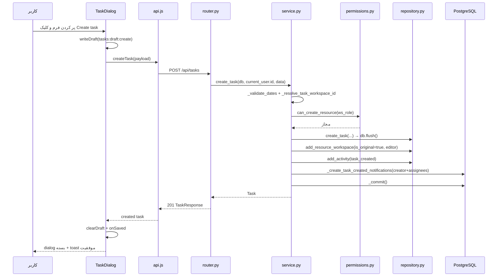

**توضیح نمودار:** مسیر ایجاد، تنها جریانی است که همزمان سه اثر جانبی دارد: انجمن اصلی workspace، تاریخچه activity و اعلان. تمام آنها قبل از یک `db.commit()` واحد قرار میگیرند تا از نیمهکامل شدن ایجاد task جلوگیری شود.

---

## جریان ۲: بارگذاری لیستTaskها

**۱. اقدام کاربر:** کاربر وارد صفحه Tasks میشود یا فیلتر `q` / `status` / `priority` / `due` را تغییر میدهد یا دکمه Load more را میزند.

**۲. کامپوننت فرانتاند:** `TasksPage` ← `useTaskFilters(query)` ← `useTasks({query, onUnauthorized})` ← `TaskBoardView` یا `TaskListView`.

**۳. تغییر State:** `loading=true`، سپس `items`, `total`, `statistics` تنظیم میشود؛ `loadMore` با `append=true` و `seen Set` از تکثیر id جلوگیری میکند.

**۴. درخواست API:** `listTasks(params)` → `GET /api/tasks?scope=...&q=...&status=...&sort=...&limit=20&offset=0`؛ در حالت kanban `effectiveQuery`، `sort=position&order=asc` را تحمیل میکند در حالی که وضعیت فیلتر `sort` در URL حفظ میشود.

**۵. روتر:** `router.list_tasks(scope, flt, ...)` → `service.list_tasks(...)`؛ خروجی شامل `attach_task_workspaces(db, current_user.id, items)` است.

**۶. اسکیما:** `TaskFilter` با اعتبارسنجی `status`, `priority`, `q` (حداکثر ۲۰۰)، `sort`, `order`, `limit` (۱–۱۰۰), `offset`؛ `TaskListResponse = {items, total, limit, offset}`.

**۷. منطق سرویس:** `workspace_id` vorhandدده است → `get_accessible_workspace`؛ سپس براساس `scope` یکی از `list_visible`, `list_created_by`, `list_assigned_to`, `list_assigned_by` انتخاب میشود.

**۸. بررسی مجوز:** `_visible_clause` دیدن workspace + legacy (شخصی/پروژه) را ترکیب میکند؛ فیلترها نمیتوانند doorway به داده کاربران دیگر باز کنند.

**۹. عملیات مخزن/DB:** `_apply_filters` → `_order_clause` → `count(subquery)` → `limit/offset` → `populate_checklist_counts` (یک کوئری GROUP BY اضافی، بدون N+1).

**۱۰. پاسخ:** `200` با آیتمهایی شامل `position`, `priority_position`, `checklist_total`, `checklist_completed`, `workspaces`.

**۱۱. بهروزرسانی فرانتاند:** `useTasks.load` نتایج را در `items` میریزد؛ `AbortController` و `requestRef` درخواستهای قدیمی را لغو میکنند.

**۱۲. آنچه کاربر میبیند:** کانبان ستونبندی شده (یا لیست) با شمارندهها، نوار آمار بالای صفحه و دکمه Load more در صورت existence `hasMore`.

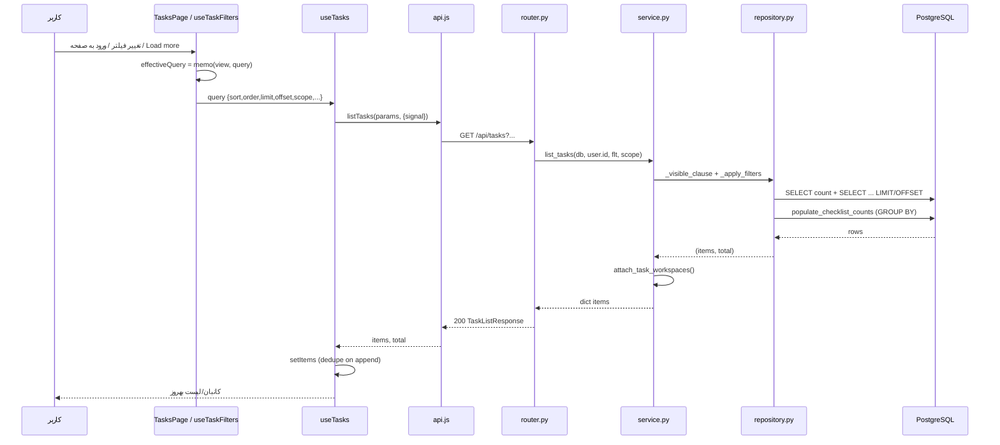

**توضیح نمودار:** نکتهی کلیدی، جداسازی «وضعیت فیلتر ذخیرهشده در URL» از «پارامتر مؤثر ارسالی به بکاند» است: `effectiveQuery` فقط در حالت kanban مرتبسازی را جایگزین میکند و باعث فلکر یا چرخه بهروزرسانی نمیشود.

---

## جریان ۳: بازکردن جزئیات از طریق `?task=<id>`

**۱. اقدام کاربر:** کاربر روی کارت کلیک میکند (یا لینک عمیق با `?task=123` را باز میکند).

**۲. کامپوننت فرانتاند:** `TaskCard.onOpen(id)` → `TasksPage.setSelectedTaskId(id)` → `searchParams.set('task', id)`.

**۳. تغییر State:** `selectedTaskId` از URL مشتق میشود (منبع حقیقت URL است، نه state محلی)؛ `TaskDetailPanel` با `taskId` و `contextWorkspaceId` رندر میشود.

**۴. درخواست API:** `useTaskDetails.load` چهار درخواست موازی میفرستد: `getTask(id)`, `listComments(id)`, `listActivities(id)`, `listLabels()`؛ بعلاوه `listTaskWorkspaces(id, {context_workspace_id})` توسط پنل.

**۵. روتر:** `router.get_task` → `service.get_task` → `_visible_task` → `serialize_task`؛ مسیر workspaces → `service.list_task_workspaces`.

**۶. اسکیما:** `TaskResponse` شامل `workspaces`, `assignments`, `labels`, `checklist_total`, `checklist_completed`؛ `TaskWorkspaceOut` شامل `workspace_id`, `workspace_name`, `is_original`, `permission_level`.

**۷. منطق سرویس:** `_visible_task` بارگذاری میکند و `_access_role` تعیین مینماید؛ در `list_task_workspaces` فقط workspaceهایی که کاربر `can_view` دارد فهرست میشوند و مرتبسازی (`is_original`، سپس نام، سپس id) اعمال میگردد.

**۸. بررسی مجوز:** منبع نامرئی → `404`؛ پنل با `isOwner`, `canEditSharedTask`, `canShare`, `canManage`, `canChangeStatus`, `canComment` تصمیم UI میگیرد (backend nevertheless مجوزها را دوباره بررسی میکند).

**۹. عملیات مخزن/DB:** `repository.get_task(eager=True)` با `selectinload(assignments)` و `selectinload(label_assignments.label)`؛ `populate_checklist_counts`؛ خواندن ردیفهای `TaskWorkspace` و `WorkspaceMember`.

**۱۰. پاسخ:** `200` و پنل Sheet سمت راست با جزئیات، چکلیست، نظرات، تاریخچه و دکمه Share.

**۱۱. بهروزرسانی فرانتاند:** بستن پنل فقط پارامتر `task` را حذف میکند (`next.delete('task')`) و سایر پارامترها (`view`, `q`, فیلترها، `dialog`) دستنخورده میمانند.

**۱۲. آنچه کاربر میبیند:** پنل جزئیات باز میشود و آدرس URL قابل share/refresh باقی میماند.

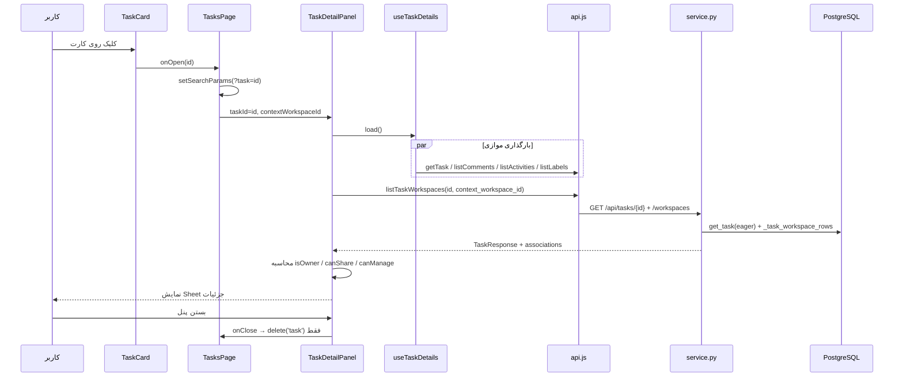

**توضیح نمودار:** URL تنها منبع حقیقت `selectedTaskId` است؛ بههمین دلیل refresh و deep link رفتار یکسانی دارند و بستن پنل، فیلترها را از دست نمیدهد.

---

## جریان ۴: بهروزرسانیTask (PATCH)

**۱. اقدام کاربر:** کاربر دکمه Edit را در پنل میزند، فیلدهای Title / Description / Priority / Dates / Labels را تغییر داده و Save changes مینماید.

**۲. کامپوننت فرانتاند:** `TaskDetailPanel.onEdit(task)` → `TasksPage.openEdit(task)` → `?dialog=edit&taskId=<id>`؛ `TaskDialog`Task را با `getTask(dialogTaskId)` بارگذاری میکند.

**۳. تغییر State:** تنها فیلدهای تغییریافته در `patch` قرار میگیرند؛ دیفرانس لیبلها محاسبه میشود؛ `saving=true`.

**۴. درخواست API:** `updateTask(id, patch)` → `PATCH /api/tasks/{id}`؛ در صورت تغییر status جداگانه `PUT /{id}/status` also فراخوانی میشود (.status عمداً از PATCH حذف شده است).

**۵. روتر:** `router.update_task` → `service.update_task(..., workspace_id=...)`.

**۶. اسکیما:** `TaskUpdate` با `extra="forbid"`، بدنه خالی ممنوع، `title` نه null، اعتبارسنجی مجدد تاریخها.

**۷. منطق سرویس:** `_owned_task` (نیاز به `can_edit`)؛ بهطور جداگانه `project_id` با `require_project_manage`؛ بررسی `due_date >= start_date`؛ ثبت activity هر فیلد از طریق `_FIELD_ACTIONS` (`priority_changed`, `due_date_changed`, `task_updated`)؛ هنگام تغییر priority، append به انتهای ستون مقصد با `priority_position` جدید؛ `ws_activity.record` متناسب با نوع فیلد؛ `_commit`.

**۸. بررسی مجوز:** `can_edit(role)` = owner یا editor؛ shared editor تنها در صورتی editor محسوب میشود که `permission_level == 'editor'` **و** نقش workspace اجازه `can_manage_content` را بدهد.

**۹. عملیات مخزن/DB:** `repository.update_task(db, task, **updates)` (setattr بدون commit)، `add_activity`، سپس commit و `refresh` + `populate_checklist_counts`.

**۱۰. پاسخ:** `200 TaskResponse` با فیلدهای بهروزشده و activity مربوطه.

**۱۱. بهروزرسانی فرانتاند:** `handleSaved` → `reload()` و `detailsRefreshKey++`؛ دیفرانس لیبلها با `attachLabel` / `detachLabel` (هرکدام owner-only) اعمال میشود.

**۱۲. آنچه کاربر میبیند:** toast «Task updated successfully» و مقادیر جدید در کارت و پنل.

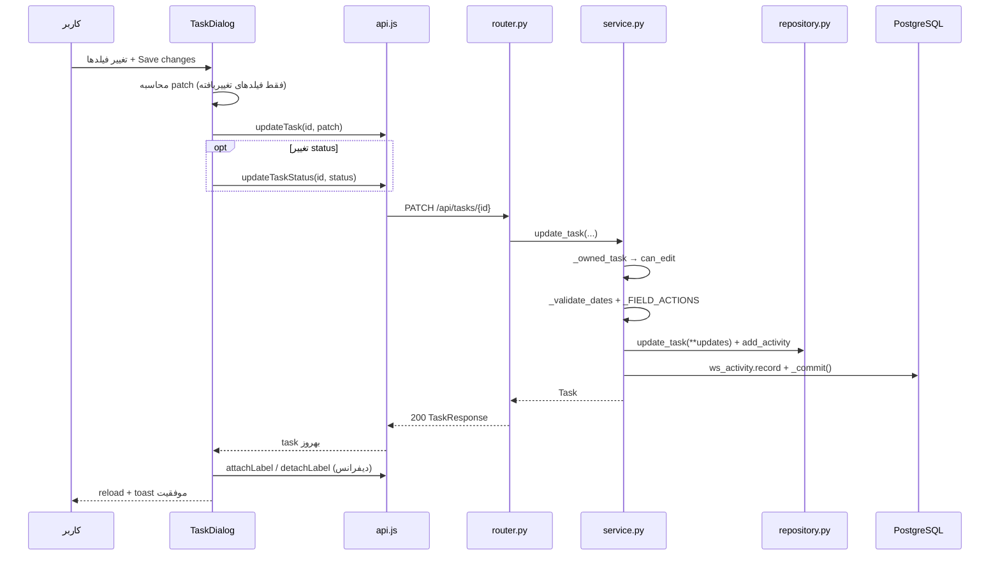

**توضیح نمودار:** Status آگاهانه خارج از PATCH نگه داشته شده است تا `completed_at` تنها در یک مکان (`set_task_status` / `set_task_position`) مدیریت شود.

---

## جریان ۵: جابجاییTask بین ستونهای کانبان

**۱. اقدام کاربر:** کاربر کارتی را با ماوس/انگشت به ستون دیگری میکشاند و رها میکند.

**۲. کامپوننت فرانتاند:** `TaskBoardView.startDrag` ← `handlePointerMove` ← `finishDrag` ← `onMoveTask(task, payload)`؛ `payload = {target_status, before_task_id, after_task_id}`.

**۳. تغییر State:** `drag` محلی، `cardRectsRef` و `suppressClickRef`؛ `useTaskMutations.moveTask` کلید انحصاری `move:${task.id}` و `pendingStatusIds` را تنظیم میکند؛ optimistic update با rollback.

**۴. درخواست API:** `updateTaskPosition(taskId, payload)` → `PATCH /api/tasks/{id}/position`.

**۵. روتر:** `router.set_task_position` پارامترها را به `service.set_task_position(target_status=..., before_task_id=..., after_task_id=...)` sản میدهد.

**۶. اسکیما:** `TaskPositionUpdate` دقیقاً یکی از `target_status` / `target_priority` را میپذیرد؛ همسایهها باید متفاوت باشند.

**۷. منطق سرویس:** حالت status: بررسی `can_change_status`، اعتبار transition طبق `ALLOWED_STATUS_TRANSITIONS`، قفلدANI ستون مبدأ و مقصد، محاسبه position با `_compute_target_position`، بهروز `completed_at` هنگام ورود/خروج از `done`، ثبت activity `status_changed` و `task_updated`.

**۸. بررسی مجوز:** owner، editor یا active assignee مجاز به تغییر statusاند (`can_change_status`)؛ جابجایی صرفاً position در همان status نیاز به مجوز status change دارد.

**۹. عملیات مخزن/DB:** `list_status_task_ids_for_update`، `_compute_target_position` (با قالب `_normalize_status_positions` در صورت نزدیکی فاصلهها)، `Task.__table__.update()`، activityها و commit.

**۱۰. پاسخ:** `200 TaskResponse` با `status`, `position`, `completed_at` نهایی.

**۱۱. بهروزرسانی فرانتاند:** `replaceItem` با نتیجه سرور جایگزین میشود تا از reload کامل و فلکر کانبان جلوگیری شود؛ در صورت خطا rollback و `reload()`.

**۱۲. آنچه کاربر میبیند:** کارت بلافاصله در ستون مقصد ظاهر میشود و ضربه/کلیک اضافی بعد از drag توسط `suppressClickRef` سرکوب میشود.

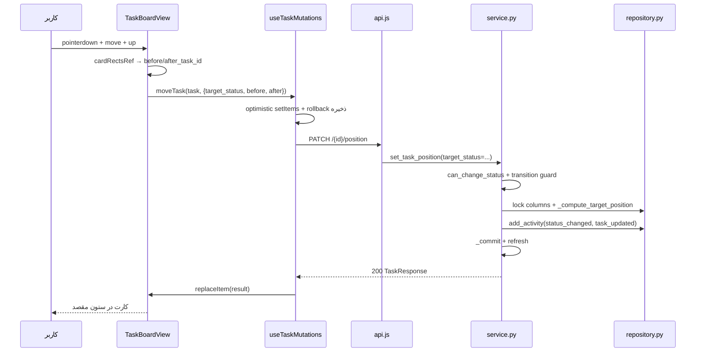

**توضیح نمودار:**position نهایی را بکاند محاسبه میکند؛ فرانتاند فقط همسایگان را ارسال میکند تا race و تضاد فاصلهها در سمت سرور حل شود.

---

## جریان ۶: مرتبسازی مجدد داخل یک ستون (Reorder)

**۱. اقدام کاربر:** کارت را در همان ستون بالا/پایین جابجا میکند.

**۲. کامپوننت فرانتاند:** همان مسیر جریان ۵، منتها `target_status` برابر status فعلی و تنها `before_task_id` / `after_task_id` تغییر میکند. حالت مشابه برای چکلیست: `TaskChecklistSection.commitReorder` با `{item_ids}`.

**۳. تغییر State:** لیست محلی بهترتیب new جایگزین میشود؛ `announce` برای screen reader بهروز میشود.

**۴. درخواست API:** `PATCH /api/tasks/{id}/position` (برای تسک) یا `PATCH /api/tasks/{id}/checklist/reorder` (برای آیتمها).

**۵. روتر:** `set_task_position` / `reorder_checklist_items`.

**۶. اسکیما:** `TaskPositionUpdate`؛ `TaskChecklistReorder.item_ids` باید مثبت، یکتا و غیرخالی باشد.

**۷. منطق سرویس:** `_compute_target_position` یا `_compute_target_priority_position`؛ همسایها باید در همان ستون باشند؛ موقعیت self بهعنوان neighbor رد میشود؛ فاصلهها نرمال میشوند.

**۸. بررسی مجوز:** حالت priority → `can_edit`؛ حالت status → `can_change_status`.

**۹. عملیات مخزن/DB:** خواندن neighbors، احتمالاً `_normalize_*_positions`، update position/priority_position، و activity `task_updated`، commit.

**۱۰. پاسخ:** `200 TaskResponse` یا `TaskChecklistListResponse`.

**۱۱. بهروزرسانی فرانتاند:** results سرور جایگزین state محلی میشود؛ Frontend position را محاسبه نمیکند (فقط optimistic پیشنمایش).

**۱۲. آنچه کاربر میبیند:** ترتیبجدید بدون فلکر و بدون بارگذاری مجدد صفحه.

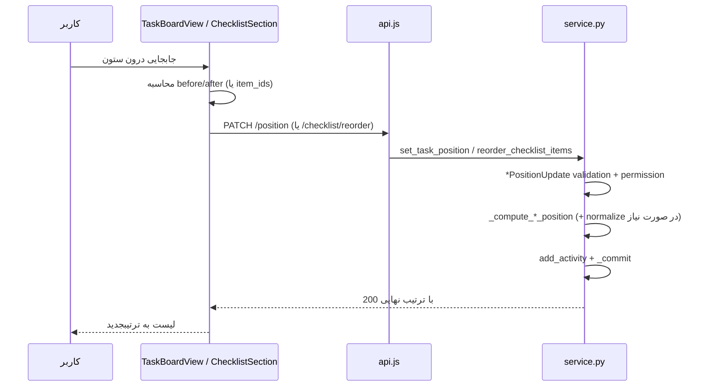

**توضیح نمودار:** الگوریتم midpoint و فاصله ۱۰۰۰ متوالی باعث میشود درجهای مکرر بدون برخورد position انجام میشود و تنها در موارد نادر نرمالسازی کامل ستون لازم است.

---

## جریان ۷: اختصاص کاربر بهTask

**۱. اقدام کاربر:** (سطح API) مالکTask، کاربری را با `assigned_user_id` مشخص میکند. نکته: رابط فعلی فاقد user-directory/lookup است، بنابراین `TaskDialog` و `TaskDetailPanel` عمداً فقط **حذف** تخصیص موجود را نمایش میدهند و کاربر جدیدی را ساختگی معرفی نمیکنند.

**۲. کامپوننت فرانتاند:** `useTaskDetails.removeAssignee` → `removeAssignment` (حذف)؛ مسیر اضافهکردن توسط `api.js.addAssignment` / `replaceAssignment` پشتیبانی میشود ولی در UI فعلی صریحاً «not available» اعلام شده است.

**۳. تغییر State:** `assignmentsBusy=true`؛ بعد از موفقیت `refreshTaskOnly()`.

**۴. درخواست API:** `POST /api/tasks/{id}/assignments` با `{assigned_user_id}` (یا `PUT /{id}/assignee` برای جایگزینی، `DELETE /{id}/assignments/{user_id}` для حذف).

**۵. روتر:** `router.assign_user` → `service.assign_user`.

**۶. اسکیما:** `TaskAssignmentCreate` با `extra="forbid"` و `assigned_user_id: int`.

**۷. منطق سرویس:** `_admin_task` (Owner-only)؛ `_assignment_target_exists`؛ تخصیص active existing → no-op، تخصیص cancelled → reactivation در همان ردیف (تاریخچه حفظ میشود)؛ در غیراینصورت ردیفجدید؛ activity `assignee_added`؛ در صورت پروژهای بودن، `project_activity.TASK_REASSIGNED` با لیست previous/new assigneeها؛ commit.

**۸. بررسی مجوز:** `can_share(role)` یعنی تنها owner canonical مجوز تغییر ساختار و تخصیصها را دارد.

**۹. عملیات مخزن/DB:** `repository.get_assignment` / `create_assignment`، شاخص منحصربهفرد pair، `add_activity`، commit.

**۱۰. پاسخ:** `200 TaskResponse` با `assignments` بهروز (حذف: `204`).

**۱۱. بهروزرسانی فرانتاند:** لیست Badgeهای assignee در پنل بهروز میشود؛ حذف دکمه Remove بلافاصله نتیجه را نشان میدهد.

**۱۲. آنچه کاربر میبیند:** در پنل، نام/شناسه کاربر و وضعیت `active` نمایش داده میشود؛ دکمه Remove فقط برای مالک/مدیر قابلاستفاده است.

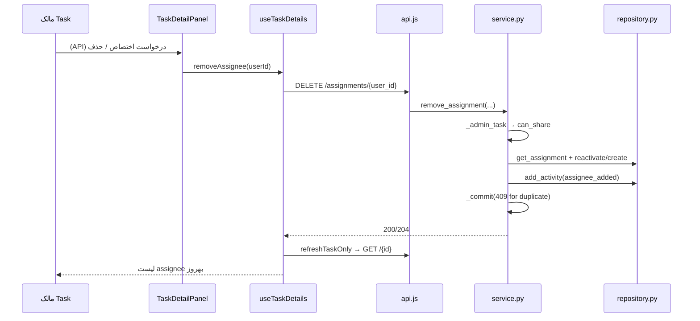

**توضیح نمودار:** تضاد تکرار در این مسیر `409` است (برخلاف بهروزرسانی سطح اشتراک که `400` است)، چون با سنت سایر عملیات attach/idempotent هماهنگ شده است.

---

## جریان ۸: اضافهکردن آیتم چکلیست

**۱. اقدام کاربر:** کاربر در پنل جزئیات یا در.dialog ایجاد، متنی را در «Add a checklist item…» وارد میکند و Add را میزند.

**۲. کامپوننت فرانتاند:** `TaskChecklistSection.handleAdd`؛ در حالت draft (`draftMode=true`) آیتم با `makeDraftId()` محلی ایجاد میشود و تا زمان ایجاد Task در `TaskDialog.draftChecklist` نگهداری میشود.

**۳. تغییر State:** `addBusy`، سپس آیتمجدید به `items` اضافه و `notifyChanged()` فراخوانی میشود.

**۴. درخواست API:** `createChecklistItem(taskId, {title})` → `POST /api/tasks/{id}/checklist`.

**۵. روتر:** `router.create_checklist_item` → `service.create_checklist_item`.

**۶. اسکیما:** `TaskChecklistItemCreate`：`title` الزامی ۱–۲۰۰ کاراکتر، trim میشود.

**۷. منطق سرویس:** `_owned_task` → `can_edit`؛ trim و محدودیت طول؛ `get_max_checklist_position` + ۱۰۰۰؛ `create_checklist_item`؛ activity `task_updated` با metadata `checklist_item_added`؛ commit.

**۸. بررسی مجوز:** owner یا shared editor؛ viewer با وجود دیدن چکلیست، اجازه نوشتن ندارد (`403`).

**۹. عملیات مخزن/DB:** جدول رابطهای `task_checklist_items` (مهاجرت `020_task_checklist_items`، NOT JSON) با FK `task_id ON DELETE CASCADE` و ایندکس `(task_id, position, id)`.

**۱۰. پاسخ:** `201 TaskChecklistItemOut` (`id`, `task_id`, `title`, `is_completed`, `position`, timestamps).

**۱۱. بهروزرسانی فرانتاند:** آیتم به لیست اضافه، نوار پیشرفت `checklist_total` بهروز و `onChanged` باعث reload جزئیات میشود.

**۱۲. آنچه کاربر میبیند:** آیتمجدید در انتهای چکلیست و درصد پیشرفت تغییر میکند.

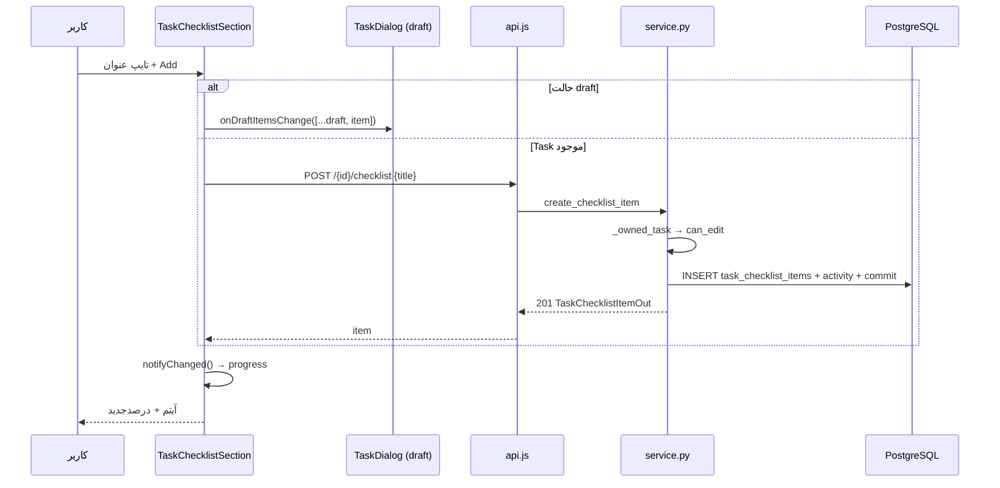

**توضیح نمودار:** چکلیست در حالت draft به API نیاز ندارد؛ پس از ایجاد Task، `TaskDialog.handleSubmit` آیتمهای draft را یکبهیک ارسال میکند و با علامت `createdId` از تکثیر هنگام retry جلوگیری مینماید.

---

## جریان ۹: تکمیل آیتم چکلیست

**۱. اقدام کاربر:** کاربر چکباکس کنار آیتم را میزند.

**۲. کامپوننت فرانتاند:** `TaskChecklistSection.handleToggle(item, checked)`.

**۳. تغییر State:** optimistic `is_completed` در `items`؛ `busyIds[item.id]`؛ ذخیره `prev` برای rollback.

**۴. درخواست API:** `updateChecklistItem(taskId, itemId, {is_completed: true})` → `PATCH /api/tasks/{id}/checklist/{item_id}`.

**۵. روتر:** `router.update_checklist_item` → `service.update_checklist_item`.

**۶. اسکیما:** `TaskChecklistItemUpdate`، حداقل یکی از `title` / `is_completed`؛ `extra="forbid"`.

**۷. منطق سرویس:** `_owned_task`، بررسی وجود آیتم (`404`)، اعمال تغییر، activity `task_updated`، commit، و بهروز شمارشهای task.

**۸. بررسی مجوز:** `can_edit` (owner/editor).

**۹. عملیات مخزن/DB:** UPDATE ردیف `task_checklist_items`، `updated_at`، سپس commit.

**۱۰. پاسخ:** `200 TaskChecklistItemOut` با `is_completed=true`.

**۱۱. بهروزرسانی فرانتاند:** نتیجه سرور جایگزین آیتم محلی میشود؛ در خطا به `prev` برگشت داده میشود و toast خطا ظاهر میشود.

**۱۲. آنچه کاربر میبیند:** خط زده شدن عنوان و پیشرفت `completed/total` بلافاصله بهروز میشود (همچنین `checklist_completed` در TaskResponse).

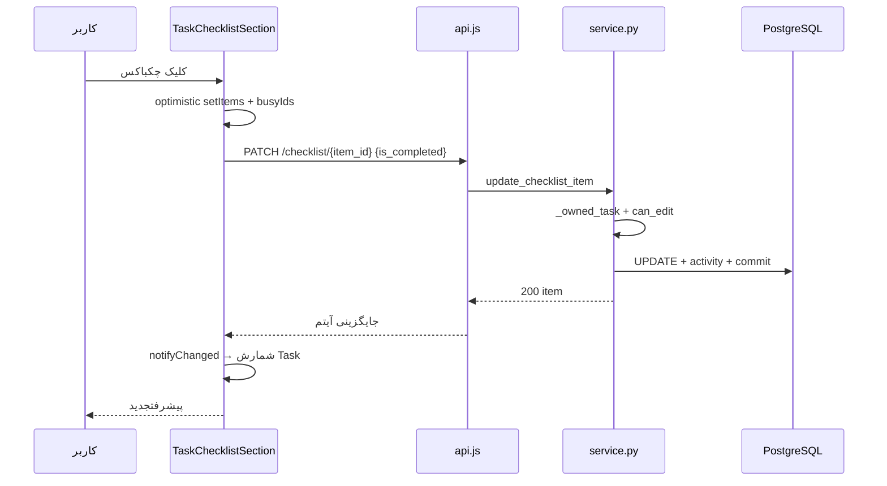

**توضیح نمودار:** optimisim همراه rollback است تا در صورت `403` یا خطای شبکه، وضعیت دروغین تکمیل باقی نماند.

---

## جریان ۱۰: اضافهکردن نظر (Comment)

**۱. اقدام کاربر:** کاربر متن نظر را در `TaskCommentsSection` وارد و ارسال میکند.

**۲. کامپوننت فرانتاند:** `TaskCommentsSection` ← `useTaskDetails.addComment(content)`.

**۳. تغییر State:** `commentsBusy=true`، سپس نظرجدید به انتهای `comments` اضافه میشود.

**۴. درخواست API:** `createComment(taskId, content)` → `POST /api/tasks/{id}/comments`.

**۵. روتر:** `router.add_comment` → `service.add_comment(db, actor_id, task_id, content, workspace_id)`.

**۶. اسکیما:** `TaskCommentCreate` شامل `content` الزامی.

**۷. منطق سرویس:** `_visible_task` + `can_comment`؛ `repository.create_comment`؛ activity `comment_added` با `comment_id`؛ commit.

**۸. بررسی مجوز:** owner، editor یا active assignee؛ viewer نمیتواند نظر بدهد (`403`).

**۹. عملیات مخزن/DB:** INSERT در جدول comments، INSERT `TaskActivity`، commit.

**۱۰. پاسخ:** `201 TaskCommentOut`.

**۱۱. بهروزرسانی فرانتاند:** نظر در لیست ظاهر میشود و `onChanged` گزارش خطا را پاک میکند.

**۱۲. آنچه کاربر میبیند:** نظر بلافاصله در پنل نمایش داده میشود.

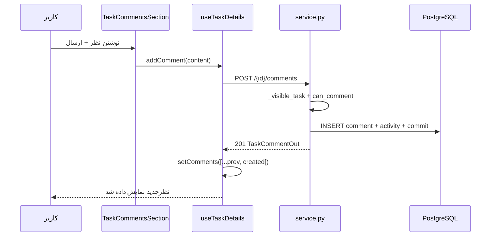

**توضیح نمودار:** نظرات oldest-first خوانده میشوند (`GET /comments`) و حذف تنها توسط نویسنده مجاز است (`comment.user_id == actor_id`).

---

## جریان ۱۱: ایجاد Notification خودکارtask

**۱. اقدام کاربر:** همان کلیک Createtask در جریان ۱؛ هیچ action جداganهای در UI وجود ندارد.

**۲. کامپوننت فرانتاند:** `TaskDialog` تنها نتیجه ایجاد task را دریافت میکند؛ اعلان در سمت سرور ایجاد میشود.

**۳. تغییر State:** تغییری در state فرانتاند ماژول Tasks نیست؛ اعلانها توسط ماژول notifications خوانده میشوند.

**۴. درخواست API:** بخشی از همان `POST /api/tasks` است، نه endpoint جداگانه.

**۵. روتر:** `service.create_task` بهطور داخلی `_create_task_created_notifications` را فراخوانی میکند.

**۶. اسکیما:** ردیف `Notification` با `type="task_created"`, `title="New task created"`, `message='Task "<title>" was created.'`, `task_id`.

**۷. منطق سرویس:** recipientها = `{actor_id}` ∪ `{active assignee_ids}`، **deduped توسط user id**؛ هر ردیف در همان تراکنش ایجادtask اضافه میشود.

**۸. بررسی مجوز:** گیرندگان فقط سازنده و تخصیصیافتههای activeاند؛ هیچ کاربر دیگری اعلان ایجادtask را دریافت نمیکند.

**۹. عملیات مخزن/DB:** INSERT چندگانه در جدول `notifications` قبل از `db.commit()`.

**۱۰. پاسخ:** همان `201 TaskResponse` جریان ۱ (اعلانها در پاسخtask برگردانده نمیشوند).

**۱۱. بهروزرسانی فرانتاند:** نیازی به بهروزرسانی اختصاصی ندارد.

**۱۲. آنچه کاربر میبیند:** اعلان در مرکز اعلانها ظاهر میشود؛ در صورتیکه سازنده و assignee یک نفر باشد، تنها یک ردیف ایجاد میشود.

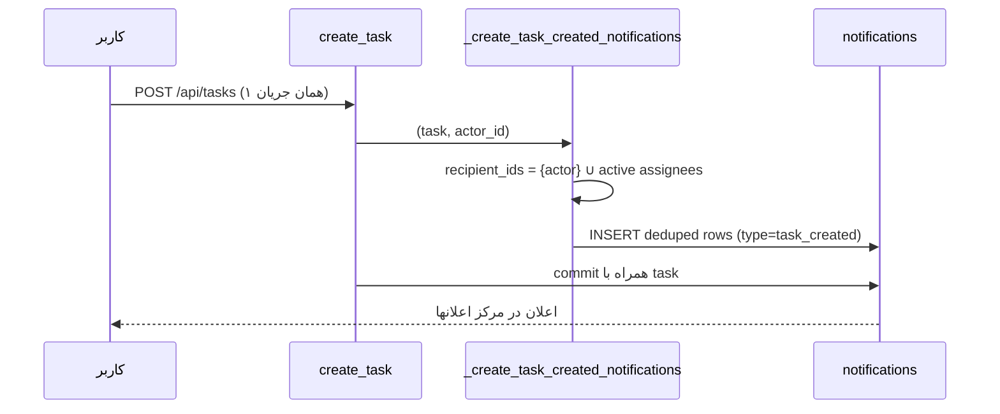

**توضیح نمودار:** deduplication از ارسال دو اعلان به همان کاربر زمانی که هم مالک و هم assignee است جلوگیری میکند؛ این رفتار در کد صریحاً با `set[int]` پیاده شده است.

---

## جریان ۱۲: اشتراکTask با workspace دیگر

**۱. اقدام کاربر:** مالکTask دکمه Share در پنل را میزند، workspace مقصد و سطح `viewer` / `editor` را انتخاب کرده و Share مینماید.

**۲. کامپوننت فرانتاند:** `TaskShareDialog.handleShare`؛ لیست workspaceها توسط `ActiveWorkspaceContext` تأمین و فیلتر میشود (`MANAGE_WORKSPACE_ROLES`)؛ workspaceهایی که از قبل متصلاند حذف میشوند (`associatedIds`).

**۳. تغییر State:** `busy=true`؛ بعد از موفقیت `refresh()` → `reloadKey++` و `onChanged()` → `shareVersion++`.

**۴. درخواست API:** `shareTaskWithWorkspace(taskId, workspaceId, permissionLevel, contextParams)` → `POST /api/tasks/{id}/workspaces/{workspace_id}?permission_level=viewer&context_workspace_id=...`.

**۵. روتر:** `router.attach_task_to_workspace` → `service.attach_task_to_workspace(..., workspace_context_id=...)`.

**۶. اسکیما:** `permission_level` باید `viewer` یا `editor` باشد؛ خروجی شامل `attached` (bool).

**۷. منطق سرویس:** `_admin_task`؛ validation سطح؛ `get_accessible_workspace` + `can_manage_content`؛ در صورت وجود انجمن، پاسخ idempotent با `attached=false` (بدون ردیفجدید)؛ در غیراینصورت `add_resource_workspace(is_original=false, shared_by_user_id=actor_id)` + workspace activity `TASK_ATTACHED` + `_commit(conflict_status=409)`.

**۸. بررسی مجوز:** تنها مالک canonical Task اجازه اشتراک دارد (`can_share`) و عضو workspace مقصد باید مجوز مدیریت محتوا داشته باشد.

**۹. عملیات مخزن/DB:** INSERT در `task_workspaces` (کلید مرکب `(task_id, workspace_id)`)، INSERT `WorkspaceActivity`، commit.

**۱۰. پاسخ:** `201` با `{workspace_id, workspace_name, workspace_type, is_original:false, permission_level, shared_by_user_id, attached:true}`؛ تکرار همان `201` با `attached:false`.

**۱۱. بهروزرسانی فرانتاند:** لیست انجمنها دوباره خوانده میشود؛ toast «Task shared» یا «Already shared»؛ `TaskDetailPanel.associations` نیاز به تکمیل مجوز editor محلی را بهروز میکند.

**۱۲. آنچه کاربر میبیند:** ردیف workspaceجدید با Badge «Shared» و سطح دسترسی در لیست ظاهر میشود.

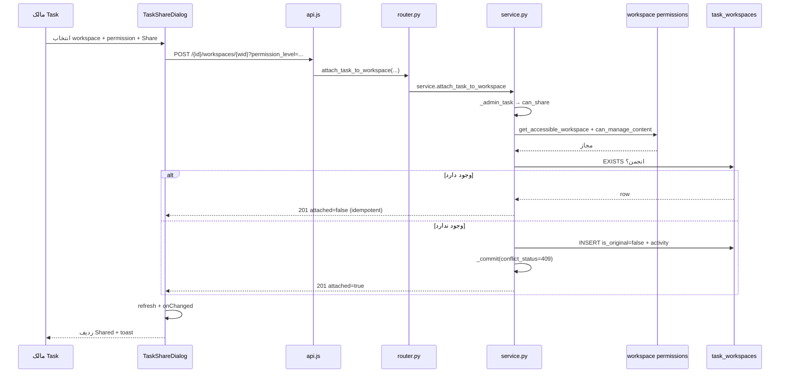

**توضیح نمودار:** `409`eting مخصوص race/duplicate است: اگر دو درخواست همزمان به همان workspace برسند، دومی `409` میگیرد، در حالی که تکرار عمدی و عادی (`existing is not None`) بهصورت `201 attached=false` برگردانده میشود.

---

## جریان ۱۳: تغییر سطح دسترسی workspace مشترک

**۱. اقدام کاربر:** مالکTask در ردیف مربوطه Select سطح دسترسی را از Viewer به Editor (یا برعکس) تغییر میدهد.

**۲. کامپوننت فرانتاند:** `TaskShareDialog.handlePermissionChange(association, nextPermission)`؛ ردیف original فاقد Select است (`association.is_original` محافظت میشود).

**۳. تغییر State:** `busy=true`، سپس `refresh()` و `onChanged()`.

**۴. درخواست API:** `PATCH /api/tasks/{id}/workspaces/{workspace_id}?permission_level=editor&context_workspace_id=...`.

**۵. روتر:** `router.update_task_workspace_permission` → `service.update_task_workspace_permission`.

**۶. اسکیما:** `permission_level ∈ {viewer, editor}` در غیراینصورت `400`.

**۷. منطق سرویس:** `_admin_task`؛ پیدا کردن ردیف (`404` اگر نباشد)؛ محافظت از ردیف original (`400`)؛ `existing.permission_level = permission_level`؛ workspace activity `TASK_UPDATED` با metadata.permission_level؛ `_commit(conflict_status=400)`.

**۸. بررسی مجوز:** تنها مالک canonical Task (`can_share`)؛ انجمن original بهعنوان Constant محافظت میشود.

**۹. عملیات مخزن/DB:** UPDATE `task_workspaces.permission_level`، INSERT activity، commit.

**۱۰. پاسخ:** `200 TaskWorkspaceOut` با سطحجدید.

**۱۱. بهروزرسانی فرانتاند:** لیست انجمنها مجدداً خوانده میشود؛ toast «Permission updated»؛ محاسبه `canEditSharedTask` در پنل ممکن است تغییر کند.

**۱۲. آنچه کاربر میبیند:** Badge/Select سطحجدید و در صورت editor شدن، workspace memberها قادر به ویرایش محتوایtask میشوند.

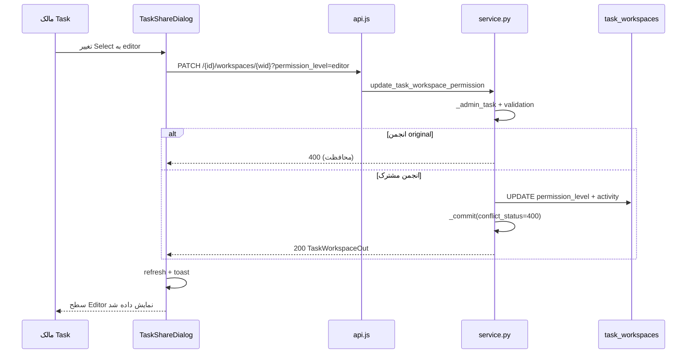

**توضیح نمودار:** دلیل `400` (not `409`) برای این عملیات، پیروی از قرارداد بهروزرسانی معمولی است: هیچ race/idempotencyای وجود ندارد و صرفاً یک فیلد بهروز میشود.

---

## جریان ۱۴: لغو اشتر workspace (Unshare)

**۱. اقدام کاربر:** مالکTask در ردیف workspace مشترک روی آیکون Trash2 میزند و در ConfirmDialog گزینه Unshare را تأیید میکند.

**۲. کامپوننت فرانتاند:** `TaskShareDialog.handleUnshare()`؛ `confirmTarget` نگهدارنده انجمن انتخابشده است.

**۳. تغییر State:** `busy=true`، `confirmTarget=null` پس از موفقیت، سپس `refresh()`.

**۴. درخواست API:** `unshareTaskWorkspace(taskId, workspaceId, contextParams)` → `DELETE /api/tasks/{id}/workspaces/{workspace_id}?context_workspace_id=...`.

**۵. روتر:** `router.detach_task_from_workspace` → `service.detach_task_from_workspace`.

**۶. اسکیما:** نیازی به body ندارد؛ `workspace_id` از مسیر میآید.

**۷. منطق سرویس:** `_admin_task`؛ انجمن پیدا نشد → `404`؛ انجمن original → `400` («The original workspace association cannot be removed»)؛ حذف انجمن + workspace activity `TASK_DETACHED` + `_commit(conflict_status=400)`.

**۸. بررسی مجوز:** تنها مالک canonical Task؛ ردیف original همیشه محافظت میشود وTask حذف نمیشود.

**۹. عملیات مخزن/DB:** DELETE از `task_workspaces` (تنها همان ردیف)، INSERT activity، commit؛ سایر انجمنها و خودTask دستنخورده میمانند.

**۱۰. پاسخ:** `204 No Content`.

**۱۱. بهروزرسانی فرانتاند:** لیست انجمنها دوباره خوانده میشود؛ toast «Workspace removed» با توضیح اینکهTask در workspace اصلی باقی میماند.

**۱۲. آنچه کاربر میبیند:** ردیف workspace از لیست Share ناپدید میشود؛ مالک workspace مقصد، task را در آن workspace نخواهد دید.

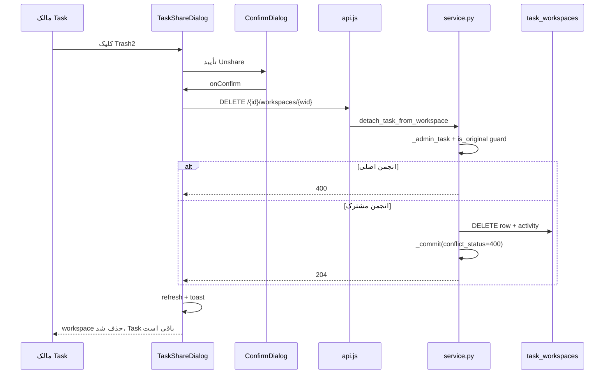

**توضیح نمودار:** برخلاف حذفTask (`DELETE /api/tasks/{id}`)، لغو اشتراک هیچ ردیفTask را حذف نمیکند؛ تنها پیوند workspace مشترک قطع میشود و انجمن original بهعنوان منبع حقیقت باقی میماند.

---

## نکات مشترک در تمام جریانها

1. **ورودیهای کاربری هرگز بهعنوان actor پذیرفته نمیشوند**؛ `actor_id` همیشه از `get_current_user` است.
2. **مجوزها دو بار بررسی میشوند**: یکبار در UI برای نمایش دکمهها و یک بار در سرویس (`_visible_task`, `_owned_task`, `_admin_task`).
3. **همهی mutationها atomicاند**: منطق تغییر + activity + اعلان/activityWorkspace در یک `db.commit()`.
4. **positionها توسط بکاند محاسبه میشوند**؛ فرانتاند تنها همسایگان را میفرستد و optimistic update را rollback میکند.
5. **URL منبع حقیقت است**: `?task=`, `?view=`, `?q=`, فیلترها و `?dialog=` و `taskId` همگی قابل refresh و shareاند.
6. **پاسخ لیست حتماً شامل فیلدهای اضافی `attach_task_workspaces` است**؛ حذف هرکدام باعث خطای اعتبارسنجی پاسخ (ResponseValidationError) میشود (ر.ک سند ۰۶).

**نکته مرتبط با خارج از ۱۴ جریان بالا (شکاف تأییدشده توسط بررسی کد):** مسیر `POST /api/tasks/{id}/subtasks` (`service.create_subtask`) جزو جریانهای مستندشده در بالا نیست، ولی همان الگوی ایجادtask را دنبال میکند. در کد فعلی، فراخوانی `_admin_task(db, actor_id, parent_task_id, ...)` نتیجه خود را به `parent` منتسب نمیکند، در حالی که بدنه تابع از `parent.id`, `parent.project_id` و `ws_repo.get_resource_workspace_ids(db, "task", parent.id)` استفاده میکند. بر همین اساس، این endpoint احتمالاً با `NameError` (و در ظاهر `HTTP 500`) مواجه میشود. **رفتار runtime تست نشده است (NOT TESTED)** و هیچ اصلاح سورسی توسط نگارنده انجام نشد. جزئیات کامل و پیشنهاد اصلاح در سند ۰۶، بخش «ج.۴» آمده است.
