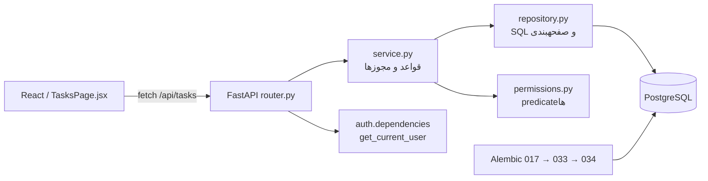
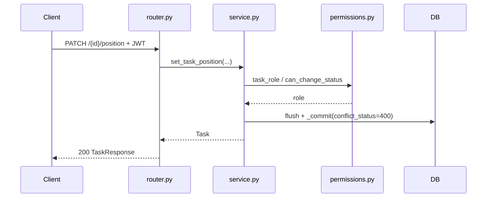
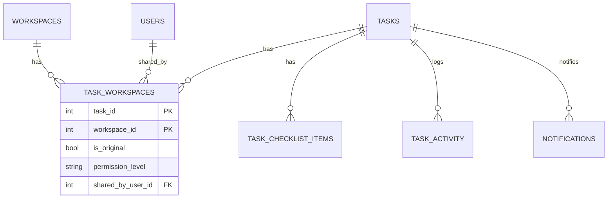
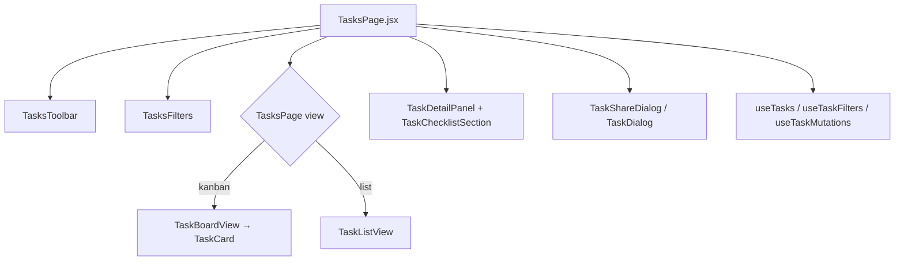
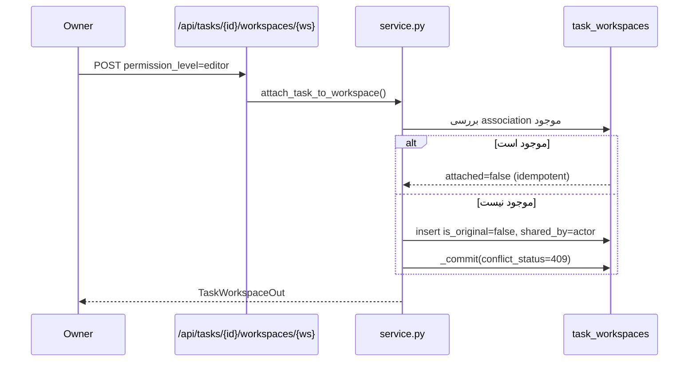
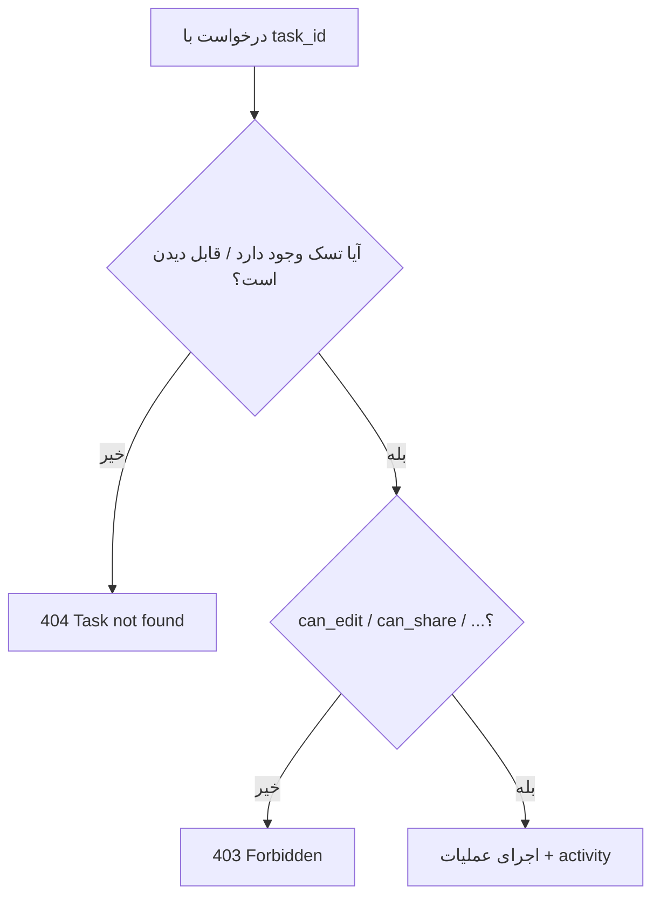
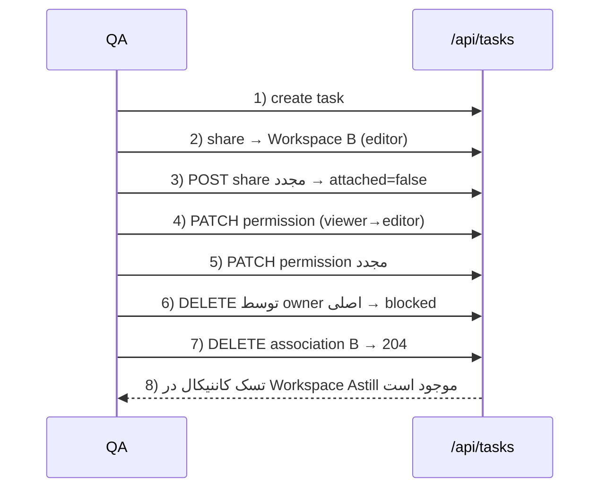
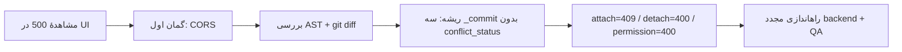

# راهنمای ارائهٔ فنی ماژول تسک‌های هلقهه

**مخاطب:** توسعهدهندگان بکاند و فرانتاند، تیم QA و بازبین کد  
**مدتهدف:** ۱۸ دقیقه ارائه + پرسش و پاسخ (در بازهٔ ۱۵–۲۰ دقیقه)  
**زبان:** فارسی، با نگهداری شناسههای انگلیسی (`task_workspaces`، `conflict_status`، `effectiveQuery` و ...) به شکل اصلیشان  
**نحوهٔ بیان:** محاورهای و فنی؛ هدف توضیح «چرا این تصمیم گرفته شد» است، نه خواندن اسلاید.

> نکتهٔ اجرایی: هر اسلاید شامل عنوان، نکات اصلی، پیشنهاد بصری، متن گفتاری، جزئیات فنی، سوالات احتمالی و پاسخ پیشنهادی است. زمانها طوری تنظیم شدهاند که مجموع دقیقاً **۱۸:۰۰** شود.

---

## جدول زمانبندی ارائه

| # | عنوان اسلاید | زمان | تجمعی |
|---|----------------|------|-------|
| 1 | معرفی و دستور کار | ۰:۴۵ | ۰:۴۵ |
| 2 | مسئلهای که حل میکردیم | ۱:۰۰ | ۱:۴۵ |
| 3 | تصویر کلی معماری | ۱:۱۵ | ۳:۰۰ |
| 4 | بکاند: Router نازک، Service تصمیمساز | ۱:۱۵ | ۴:۱۵ |
| 5 | مدل داده و مهاجرتهای Alembic | ۱:۱۵ | ۵:۳۰ |
| 6 | احراز هویت و مجوزها | ۱:۰۰ | ۶:۳۰ |
| 7 | فرانتاند: State در URL و هوکها | ۱:۱۵ | ۷:۴۵ |
| 8 | دو نما: Kanban و List | ۱:۱۵ | ۹:۰۰ |
| 9 | چکلیست، نظرات و تاریخچهٔ.activity | ۱:۰۰ | ۱۰:۰۰ |
| 10 | اشتراکگذاری میان Workspaceها | ۱:۳۰ | ۱۱:۳۰ |
| 11 | امنیت: 404 به جای 403 و جلوگیری از IDOR | ۱:۰۰ | ۱۲:۳۰ |
| 12 | سناریوی کامل End-to-End | ۱:۳۰ | ۱۴:۰۰ |
| 13 | داستان اشکال Phase 3.1 | ۱:۱۵ | ۱۵:۱۵ |
| 14 | چالشها و راهحلها | ۱:۰۰ | ۱۶:۱۵ |
| 15 | مهارتهای به کار رفته | ۰:۴۵ | ۱۷:۰۰ |
| 16 | جمع بندی و پرسش و پاسخ | ۱:۰۰ | ۱۸:۰۰ |

---

## اسلاید ۱ — معرفی و دستور کار (۰:۴۵)

**نکات اصلی**
- معرفی ماژول Tasks در هلقهه: از ساخت یک تسک ساده تا اشتراکگذاری آن بین Workspaceها.
- پشتوانهٔ فنی: FastAPI + PostgreSQL + Alembic در سمت سرور؛ React/Vite + Tailwind + shadcn/Radix + Lucide در سمت کاربر.
- قول ارائه: تمرکز بر تصمیمهای طراحی و نقاط تصمیمگیرانه، نه خواندن کد خط به خط.

**پیشنهاد بصری**
نوار زمانی سادهٔ ۱۸ دقیقهای با برچسبهای «معماری → بکاند → data → فرانتاند → سناریو → اشکال».

**متن گفتاری پیشنهادی**
> «صبح بخیر. امروز قرار است ماژول تسکها را از زاویهٔ فنی مرور کنیم. قرار نیست اسم تک تک endpointها را بخوانم؛ میخواهم نشان دم چرا ساختارش این شکلی شد، کجا تصمیمهای سخت گرفتیم، و یک باگ واقعی که هفتهٔ قبل پیش آمد چطور پیدا و حل شد. اگر در میانه سوالی پیش آمد، حتماً بپرسید—بخش زیادی از یادگیری همانجاست.»

**جزئیات فنی مهم**
- ورودی ارائه: `service/task/router.py`، `service/task/service.py`، `service/task/permissions.py`، `service/workspace/models.py` و `web/app/task/TasksPage.jsx`.
- مستندات تکمیلی: `11-TECHNICAL-GLOSSARY.md` و `12-FUTURE-IMPROVEMENTS.md` در همان پوشه.

**سوالات احتمالی**
- «در ارائه قرار است کد را هم نمایش دهیم؟»
- «پیشنیاز لازم است؟»

**پاسخ پیشنهادی**
- «فقط به جاهایی_reference میدهم که تصمیمی پشتش هست؛ لینک فایلها در اسلایدها هست.»
- «آشنایی با FastAPI و React کافی است؛ اصطلاحات در glossary توضیح داده شدهاند.»

---

## اسلاید ۲ — مسئلهای که حل میکردیم (۱:۰۰)

**نکات اصلی**
- تسکها پراکنده بودند: نه نمای Kanban مشخصی وجود داشت، نه ترتیب قابل پیشبینی.
- نیاز به «اشتراکگذاری» یک تسک با Workspace دیگری بدون کپی شدن و بدون از دست رفتن مالکیت.
- پیچیدگی واقعی: پلتفرم **تیم و نقش manager ندارد** (در Phase 1 بررسی شد)، پس مدل مجوزها باید ساده و صادق میماند.

**پیشنهاد بصری**
دو جعبه در کنار هم: «قبل» (تسکهای پراکنده، بدون ترتیب، دسترسی مبهم) → فلش → «بعد» (تسک واحد،-order مشخص، sharing با viewer/editor).

**متن گفتاری پیشنهادی**
> «اول ببینیم دقیقاً چه مشکلی را حل میخواستیم. سادهاش این است: یک تسک متعلق به یک Workspace است، ولی گاهی لازم است آن را در Workspace دیگری هم نشان دهیم—بدون اینکه کپی جدیدی بسازیم یا مالکیتش را از دست بدهیم. از طرفی نماهای Kanban و لیست باید ترتیب پایدار داشته باشند. و چون پلتفرم اساساً تیم و manager ندارد، نمیتوانستیم یک RBAC پیچیده اختراع کنیم. مجوزها را بر اساس رابطهٔ واقعی کاربر با تسک تعریف کردیم.»

**جزئیات فنی مهم**
- نقشها در `service/task/permissions.py`: `owner`، `editor`، `assignee`، `project_viewer`، `none`.
- تصمیم مهم: «غیرقابل دیدن» و «غیرقابل تغییر» دو چیز متفاوتاند؛ اولی 404 و دومی 403.

**سوالات احتمالی**
- «چرا نقش `editor` را اصلاً تعریف کردیم مگر پلتفرم تیم ندارد؟»
- «آیا Workspace همان تیم است؟»

**پاسخ پیشنهادی**
- `editor` از `permission_level` روی association Workspace میآید، نه از ساختمان تیم. یعنی مالک تسک تصمیم میگیرد کدام Workspace فقط ببیند و کدام بتواند ویرایش کند.
- «خیر. Workspace یک واحد organization است؛ عضویت آن در `workspace_members` با نقش `admin`/`editor`/`viewer` نگهداری میشود، و جدا از مجوز روی خود تسک است.»

---

## اسلاید ۳ — تصویر کلی معماری (۱:۱۵)

**نکات اصلی**
- چهار لایهٔ کلاسیک پروژه: Router → Service → Repository → Models/DB.
- احراز هویت یکپارچه از `get_current_user` و.session `get_db` تزریق میشود.
- مسیر API برخلاف سایر ماژولها با prefix `/api/tasks` آغاز میشود.

**پیشنهاد بصری — نمودار Mermaid**

**متن گفتاری پیشنهادی**
> «از بالا شروع کنیم. کاربر در صفحه درخواست میفرستد، FastAPI آن را میگیرد، آبراه از طریق dependency کاربر جاری را مشخص میکند و بقیهٔ کار را به service میسپارد. service تصمیم میگیرد که کاربر مجاز است یا خیر، activity مینویسد و در نهایت repository تنها مسئول اجرای SQL است. نکتهٔ جالب این است که committer در service است، نه repository—یک قاعدهٔ ثابت در کل پلتفرم.»

**جزئیات فنی مهم**
- `router = APIRouter(prefix="/api/tasks", tags=["tasks"])` در `service/task/router.py:59`.
- `service/main.py` نیازی به تغییر نداشت؛ router از قبل include شده بود.
- `_commit()` تنها جایی است که `db.commit()` انجام میدهد و `IntegrityError` را به HTTP تبدیل میکند.

**سوالات احتمالی**
- «چرا prefix متفاوت از `/auth` و `/calendars` است؟»
- «آیا repository هیچ commitی ندارد؟»

**پاسخ پیشنهادی**
- «طبق مشخصات مصوب API، ماژول تسکها از مسیر `/api/tasks` است. چون prefix داخل router تعریف شده، `main.py` دست نخورده ماند.»
- «بله. repository فقط flush و query میدهد؛ transaction و committing در service است تا activity و تغییر اصلی اتمیک بمانند.»

---

## اسلاید ۴ — بکاند: Router نازک، Service تصمیمساز (۱:۱۵)

**نکات اصلی**
- Router فقط dependencyها را حل میکند، پاسخ را به Pydantic میدهد و کد وضعیت را تعیین میکند.
- قواعد کسبوکار—transition وضعیت، جلوگیری از cycle، اعمال مجوز—همه در `service.py`.
- کدهای وضعیت ثابت: 201 برای create، 204 برای delete، 200 برای بقیه.

**پیشنهاد بصری — نمودار توالی**

**متن گفتاری پیشنهادی**
> «یک مثال بزنم: جابهجایی کارت در Kanban. کلاینت میگوید من این تسک را قبل از آن یکی بگذار. Router اصلاً حساب نمیکند کدام position نهایی میشود؛ فقط payload را validate میکند و میفرستد سمت service. service مجوز را چک میکند، همسایهها را پیدا میکند، position نهایی را خودش حساب میکند و در همان transaction یک رد activity هم مینویسد.»

**جزئیات فنی مهم**
- `set_task_position` در `service/task/service.py:1002` و endpoint متناظر در `router.py:361`.
- `TaskPositionUpdate` در `schemas.py:188` دقیقاً یکی از `target_status` یا `target_priority` را میپذیرد.
- `_commit(db, *, conflict_detail, conflict_status)` در `service.py:95`—همین امضاء بعداً سوژهٔ باگ Phase 3.1 شد.

**سوالات احتمالی**
- «وضعیت position را چرا بکاند حساب میکند و فرانتاند ارسال نمیکند؟»
- «اگر همزمان دو کاربر جابهجا کنند چه میشود؟»

**پاسخ پیشنهادی**
- «چون تنها بکاندIImage تصویر کامل لیست را دارد و باید integrity ترتیب را تضمین کند؛ فرانتاند فقط «قبل/بعد» را میفرستد.»
- «در حال حاضر `conflict_status=400` روی تضادها برگردانده میشود و لاک ردیفها در عملیات حساس مثل reorder چکلیست وجود دارد؛ در DOC 12 پیشنهاد تست بارگذاری و لاک کردن صریحتر ثبت شده است.»

---

## اسلاید ۵ — مدل داده و مهاجرتهای Alembic (۱:۱۵)

**نکات اصلی**
- جدول محوری `task_workspaces` رابطهٔ many-to-many بین Task و Workspace را نگه میدارد.
- علاوه بر Task، جدولهای assignments، comments، labels، activity، checklist و notifications هم داریم.
- زنجیرهٔ مهاجرت: trunk تا `017`، سپس دو head به نامهای `032` و `020_task_checklist`، ادغام با `033_merge_heads` و نهایتاً `034_task_workspace_sharing`.

**پیشنهاد بصری — نمودار ER ساده**

**متن گفتاری پیشنهادی**
> «مهاجرت 034 سه ستون به جدول association اضافه کرد: `is_original`، `permission_level` و `shared_by_user_id`. کاری که از بقیه مهاجرتهای ما متفاوت است، backfill محتاطانهاش است: در حالت backfill اگر نتواند workspace اصلی را با دلیل مشخص کند، مهاجرت متوقف میشود و ID تسکهای مشکلدار را چاپ میکند. ترجیح ما شکست صریح است تا حدس اشتباه.»

**جزئیات فنی مهم**
- `_resolve_original_workspace()` در `alembic/versions/034_task_workspace_sharing.py:39` سه منبع شواهد را به ترتیب چک میکند: `project.workspace_id`، فعالیت `task.created`، و تنها association موجود.
- index جزئی `uq_task_workspaces_original_task` تضمین میکند هر تسک دقیقاً یک association اصلی داشته باشد.
- `downgrade()` عمداً forward-only است (`pass`).

**سوالات احتمالی**
- «چرا دو head داشتیم؟»
- «اگر داده از قبل ناسازگار بود چی؟»

**پاسخ پیشنهادی**
- «دو شاخهٔ مستقل توسعه (workspace activity و checklist) هر کدام از `019` منشعب شده بودند؛ `033_merge_heads` آنها را با `down_revision = ("032", "020_task_checklist")` ادغام کرد.»
- «مهاجرت با `RuntimeError` متوقف میشود و لیست دقیق task_idها را میدهد؛ یعنی هیچ حدس وسیع و مخربی زده نمیشود.»

---

## اسلاید ۶ — احراز هویت و مجوزها (۱:۰۰)

**نکات اصلی**
- Authentication: JWT از طریق `get_current_user`؛ هر endpoint کاربر جاری را به service میدهد.
- Authorization: توابع خالص در `permissions.py` بدون DB و بدون HTTP.
- جدول سادهٔ مجوزها: owner همه کاره، editor محتوا ویرایش میکند، assignee وضعیت و نظر میدهد، none → 404.

**پیشنهاد بصری**
جدول ماتریسی: ردیفها `can_view`، `can_edit`، `can_change_status`، `can_assign`، `can_share`، `can_delete_task`؛ ستونها owner / editor / assignee / none.

**متن گفتاری پیشنهادی**
> «نکتهٔ طراحی که دوست دارم برجسته کنم: جدا کردن کامل تصمیم مجوز از اجرای آن. `task_role()` فقط میداند کی مالک است و کی assignee فعال است. بقیهٔ توابع مثل `can_share` یا `can_delete_task` predicate سادهاند. مالکیت حذف و اشتراکگذاری را همیشه نزد canonical owner نگه داشتیم، حتی وقتی تسک در Workspace دیگری به اشتراک گذاشته شده است.»

**جزئیات فنی مهم**
- `task_role()` در `permissions.py:37`— assignmentهای با `assignment_status == "active"` شمرده میشوند.
- `can_share()` و `can_delete_task()` تنها برای `ROLE_OWNER` trueاند (`permissions.py:84`، `:89`).
- سطوح permission_level Universität `viewer`/`editor` با نقش Workspace (`admin`/`editor`/`viewer`) متفاوتاند.

**سوالات احتمالی**
- «یک `editor` در Workspaceshared شده میتواند تسک را حذف کند؟»
- «منظور از canonical owner چیست؟»

**پاسخ پیشنهادی**
- «خیر. `can_delete_task` فقط owner را میپذیرد؛ حتی کاربری که در Workspace مقصد `admin` است نمیتواند تسک مالک دیگری را حذف کند.»
- «همان `created_by` تسک در Workspace اصلی. هویت مالک با Share کردن عوض نمیشود.»

---

## اسلاید ۷ — فرانتاند: State در URL و هوکها (۱:۱۵)

**نکات اصلی**
- `TasksPage.jsx` ریشهٔ صفحه است: view، فیلترها، صفحهبندی و dialogها در URL زندگی میکنند.
- سه هوک اصلی: `useTasks` (داده و reload)، `useTaskFilters` (فیلتر/page)، `useTaskMutations` (تغییر با rollback خوشبینانه).
- Workspace جاری از `ActiveWorkspaceContext` میآید و وقتی عوض شود، صفحهبندی ریست میشود.

**پیشنهاد بصری — درخت کامپوننت**

**متن گفتاری پیشنهادی**
> «ما سعی کردیم URL را منبع حقیقت نماها تصمیم بگیریم. وقتی کاربر لینک `/tasks?view=list&task=42` را باز میکند، صفحه دقیقاً همان حالت را بازسازی میکند. دو هوک `effectiveQuery` و `resetPagination` همینجاست: احتمالاً در اسلاید بعدی واضحتر میشود.»

**جزئیات فنی مهم**
- `effectiveQuery` در `TasksPage.jsx:129` در حالت Kanban همیشه `sort: 'position', order: 'asc'` تحمیل میکند.
- `resetPagination()` در `useTaskFilters.js:160` و فراخوانی آن در `TasksPage.jsx:125–127` هنگام تغییر `workspaceScope`.
- `useTaskMutations.js` بستهٔ `optimistic` و rollback میگیرد (`changeStatus`، `changePriority`، `moveTask`).

**سوالات احتمالی**
- «چرا فیلترها را در state داخلی نگذاشتید؟»
- «اوسط workspace عوض شود، صفحه چند میماند؟»

**پاسخ پیشنهادی**
- «چون deep-link و refresh و back/forward دقیقاً همان حالت را برگردانند؛ URL قابل اشتراک هم هست.»
- «نه؛ `resetPagination` صریحاً فراخوانی میشود تا offset قدیمی نتایج workspace جدید را ناخواسته نگه ندارد.»

---

## اسلاید ۸ — دو نما: Kanban و List (۱:۱۵)

**نکات اصلی**
- Kanban بر اساس position مرتب میشود؛ List قابلیت sort معمولی (due_date، created_at، priority) دارد.
- Drag & drop مبتنی بر Pointer Events است، نه HTML5 drag-and-drop.
- تغییرات خوشبینانهاند و در صورت خطا rollback میخورند.

**پیشنهاد بصری**
دو ستون کنار هم: چپ «Kanban» با کارتهایی که فلش جابهجایی دارند؛ راست «List» با جدول و منوهای sort. پائین فلش سمت بکاند: `PATCH /{id}/position {before_task_id, after_task_id}`.

**متن گفتاری پیشنهادی**
> «در Kanban کاربر کارت را میکشد و ما تنها «between these two» را ارسال میکنیم. بکاند position نهایی را حساب میکند و همان transition وضعیت را اعمال میکند—پس وضعیت و ترتیب در یکجا تصمیمگرفته میشوند. در لیست، ترتیب از query strained میآید و همان queryESTANدادهها را به statistics هم میفرستد.»

**جزئیات فنی مهم**
- `TaskBoardView.jsx:142` از `setPointerCapture` و `pointermove` با `{ passive: false }` استفاده میکند.
- `TaskCard.jsx:87` تنها زمانی `onPointerDown` میدهد که `canMutate` true باشد (RW Gain بر اساس permission).
- `set_task_position` پاسخ Task را برمیگرداند، ولی **فیلد `workspaces` در آنپاسخ وجود ندارد** (مismatch ثبتشده در DOC 12).

**سوالات احتمالی**
- «چرا positionها با فاصلهٔ ۱۰۰۰ ذخیره میشوند؟»
- «اگر سمت فرانتاند permission نداشته باشد، DnD غیرفعال است؟»

**پاسخ پیشنهادی**
- «برای اینکه جابهجایی بخشی از آیتمها نیاز به بازنویسی همگی positionها نداشته باشد؛ پرکردن فاصله با میانگینگیری positions است.»
- «بله، ولی این راه فقط UX است؛ تصمیم نهایی همیشه در `can_change_status`/`can_edit` سمت بکاند چک میشود.»

---

## اسلاید ۹ — چکلیست، نظرات و تاریخچهٔ.activity (۱:۰۰)

**نکات اصلی**
- چکلیست فقط متعلق به تسک است؛ position jeden آیتم با گام ۱۰۰۰.
- reorder دومرحلهای است تا برخورد موقتی با constraint یکتایی پیش نیاید.
- هر تغییر—including چکلیست—یک `TaskActivity` در **همان transaction** مینویسد.

**پیشنهاد بصری**
نوار پیشرفت چکلیست (مثلاً ۳ از ۵)، در کنار لیستی از رویدادها: `task_created` → `priority_changed` → `checklist_item_added`.

**متن گفتاری پیشنهادی**
> «چکلیست در ظاهر ساده است ولی دو نکتهاش مهم است: اول اینکه reorder آیتمها را ابتدا به عددهای خیلی بزرگ میبریم، flush میکنیم، سپس به ۱۰۰۰، ۲۰۰۰ و ... میچینیم. دوم اینکه تمام اینها در همان تراکنش activity ثبت میشوند—پس history و data از هم جدا نمیشوند.»

**جزئیات فنی مهم**
- `reorder_checklist_items` در `service.py:1992`— لاک ردیفها با `list_checklist_item_ids_for_update` و offset برابر `1_000_000_000`.
- endpointها: `GET/POST /{task_id}/checklist`، `PATCH /{task_id}/checklist/reorder`، `PATCH/DELETE /{task_id}/checklist/{item_id}`.
- notifications فعلاً فقط `task_created`اند و فقط به creator + assigneeهای active میروند (`_create_task_created_notifications`، `service.py:193`).

**سوالات احتمالی**
- «چرا history جداست و با EventListener نمیشود؟»
- «چرا فقط notification ساخت تسک؟»

**پاسخ پیشنهادی**
- «چون نوشتن صریح در service قابلپیشبینیتر است و تضمین میکند activity دقیقاً همان چیزی را ثبت کند که کاربر دید.»
- «به دلیل دامنهٔ فعلی پیادهسازی؛ موارد بعدی مانند change-status و share در DOC 12 بهعنوان پیشنهاد High ثبت شدهاند.»

---

## اسلاید ۱۰ — اشتراکگذاری میان Workspaceها (۱:۳۰)

**نکات اصلی**
- `task_workspaces` تنها یک ردیف «اصلی» per task دارد؛ بقیه shareاند.
- Share کردن به معنای «همان تسک در Workspace دوم»، نه کپی. عدم تکرار آن idempotent است.
- مالکیت، حذف و تنظیم مجوز منحصراً از آنِ canonical owner است.

**پیشنهاد بصری — نمودار توالی**

**متن گفتاری پیشنهادی**
> «فرض کنید تسکی در Workspace الف ساخته شده و میخواهیم آن را در Workspace ب هم نشان دهیم. با POST یک association دوم میسازیم با `is_original=False` و permission_level دلخواه. اگر دوباره همان درخواست تکرار شود، خطا نمیگیریم؛ `attached=false` برمیگردانیم. و اگر کسی بخواهد association اصلی را پاک کند یا sub grant دهد—400 میگیریم. حذف تسک همواره تحت کنترل مالک اصلی میماند.»

**جزئیات فنی مهم**
- `attach_task_to_workspace` در `service.py:1740`—`_admin_task` قبل از هر کاری owner بودن را چک میکند.
- `detach_task_from_workspace` (`service.py:1802`) association اصلی را با 400 رد میکند؛ `update_task_workspace_permission` (`service.py:1841`) همینطور.
- `list_task_workspaces` تنها Workspaceهایی را که کاربر مجوز دیدن دارد برمیگرداند (`service.py:1714`).
- `ws_activity.record` رویدادهای `TASK_ATTACHED`/`TASK_DETACHED` را در همان تراکنش مینویسد.

**سوالات احتمالی**
- «اگر Workspace ب حذف شود، تسک حذف میشود؟»
- «آیا اشتراکگذاری مستقل از عضویت کاربر در Workspace است؟»

**پاسخ پیشنهادی**
- «خیر. association با `ondelete=CASCADE` پاک میشود، ولی تسک در Workspace اصلی دستنخورده باقی میماند—همانچیزی که در تست QA هم بررسی شد.»
- «خیر؛ `attach_task_to_workspace` ابتدا `get_accessible_workspace` و `can_manage_content` را چک میکند. عضویت معتبر شرط لازم است.»

---

## اسلاید ۱۱ — امنیت: 404 به جای 403 و جلوگیری از IDOR (۱:۰۰)

**نکات اصلی**
- منبع نامرئی یا موجودنبودن → 404 یکسان؛ منبع مرئی ولی مجوز ناکافی → 403.
- نتیجه: حدس زدن IDها هیچ اطلاعی نمیدهد (IDOR-safe).
- بدون CSRF سنتی کار میکنیم چون احراز هویت JWT/Headers است.

**پیشنهاد بصری — درخت تصمیم**

**متن گفتاری پیشنهادی**
> «یکی از قواعد خانهٔ ما این است که 404 و 403 را اشتباهی به هم ندهیم. اگر من به تسکی دسترسی ندارم، نباید بفهمم که اصلاً وجود دارد—پس 404. ولی اگر تسک را میبینم و مثلاً حق حذف ندارم، 403 صادقتر است و تجربهٔ کاربری بهتری میدهد. تمام endpointها از همین الگو پیروی میکنند.»

**جزئیات فنی مهم**
- `_visible_task` و `_admin_task` در `service.py` نقطهٔ ورود این تصمیماند.
- مستندسازی صریح در ابتدای `router.py` (خطوط ۹–۱۲) و `permissions.py` (خطوط ۱۸–۲۳).
- تستها: `test_viewer_can_read_but_not_mutate_shared_task` و `test_editor_can_edit_but_not_delete_or_share` در `service/tests/test_task_workspace_sharing.py`.

**سوالات احتمالی**
- «آیا 403 نشت اطلاعات نمیدهد؟»
- «point permission_level چطور به نقش تبدیل میشود؟»

**پاسخ پیشنهادی**
- «فقط وقتی کاربر از قبل میتواند تسک را ببیند؛ یعنی اطلاعاتی که از قبل دارد.»
- «در `_visible_task`/`_role_rank` سطح Workspace با نقش owner/editor/assignee ترکیب میشود و بالاترین سطح معتبر اعمال میشود.»

---

## اسلاید ۱۲ — سناریوی کامل End-to-End (۱:۳۰)

**نکات اصلی**
یک تسک disposable را از ساخت تا اشتراک، تلاش تکثیر، ویرایش، تلاش حذف توسط مالک اصلی و در نهایت unshare دنبال میکنیم.

**پیشنهاد بصری — نمودار توالی یا لیست شمارهدار**

**متن گفتاری پیشنهادی**
> «این همان سناریویی است که در QA اجرا کردیم. یک تسک ساختیم، آن را share کردیم، دوباره همان share را زدیم— idempotent بود. مجوز را عوض کردیم، دوباره عوض کردیم. سپس مالک اصلی تلاش کرد تسک را حذف کند در حالی که association وجود دارد—مسدود شد. در نهایت unshare کردیم و دیدیم تسک اصلی سالم مانده. سپس تسک disposable را پاک کردیم.»

**جزئیات فنی مهم**
- نتیجهٔ مشاهدهشده: `attach` تکراری → `attached=false`؛ حذف association اصلی → 400؛ حذف تسک توسط owner با association اضافی → مسدود؛ `unshare` → 204 و canonical task باقی میماند.
- شواهد تستی: `test_second_workspace_association_defaults_to_viewer`، `test_original_association_cannot_be_removed_or_downgraded`، `test_unshare_preserves_task_and_removes_destination_access`.
- flat related: `test_task_deletion_keeps_other_task_checklist_intact`.

**سوالات احتمالی**
- «چرا حذف تسک موقع share بودن مسدود میشود؟»
- «بعد از unshare، مجوز Workspace ب چی میشود؟»

**پاسخ پیشنهادی**
- «برای جلوگیری از پراکندگی دادهها و تکثیر ناخواسته؛ حذف تسک تنها وقتی مجاز است که هیچ association اضافی وجود نداشته باشد. مالک میبایست ابتدا unshare کند.»
- «دسترسی آن Workspace به تسک کاملاً از بین میرود؛ ردیف association پاک میشود و تسک تنها در Workspace اصلی دیده میشود.»

---

## اسلاید ۱۳ — داستان اشکال Phase 3.1 (۱:۱۵)

**نکات اصلی**
- سه فراخوانی `_commit` آرگومان اجباری `conflict_status` را نداشتند → `TypeError` → 500.
- مرورگر خطا را به شکل CORS نشان میداد؛ تشخیص اولیه گیجکننده بود.
- ریشهٔ واقعی در service بود، نه در تنظیمات CORS یا network.

**پیشنهاد بصری — خط زمانی تشخیص**

**متن گفتاری پیشنهادی**
> «یکی از آن لحظاتی بود که ظاهر ماجرا دروغ میگفت. کاربر خطای CORS میدید، ولی وقتی لاگ بکاند را خواندیم مشخص شد سه جایی که `_commit` صدا زده شده، پارامتر اجباری `conflict_status` را نفرستادهاند. نتیجه TypeError قبل از اینکه اصلاً commit اتفاق بیفتد. با بررسی AST و git diff دقیقاً همان سه نقطه را پیدا کردیم: share، unshare و update permission. کد وضعیت مناسب را گذاشتیم—409 برای attach، 400 برای دو تای دیگری— سپس service را ریستارت کردیم.»

**جزئیات فنی مهم**
- امضاء: `_commit(db, *, conflict_detail: str, conflict_status: int)` در `service.py:95`.
- مقادیر نهایی: `attach` → 409 (`service.py:1796`)، `detach` → 400 (`service.py:1836`)، `update permission` → 400 (`service.py:1879`).
- `pytest` در محیط در دسترس نبود؛ بنابراین تست Automated اجرا نشد و تکیهٔ ما بر AST، diff و QA دستی بود (جزئیات در DOC 12).

**سوالات احتمالی**
- «چرا خطای 500 شبیه CORS دیده شد؟»
- «چرا 409 برای attach و 400 برای بقیه؟»

**پاسخ پیشنهادی**
- «چون پاسخ سالم HTTP never ساخته نشد؛ مرورگر نتوانست هدرها را بخواند و خطای سطح شبکه نشان داد. ریشه در سرور بود.»
- «409 بیانگر تضاد با وضعیت موجود است (مثلاً association تکراری)؛ 400 برای درخواستهای نامعتبر یا عملیات ممنوع بر روی association اصلی مناسبتر است.»

---

## اسلاید ۱۴ — چالشها و راهحلها (۱:۰۰)

**نکات اصلی**
خلاصهای از تصمیمهای سخت و بدهیهای شناختهشده.

| چالش | راهحل اعمالشده | وضعیت |
|------|------------------|--------|
| دو head در Alembic | `033_merge_heads` با `down_revision` دوگانه | حل شد |
| تعیین workspace اصلی در داده موجود | backfill با سه منبع شواهد و توقف صریح | حل شد |
| جابهجایی position و cycle | محاسبه در service + لاک ردیفها | حل شد |
| گمان CORS به جای خطای واقعی | اصلاح `conflict_status` در سه `_commit` | حل شد |
| پوشش تست self-contained | محیط pytest موجود نبود | باز (DOC 12) |
| فیلد `workspaces` در پاسخ position | فعلاً حذف شده است | باز (DOC 12) |
| مستندات قدیمی (`017`) | نیاز به بهروزرسانی | باز (DOC 12) |
| `create_subtask` و متغیر `parent` تعریفنشده | فراخوانی `_admin_task` بدون ذخیرهٔ نتیجه | باز (DOC 12 / C2؛ کشف استاتیک، اجرانشده) |

**پیشنهاد بصری**
همان جدول بالا با رنگبندی سبز/زرد؛ بدون اسلاید اضافی.

**متن گفتاری پیشنهادی**
> «بخشی از چالشها مهاجرت و صحت داده است، بخشی رفتار همزمانی، و بخشی هم مستندات که عقب ماندهاند. چیزی که مهم است این است که بدهیها را مینویسیم، نه اینکه وانمود کنیم وجود ندارند. DOC 12 فهرست کاملی از آنها با دستهبندی Critical/High ارائه میدهد.»

**جزئیات فنی مهم**
- موارد High در DOC 12: نبود pytest و پوشش مجوز sharing، نبود تست cross-workspace مرورگر، و flagهای مجوز client-derived.
- موارد Medium/Low: pagination چکلیست، N+1، لاگگیری، accessibility، mobile matrix، dead code و mismatched toast.
- مورد **جدید C2**: `create_subtask` در `service.py:479` نتیجهٔ `_admin_task` را ذخیره نمیکند ولی در خطوط 494–521 از `parent.id` و `parent.project_id` استفاده مینماید؛ حین بازبینی مستندات کشف شد، **runtime تست نشد** و source اصلاح نگردید.

**سوالات احتمالی**
- «بزرگترین ریسک باقیمانده چیست؟»
- «آیا مستندات قدیمی خطر اجرایی دارد؟»

**پاسخ پیشنهادی**
- «نبود اجرای تست self-contained در CI است؛ کد از نظر منطقی بررسی شده، ولی regression آینده بدون تست self-contained قابلتضمین نیست.»
- «بله؛ `service/task/README.md` هنوز «26 routes» و migration `017` را مینویسد، در حالی که trunk به 034 رسیده.»

---

## اسلاید ۱۵ — مهارتهای به کار رفته (۰:۴۵)

**نکات اصلی**
- طراحی لایهای و جداسازی مسئولیتها (Router / Service / Repository / Permissions).
- مدلسازی data و مهاجرت ایمن با partial unique index و backfill قابلتوقف.
-driver Authorization سطح شیء و تمایز 404/403.
- Statehirی URL، هوکهای React، DnD مبتنی بر Pointer Events و optimistic rollback.
- عیبیابی سیستماتیگک (AST + git diff + لاگ + QA دستی) وقتی ابزار تست در دسترس نبود.

**پیشنهاد بصری**
چند تگ کوتاه در کنار هم: `FastAPI` `SQLAlchemy` `Alembic` `Pydantic` `React` `shadcn` `JWT` `RBAC` `Pointer Events` `Debugging`.

**متن گفتاری پیشنهادی**
> «اگر بخواهم یک مهارت را برجسته کنم، «قرار دادن تصمیم در جای درست» است: مجوز در permissions، تراکنش در service، SQL در repository و حالت نما در URL. همین اصل است که نگهداری کد را ارزان میکند.»

**سوالات احتمالی**
- «کدام imx مهارت برای تیم قابلانتقالتر است؟»
- «آیا الگوی URL-state برای بقیه ماژولها هم پیشنهاد میشود؟»

**پاسخ پیشنهادی**
- «الگوی 404/403 و جداسازی service/repository قابل کپیبرداری به ماژولهای calendar و docs است.»
- «بله، جایی که deep-link و refresh مهماند؛ ولی در DOC 12 پیشنهاد الگوی مشترکconservatively مطرح شده است.»

---

## اسلاید ۱۶ — جمع بندی و پرسش و پاسخ (۱:۰۰)

**نکات اصلی**
- ماژول Tasks امروز: Kanban/List، چکلیست، نظر، activity، برچسب، assignment،position، sharing و notification محدود به `task_created`.
- امنیت بر پایهٔ canonical owner و 404/403 صادقانه.
- گام بعدی: بستن موارد Critical/High DOC 12، سپس بهروزرسانی مستندات قدیمی.

**پیشنهاد بصری**
چکلیست کوتاه با علامت ✓ برای «انجام شد» و ◻ برای «درDOC 12».

**متن گفتاری پیشنهادی**
> «خلاصه اینکه ما یک ماژولtasks ساختیم که هم نمای)b و هم همکاری میان Workspaceها را پوشش میدهد، بدون اینکه مالکیت را فدای سادگی کند. هنوز کار باقی هست—مخصوصاً تست self-contained—ولی معماری به اندازهای تمیز است که بتوانیم آنها را اضافه کنیم بدون بازنویسی. ممنون؛ سوالاتتان؟»

**جزئیات فنی مهم**
- مرجع glossary: `11-TECHNICAL-GLOSSARY.md`.
- مرجع بدهیها: `12-FUTURE-IMPROVEMENTS.md`.

**سوالات احتمالی**
- «از کجا شروع کنیم؟»
- «آیا مستند قبلی README را هم تغییر دادیم؟»

**پاسخ پیشنهادی**
- «از دو مورد Critical DOC 12: راهاندازی pytest و تست مجوز sharing. سپس تست cross-workspace مرورگری.»
- «خیر. طبق محدودیت این وظیفه، تنها همین سه سند ایجاد شدnd و هیچ فایل source، migration یا مستند دیگری تغییر نکرد.»

---

## یادداشتهای نهایی برای ارائهدهنده

1. زمانها را با جدول ابتدا چک کنید؛ مجموع **۱۸:۰۰** است و در بازهٔ ۱۵–۲۰ دقیقه قرار دارد.
2. نمودارهای Mermaid را فقط در اسلایدهای ۳، ۴، ۵، ۷، ۱۰، ۱۱، ۱۲ و ۱۳ نشان دهید؛ بقیه اسلایدها متن/جدول سادهاند تا ارائه شلوغ نشود.
3. موقع رسیدن به اسلاید ۱۳، حتماً بگویید که `pytest` در محیط در دسترس نبود؛./ از «تست شد» نزنید مگر همان QA دستی منظور باشد.
4. تمایز «editor در Workspace» و «owner تسک» را در تمام ارائه حفظ کنید—رایجترین سوال همینجاست.
5. وقتی به C2 رسیدید، صریحاً بگویید «فقط از روی کد دیدیم، اجرا نکردیم»؛ از عبارت «تست شد» پرهیز کنید.
